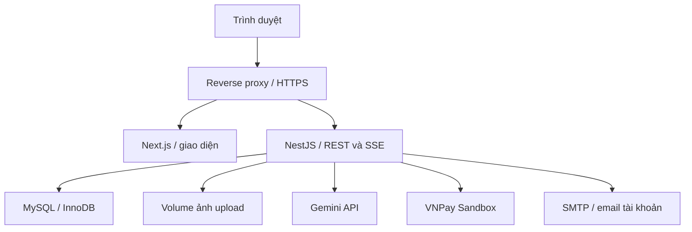

# VỊ VIỆT — THIẾT KẾ KIẾN TRÚC HỆ THỐNG

Phiên bản 1.0 · Hoàn thiện ngày 04/11/2026 · Trạng thái: thiết kế để triển khai, chưa phải hệ thống đã chạy.

## 1. Cơ sở và phạm vi

Đối chiếu tài liệu nghiệp vụ `vi-viet-phan-tich-nghiep-vu.md` phiên bản 1.0 và bộ `vi-viet-database.zip` gồm 37 bảng. Các mã FR, BR, AC trong tài liệu này tham chiếu bản nghiệp vụ. Hai tài liệu đi cùng là đặc tả UI/animation (02), đặc tả API (03), kế hoạch triển khai (04).

Một cửa hàng, một vai trò chính trên mỗi tài khoản: CUSTOMER, OPERATOR, KITCHEN, ADMIN. Mua hàng cần đăng nhập, khách vãng lai vẫn xem món, giữ giỏ cục bộ và hỏi AI. Không có microservices, ứng dụng tài xế, hệ thống kho hoặc mô hình 3D bắt buộc.

## 2. Kiến trúc được chọn

Sử dụng một frontend Next.js và một backend NestJS chia module, chung MySQL. Backend triển khai một instance trong phiên bản đồ án. Có reverse proxy cùng origin để định tuyến và TLS.



SMTP được bổ sung như hạ tầng cần thiết cho FR-02, không thay backend tự xây dựng. Local dùng hộp thư thử nghiệm; môi trường thật dùng SMTP do chủ dự án cấu hình. Không hiển thị token đặt lại mật khẩu trong giao diện công khai.

| Đường dẫn ngoài | Đích | Yêu cầu |
|---|---|---|
| `/` và trang ứng dụng | Next.js | Public SSR cho nội dung, client component cho tương tác |
| `/api/v1/*` | NestJS | Giữ nguyên prefix; không đi qua lớp tính nghiệp vụ ở Next |
| `/media/*` | Volume upload chỉ đọc | Không chạy file như mã; MIME hợp lệ, cache theo tên bất biến |
| `/api/v1/events` | NestJS SSE | Tắt proxy buffering và caching; heartbeat, timeout phù hợp |

## 3. Công nghệ và quy tắc phiên bản

| Thành phần | Quyết định |
|---|---|
| Ngôn ngữ | TypeScript strict cho web/API |
| Web | Next.js + React, Tailwind CSS |
| Animation | GSAP + ScrollTrigger; CSS cho tương tác nhỏ |
| API | NestJS với REST, DTO validation, guards và service |
| Dữ liệu | MySQL 8.4, InnoDB, Prisma ORM 7 |
| Auth | JWT access token, refresh token ngẫu nhiên đã băm, Argon2id |
| Thông báo | SSE; GET đối soát khi kết nối lại |
| AI | Gemini API, tool calling; bộ lọc/xếp hạng tự viết |
| Thanh toán | VNPay Sandbox, COD; adapter backend |
| Test | Jest/Supertest cho API, Playwright cho luồng trình duyệt |
| Local/triển khai | Docker Compose, reverse proxy, persistent volume |

Khi khởi tạo, chọn các bản stable tương thích Node.js và khóa phiên bản chính xác trong lockfile, README và image tag. Không cài mù phiên bản `latest`. Prisma phải giữ nhánh hỗ trợ MySQL đã chốt; thay major cần kiểm chứng migration và transaction. Các công nghệ trên là lựa chọn thiết kế, không yêu cầu thêm dependency tương đương chức năng.

## 4. Tổ chức mã nguồn

Một repository dùng npm workspaces, với hai ứng dụng `apps/web`, `apps/api`; thư mục `docs`, `infra`, `assets-source`. Đây là cấu trúc dự kiến, không phải đường dẫn dự án đã tồn tại.

| Khu vực | Nội dung |
|---|---|
| `apps/web/app` | Route khách hàng, auth, account và staff/admin |
| `apps/web/features` | Menu, cart, checkout, orders, ai, storytelling |
| `apps/web/components` | Thành phần dùng chung, form, dialog, trạng thái |
| `apps/web/lib` | HTTP client, định dạng, cấu hình public |
| `apps/api/src/modules` | Các module nghiệp vụ trong mục 5 |
| `apps/api/src/common` | Auth guard, exception filter, logging, validation |
| `apps/api/prisma` | Schema introspection, migration và seed |
| `infra` | Compose, reverse proxy, hướng dẫn volume/backup |
| `assets-source` | Ảnh gốc, cutout, giấy phép/nguồn và manifest asset |
| `docs` | Bộ tài liệu, bằng chứng test và quyết định thay đổi |

Tên route web không quyết định quyền. Trang staff bị chặn ở cả giao diện và API. Không tạo package chia sẻ trống; sau khi OpenAPI ổn định có thể sinh kiểu API cho frontend thay vì chép DTO thủ công.

## 5. Module backend và dữ liệu sở hữu

| Module | Trách nhiệm | Bảng chính |
|---|---|---|
| Auth | Đăng nhập, phiên, verify/reset, rotation | users, auth_sessions, account_tokens |
| Customers | Hồ sơ, địa chỉ, sở thích, yêu thích | addresses, user_preferences, các bảng sở thích |
| Catalog | Món, giá, biến thể, tùy chọn, thành phần | categories, dishes và các bảng liên quan |
| Cart | Giỏ đăng nhập, thay snapshot, kiểm tra lựa chọn | carts, cart_items, cart_item_options |
| Checkout/Orders | Quote, tạo đơn, trạng thái, hủy, lịch sử | orders, order_items, order_item_options, order_events |
| Promotions | Quy tắc mã, giữ/dùng/trả lượt | coupons, coupon_redemptions |
| Payments | Lần thử, IPN, COD, hoàn/đối soát | payments, payment_events, refunds |
| Reviews | Quyền đánh giá, phản hồi, kiểm duyệt | reviews |
| Recommendations/AI | Hội thoại, tool, bộ gợi ý, tương tác | ai_conversations, ai_messages, recommendation_items, user_interactions |
| Content/Store | Cảnh cuộn, cấu hình quán, upload | story_sections, store_settings, dish_images |
| Reports | Tổng hợp đọc từ giao dịch, không tự sửa nguồn | orders/payments/refunds và dữ liệu tổng hợp |
| Events | Kết nối SSE, lọc người nhận và heartbeat | Đọc order_events, không thay nguồn trạng thái |

Controller chỉ nhận DTO, xác thực ngữ cảnh, gọi service và chuyển response. Service là nơi xử lý quy tắc. Prisma thao tác dữ liệu trong service; chưa tạo repository/interface chung cho mọi bảng nếu chỉ bọc lại Prisma.

Orders có thể gọi Payments/Promotions ở mức service được thiết kế rõ; tránh vòng phụ thuộc module. Thay đổi tiền và đơn dùng cùng transaction context. Network call không nằm trong transaction.

## 6. Xác thực, cookie và phân quyền

### 6.1. Phương án chốt

JWT access token đặt trong cookie HttpOnly `vv_access`, thời hạn đề xuất 15 phút. Refresh token ngẫu nhiên đặt trong cookie HttpOnly `vv_refresh`, thời hạn đề xuất 7 ngày. Đây là giá trị cấu hình ban đầu, không hardcode vào UI.

Cookie dùng Secure trên HTTPS, SameSite=Lax, host-only; access path `/api`, refresh path `/api/v1/auth`. Local HTTP chỉ tắt Secure ở cấu hình development. Không lưu token trong localStorage hoặc query string. JWT chứa sub, sid, exp; không chứa địa chỉ hoặc secret. Mỗi request riêng tư kiểm tra tài khoản, phiên và role hiện tại để khóa/thu hồi có hiệu lực.

Refresh rotation cập nhật hash trên cùng session dưới khóa hàng, không trả token qua JSON. Frontend chỉ cho một refresh in-flight; khi 401 thì refresh tối đa một lần, sau đó thử lại. Request thay đổi trạng thái có idempotency riêng trước khi tự retry. Nếu refresh cũ không hợp lệ thì trả 401; không tự thu hồi phiên mới chỉ vì một request cũ chạy muộn.

### 6.2. Bảo vệ request

- Mọi request thay đổi dữ liệu từ trình duyệt, kể cả login/logout, phải có Origin thuộc allowlist chính xác và header `X-Requested-With: ViVietWeb`; không cho CORS tùy ý. JSON mutation không nhận form content-type ngoài hợp đồng. SameSite là lớp bổ sung, không thay Origin/header check.
- IPN VNPay là ngoại lệ kiểm tra Origin/cookie; xác minh theo chữ ký và hợp đồng đối tác. GET IPN có tác động dữ liệu là route giao thức riêng, không làm mẫu cho API trình duyệt.
- Không truy cập đơn/hội thoại của khách khác chỉ vì biết id. Dữ liệu riêng không có thì trả 404; route staff sai role trả 403.
- Giới hạn tốc độ theo route, tài khoản/IP, kích thước body và đồng thời gọi AI. Local rate limiter một instance được chấp nhận, reset khi restart; cần giải pháp chia sẻ nếu tăng instance.
- Không log token, mật khẩu, chữ ký secret, toàn bộ hội thoại hoặc địa chỉ khi không cần. Log requestId, actorId, action, resourceId và lỗi đã giảm dữ liệu.

### 6.3. Email tài khoản

Token verify/reset lưu hash, hạn và used_at. Khi dùng token thì kiểm tra/tiêu thụ trong transaction. Email forgot-password trả thông báo chung dù email tồn tại hay không. Gửi SMTP sau commit; lỗi cho phép yêu cầu gửi lại và có rate limit. Không cần queue riêng ở phiên bản đầu; không tuyên bố bảo đảm gửi đúng một lần khi tiến trình chết.

## 7. Chuẩn dữ liệu và cache

- API dùng camelCase; bảng SQL dùng snake_case. Prisma/service mapping rõ, không trả raw row.
- BIGINT trả chuỗi số. Tiền trả chuỗi số nguyên VND; tính bằng Decimal hoặc integer an toàn, không Float.
- DATETIME lưu UTC, API ISO 8601 có Z, UI hiển thị giờ Việt Nam. Chuyển ranh giới ngày báo cáo sang UTC trước truy vấn.
- Query public thực đơn có cache ngắn hoặc revalidate; `/dishes/:id`, quote và tạo đơn luôn đọc giá/trạng thái hợp lệ tại thời điểm thao tác. Cache nội dung không được trở thành nguồn chốt tiền.
- Response `/me`, giỏ, đơn, AI và staff đặt private/no-store. SSR nội dung riêng chỉ forward cookie của request hiện tại, không dùng cache chung. Không nhúng secret vào biến public.

## 8. Luồng checkout và giao dịch

### 8.1. Quote có chữ ký

Frontend gửi snapshot lựa chọn, cách nhận, người nhận/địa chỉ, vùng phục vụ và coupon tới `/checkout/quote`. Backend kiểm tra và trả tổng tiền cùng quoteToken ký HMAC có hạn đề xuất 5 phút. Token chứa dữ liệu chuẩn hóa, giá/ưu đãi được báo và digest; không cần bảng quotes ở phiên bản đầu. Nội dung token có thể đọc được nên không chứa secret; không log hoặc đặt vào URL.

Khi tạo đơn, backend kiểm tra token, chủ sở hữu, hạn, dữ liệu rồi tính lại từ nguồn. Nếu số tiền hoặc điều kiện đã đổi, trả QUOTE_CHANGED và báo giá mới; khách xem lại. Token không giữ lượt coupon/món.

### 8.2. Transaction và thứ tự khóa

Tạo đơn khóa coupon nếu dùng, rồi đọc/khóa dữ liệu catalog liên quan theo thứ tự id tăng; tạo đơn và giữ lượt trong cùng transaction. Các thao tác trên đơn đã tồn tại phải đọc coupon_id, khóa coupon nếu cần tác động lượt, khóa orders rồi payments/refunds. Mọi điểm ghi theo cùng thứ tự; deadlock có retry giới hạn cho transaction idempotent, không retry mù network call.

`Idempotency-Key` do client tạo UUID, được namespace theo user và operation. orders.checkout_key lưu khóa đã namespace. Khi có đơn cũ, so sánh hash yêu cầu chuẩn hóa rồi trả cùng đơn; payload khác trả IDEMPOTENCY_CONFLICT. Backend không tin key như bằng chứng ownership.

Sau commit mới gọi đối tác, phát SSE và gửi thông báo. Nếu SSE mất, GET từ database vẫn đúng. Khi process chết sau commit nhưng trước SSE, client refetch khi reconnect/poll; không cần outbox cho demo nhưng phải nêu giới hạn này.

## 9. Thay đổi CSDL tối thiểu cần thêm

Bản 37 bảng chưa có digest checkout để so sánh payload retry chính xác. Tạo migration mới trước khi viết endpoint tạo đơn; không sửa âm thầm bản SQL gốc:

```sql
ALTER TABLE orders
  ADD COLUMN checkout_request_hash CHAR(64)
  CHARACTER SET ascii COLLATE ascii_bin NULL AFTER checkout_key;
```

Backend bắt buộc ghi hash với đơn mới. NULL chỉ dành cho dữ liệu cũ; không tự replay một đơn cũ thiếu hash như thể đã xác minh payload. Nếu triển khai từ database rỗng có thể thêm NOT NULL ngay trong migration được kiểm soát. Không thêm bảng idempotency tổng quát khi checkout là nơi đầu tiên cần.

Các thay đổi khác trong hợp đồng dùng được với bảng hiện có: actionKey của thao tác staff nằm trong order_events.note dạng JSON có schema; requestKey hội thoại trong ai_messages.structured_data. Service khóa đơn/hội thoại để kiểm tra trước khi ghi; không có unique index cho các key JSON này nên mọi điểm ghi phải qua cùng service. Khi có tải lớn mới nâng cấp thành cột/index riêng.

## 10. Thanh toán và tác vụ nền

Payments lưu lần thử trước khi tạo URL. Nếu còn lần thử PENDING chưa hết hạn, trả lại cùng attempt và dựng URL từ dữ liệu lần thử; không tự tạo attempt thứ hai khi khách double-click. Nếu kết quả chưa rõ, đối soát trước khi tạo lại để giảm khả năng thu trùng.

VNPay có Return URL cho trình duyệt và IPN riêng. Return dùng để điều hướng/hiển thị chờ xác minh; IPN kiểm tra chữ ký, tham chiếu và số tiền trước khi cập nhật. Adapter chuyển đổi đơn vị `vnp_Amount` theo tài liệu đối tác, không để số nhân 100 lan vào dữ liệu nghiệp vụ.

Job trong NestJS, mỗi phút kiểm tra đơn hết hạn, giữ khóa và xử lý idempotent. Trước hủy do hết hạn, không đoán FAILED khi đối tác chưa rõ; dùng đối soát nếu khả dụng hoặc ghi chờ xử lý. Nếu tiền tới muộn vẫn ghi nhận và xử lý hoàn. Thêm job dọn phiên/token và dữ liệu AI theo chính sách lưu trữ được cấu hình.

Refund thủ công gắn mã chứng từ/reference vào provider_refund_id và ghi order_event chứa căn cứ đã giảm dữ liệu. Chỉ ADMIN quyết định hoàn và xác nhận kết quả; failed có thể thử lại theo quy trình, không tự success khi gọi HTTP thành công nhưng đối tác chưa xác nhận.

## 11. SSE và nhất quán màn hình

SSE phục vụ trạng thái đơn và hàng chờ, không làm nguồn tiền. Cookie cùng origin giúp EventSource xác thực mà không đưa JWT lên URL. Kiểm tra quyền ngay khi kết nối, lọc event theo chủ/role và đóng stream khi phiên hết hạn/thu hồi. Có heartbeat 15 giây và giới hạn kết nối.

Event sau commit có id từ order_events. Frontend nhận event thì refetch dữ liệu, không áp tin nhắn SSE như lệnh đổi trạng thái. Khi reconnect luôn GET snapshot; Last-Event-ID chỉ tối ưu replay từ order_events, không hứa replay payment-only event chưa có lịch sử. Job/SSE cùng ghi order_event cho các cập nhật đơn có ý nghĩa.

Một instance phát event trong bộ nhớ là đủ phạm vi này. Nếu tăng nhiều instance thì bổ sung pub/sub và cơ chế phát bền vững khi có nhu cầu; trước đó không cài Redis chỉ để dự phòng.

## 12. AI và bộ gợi ý

AI được phép yêu cầu các tool đọc: searchMenu, getDishDetails, buildMealOptions. Backend kiểm tra schema tham số, giới hạn số món và ngân sách, truy vấn thực tế rồi trả dữ liệu tối thiểu. Không cung cấp tool arbitrary SQL, cập nhật quyền, thanh toán hoặc tự đặt đơn.

Một request tối đa 4 vòng tool và timeout tổng đề xuất 20 giây. Nếu thất bại, trả lỗi có thể thử lại và đường vào thực đơn. Lưu modelName/tokens khi được cung cấp; không lưu suy luận nội bộ. Hội thoại guest dùng secret cookie đã băm, không dựa vào id công khai; có hạn lưu.

Bộ gợi ý: lọc bắt buộc → điểm sở thích khai báo → điểm lịch sử khi đồng ý → đa dạng hóa → trả lý do. Phiên bản đầu tính trực tiếp từ SQL trên dữ liệu nhỏ. Trọng số đề xuất ban đầu: tag thích +3/tag, món đánh giá tốt +2, mua hoàn thành gần đây +1 có trần; điều kiện tránh không được đổi thành trừ điểm rồi vẫn lọt kết quả. Dữ liệu dị ứng chưa đủ phải trả không thể xác nhận, không chỉ NOT EXISTS.

Schema recommendation_items hỗ trợ gợi ý dạng món; giá/tổ hợp từ chat nằm trong structured_data có schema và phải kiểm tra lại khi thêm giỏ. Không công bố chuyển đổi mua theo từng recommendation khi chưa có attribution từ giỏ sang order_items.

## 13. Asset, upload và frontend animation

Ảnh upload do NestJS nhận: ADMIN, kiểm MIME thực, kích thước đề xuất tối đa 8 MB, định dạng JPEG/PNG/WebP; từ chối SVG/script, tạo tên UUID và ghi đường dẫn tương đối. Không nhận URL remote rồi tải tùy ý. File gốc nằm volume bền vững, ảnh tối ưu phục vụ qua media route. Không xóa file còn được tham chiếu bởi món/phân cảnh.

Content trả preset được cho phép; GSAP timeline ở client component với phạm vi DOM riêng. SSR vẫn có tiêu đề/nội dung/nút đọc được; khi JS chưa tải, các món hiển thị tĩnh. Cleanup animation khi đổi route/breakpoint để không tạo pin spacer trùng. Tài liệu 02 quy định timeline và asset.

## 14. Môi trường và vận hành ban đầu

| Môi trường | Thành phần |
|---|---|
| Development | Web/API hot reload, MySQL riêng, SMTP test, VNPay sandbox, dữ liệu mẫu |
| Test | Database disposable, mock gateway/AI có fixture, không dùng dữ liệu thật |
| Staging/demo | Docker build production, HTTPS, sandbox gateway, khóa demo hạn chế |
| Production nếu có | Secret riêng, backup/restore được thử, chính sách cửa hàng được xác nhận |

Biến môi trường cần mô tả trong `.env.example` không chứa giá trị thật: DATABASE_URL, JWT_SECRET, CHECKOUT_QUOTE_SECRET, COOKIE_SECURE, APP_ORIGIN, API_INTERNAL_URL, GEMINI_API_KEY, GEMINI_MODEL, VNPAY_TMN_CODE, VNPAY_HASH_SECRET, VNPAY_URL, VNPAY_RETURN_URL, VNPAY_IPN_URL, SMTP_HOST/PORT/USER/PASSWORD/FROM, UPLOAD_ROOT, AI_TIMEOUT_MS.

Chỉ expose APP_ORIGIN/API public base nếu cần; secret không có prefix public. MySQL không mở public port trên VPS. Backup database và volume ảnh; thử restore ở môi trường riêng. Quy trình rollback phải phân biệt rollback image với migration dữ liệu; không tự chạy down migration phá dữ liệu sau một lỗi frontend.

## 15. Kiểm chứng và điều kiện chấp nhận kiến trúc

- Chạy frontend/backend/database độc lập qua Compose, healthcheck rõ.
- Import schema trên MySQL thật; bản CSDL trước đó mới được kiểm tra tĩnh.
- Thử quyền theo AC-01, token theo AC-02, checkout/coupon cạnh tranh theo AC-06/07.
- Thử IPN lặp, tiền về muộn/thu thừa, hoàn cạnh tranh theo AC-09/10/11/14.
- SSE ngắt/reconnect vẫn hiện đúng snapshot AC-23.
- AI/tool không thể đổi giá, role hoặc tạo giao dịch; lỗi AI không chặn luồng thường.
- Bộ mã nguồn có lockfile, README chạy local, migration/seed, log giảm dữ liệu và bằng chứng test.

## 16. Nguồn kỹ thuật đối chiếu

- NestJS SSE: https://docs.nestjs.com/techniques/server-sent-events
- GSAP ScrollTrigger: https://gsap.com/docs/v3/Plugins/ScrollTrigger/
- VNPay thanh toán: https://sandbox.vnpayment.vn/apis/docs/thanh-toan-pay/pay.html
- VNPay mô hình kết nối: https://sandbox.vnpayment.vn/apis/docs/mo-hinh-ket-noi/

Các thông số timeout, token, tải và nhịp animation là quyết định thiết kế đề xuất, cần đo lại trong triển khai. Tài liệu không khẳng định đã đạt các chỉ số này.
