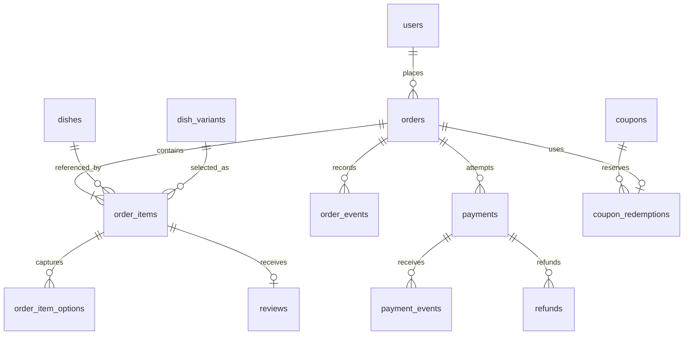
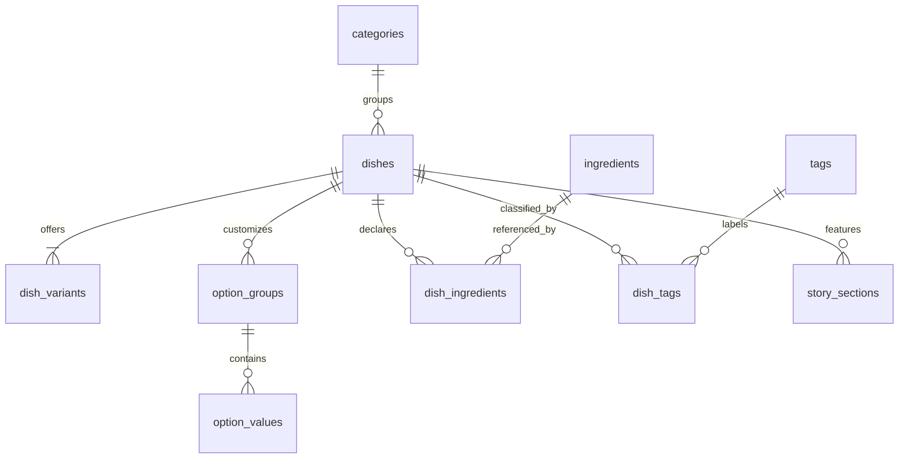
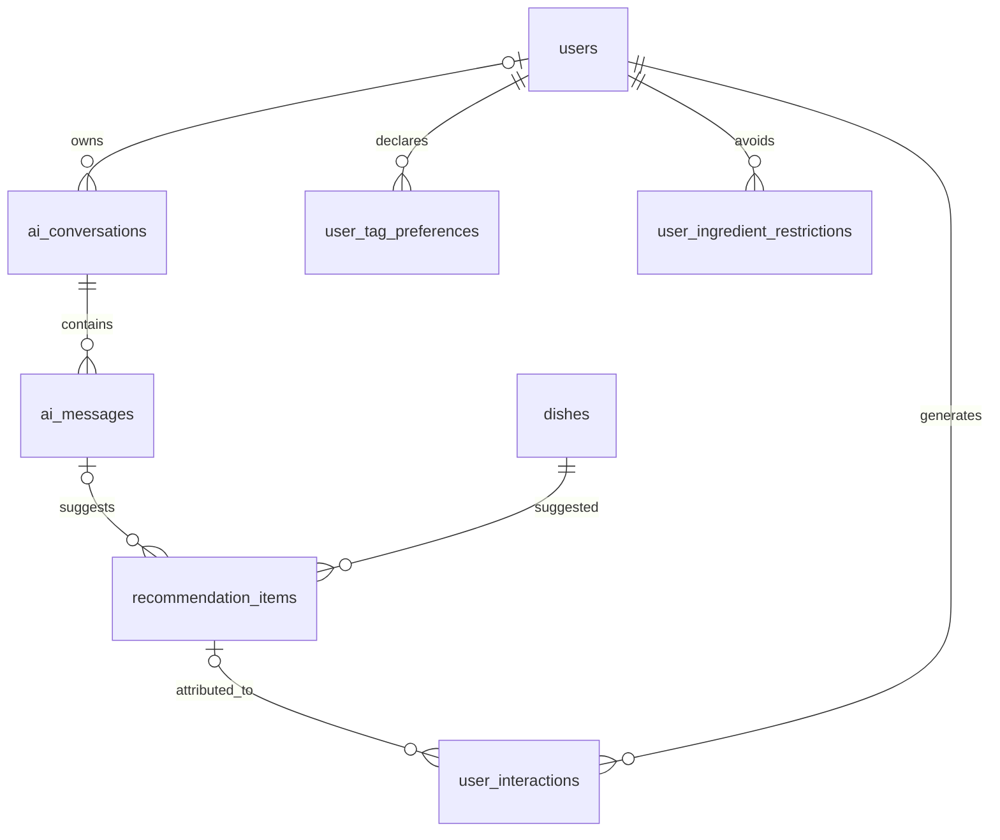

# Thiết kế cơ sở dữ liệu Vị Việt

## 1. Phạm vi và quyết định thiết kế

Một cửa hàng, nhiều nhân viên; giao tận nơi hoặc nhận tại quán. Khách có thể xem món và hỏi AI không cần đăng nhập; đặt hàng yêu cầu đăng nhập. Một tài khoản có một vai trò chính. Giỏ khách vãng lai lưu cục bộ rồi đồng bộ sau đăng nhập. Không quản lý tài xế, GPS, nhiều chi nhánh hoặc kho nguyên liệu trong phiên bản này.

Một đơn tối đa một coupon, áp toàn đơn hoặc phí giao. Mỗi tùy chọn được chọn tối đa một lần trên một phần ăn; số phần tăng bằng quantity. Topping nhân số lượng riêng, lịch bán theo từng món, hạn mức suất theo ngày và ưu đãi theo danh mục là phần mở rộng, chưa được biểu diễn trong schema này.

Mục tiêu MySQL 8.4, InnoDB, utf8mb4_0900_ai_ci. Mọi bảng có id BIGINT UNSIGNED. Backend trả id dạng chuỗi để tránh giới hạn số nguyên JavaScript. Tiền VND dùng DECIMAL(12,0), không FLOAT; backend dùng Decimal hoặc số nguyên an toàn, làm tròn phần trăm theo quy tắc thống nhất. Mọi DATETIME lưu UTC, giao diện đổi sang Asia/Ho_Chi_Minh. SQL đặt múi giờ cho phiên import; ứng dụng phải cấu hình UTC cho từng connection.

Trạng thái đơn và thanh toán tách riêng. Giá, tên món, địa chỉ, tên tùy chọn được chụp trên đơn. FK gốc giữ liên kết để báo cáo, nhưng không dùng giá hiện tại để tái tạo đơn cũ. Các bảng nghiệp vụ giữ lịch sử, dùng ẩn/vô hiệu hóa thay vì xóa cứng dữ liệu đã được tham chiếu. ON DELETE RESTRICT là chủ đích. Xóa tài khoản theo yêu cầu cần quy trình ẩn danh hóa và retention phù hợp, không xóa dây chuyền đơn.

## 2. Nhóm bảng


| Nhóm | Bảng |
|---|---|
| Tài khoản và sở thích | `users`, `auth_sessions`, `account_tokens`, `addresses`, `user_preferences`, `user_tag_preferences`, `user_ingredient_restrictions`, `favorites` |
| Thực đơn và thành phần | `categories`, `dishes`, `dish_images`, `dish_variants`, `option_groups`, `option_values`, `ingredients`, `dish_ingredients`, `tags`, `dish_tags` |
| Giỏ và đơn hàng | `carts`, `cart_items`, `cart_item_options`, `coupons`, `orders`, `order_items`, `order_item_options`, `coupon_redemptions`, `order_events` |
| Thanh toán và đánh giá | `payments`, `payment_events`, `refunds`, `reviews` |
| AI và cá nhân hóa | `ai_conversations`, `ai_messages`, `recommendation_items`, `user_interactions` |
| Nội dung và cửa hàng | `story_sections`, `store_settings` |

Tổng cộng **37 bảng**. Bảng liên kết thường nhỏ nhưng giúp giữ dữ liệu rõ ràng và có khóa ngoại. Không cần triển khai mọi module đồng thời.

## 3. Sơ đồ quan hệ theo nghiệp vụ



Số dòng đơn tối thiểu 1 trong sơ đồ là điều kiện nghiệp vụ khi commit, không được FK tự đảm bảo. Quan hệ lượt dùng mã trên đơn chỉ tồn tại khi đơn có coupon.





## 4. Từ điển dữ liệu

Tất cả bảng có khóa chính id và hai mốc created_at/updated_at. Dưới đây ghi đầy đủ cột để triển khai. Các enum là tập trạng thái ban đầu; thay đổi phải có migration.


### 4.1. `users`

Khách hàng và nhân viên; một tài khoản có một vai trò chính trong phạm vi đồ án.

| Cột | Kiểu / mặc định | Ý nghĩa |
|---|---|---|
| `id` | `BIGINT UNSIGNED NOT NULL AUTO_INCREMENT` | Khóa chính |
| `full_name` | `VARCHAR(120) NOT NULL` | Họ tên |
| `email` | `VARCHAR(254) NOT NULL` | Email chuẩn hóa chữ thường; duy nhất |
| `phone` | `VARCHAR(20) NULL` | Điện thoại; lưu dạng chuỗi |
| `password_hash` | `VARCHAR(255) NOT NULL` | Hash Argon2, không lưu mật khẩu gốc |
| `role` | `ENUM('CUSTOMER','OPERATOR','KITCHEN','ADMIN') NOT NULL DEFAULT 'CUSTOMER'` | Vai trò chính |
| `status` | `ENUM('ACTIVE','LOCKED','DEACTIVATED') NOT NULL DEFAULT 'ACTIVE'` | Trạng thái tài khoản |
| `email_verified_at` | `DATETIME(3) NULL` | Thời điểm xác minh |
| `deactivated_at` | `DATETIME(3) NULL` | Vô hiệu hóa mềm |
| `created_at` | `DATETIME(3) NOT NULL DEFAULT CURRENT_TIMESTAMP(3)` | Thời điểm tạo UTC |
| `updated_at` | `DATETIME(3) NOT NULL DEFAULT CURRENT_TIMESTAMP(3) ON UPDATE CURRENT_TIMESTAMP(3)` | Cập nhật UTC |

Chỉ mục: `UNIQUE KEY uq_users_email (email)`; `KEY ix_users_role_status (role,status)`.

### 4.2. `auth_sessions`

Phiên đăng nhập với refresh token đã băm.

| Cột | Kiểu / mặc định | Ý nghĩa |
|---|---|---|
| `id` | `BIGINT UNSIGNED NOT NULL AUTO_INCREMENT` | Khóa chính |
| `user_id` | `BIGINT UNSIGNED NOT NULL` | Tài khoản |
| `refresh_token_hash` | `VARCHAR(64) COLLATE utf8mb4_bin NOT NULL` | SHA-256 token ngẫu nhiên |
| `expires_at` | `DATETIME(3) NOT NULL` | Hết hạn |
| `revoked_at` | `DATETIME(3) NULL` | Thu hồi |
| `user_agent` | `VARCHAR(512) NULL` | Thiết bị, tối thiểu hóa dữ liệu |
| `created_at` | `DATETIME(3) NOT NULL DEFAULT CURRENT_TIMESTAMP(3)` | Thời điểm tạo UTC |
| `updated_at` | `DATETIME(3) NOT NULL DEFAULT CURRENT_TIMESTAMP(3) ON UPDATE CURRENT_TIMESTAMP(3)` | Cập nhật UTC |

Khóa ngoại: `(user_id) → users(id)`.

Chỉ mục: `UNIQUE KEY uq_sessions_token (refresh_token_hash)`; `KEY ix_sessions_user_expiry (user_id,expires_at)`.

### 4.3. `account_tokens`

Token một lần cho xác minh email hoặc đặt lại mật khẩu.

| Cột | Kiểu / mặc định | Ý nghĩa |
|---|---|---|
| `id` | `BIGINT UNSIGNED NOT NULL AUTO_INCREMENT` | Khóa chính |
| `user_id` | `BIGINT UNSIGNED NOT NULL` | Tài khoản |
| `purpose` | `ENUM('VERIFY_EMAIL','RESET_PASSWORD') NOT NULL DEFAULT 'RESET_PASSWORD'` | Mục đích |
| `token_hash` | `VARCHAR(64) COLLATE utf8mb4_bin NOT NULL` | Hash token ngẫu nhiên |
| `expires_at` | `DATETIME(3) NOT NULL` | Hết hạn |
| `used_at` | `DATETIME(3) NULL` | Đã dùng |
| `created_at` | `DATETIME(3) NOT NULL DEFAULT CURRENT_TIMESTAMP(3)` | Thời điểm tạo UTC |
| `updated_at` | `DATETIME(3) NOT NULL DEFAULT CURRENT_TIMESTAMP(3) ON UPDATE CURRENT_TIMESTAMP(3)` | Cập nhật UTC |

Khóa ngoại: `(user_id) → users(id)`.

Chỉ mục: `UNIQUE KEY uq_account_token (token_hash)`.

### 4.4. `addresses`

Sổ địa chỉ khách hàng; địa chỉ trên đơn được chụp riêng.

| Cột | Kiểu / mặc định | Ý nghĩa |
|---|---|---|
| `id` | `BIGINT UNSIGNED NOT NULL AUTO_INCREMENT` | Khóa chính |
| `user_id` | `BIGINT UNSIGNED NOT NULL` | Chủ sở hữu |
| `recipient_name` | `VARCHAR(120) NOT NULL` | Người nhận |
| `phone` | `VARCHAR(20) NOT NULL` | Điện thoại nhận |
| `address_line` | `VARCHAR(500) NOT NULL` | Địa chỉ đầy đủ theo đơn vị hành chính hiện hành |
| `delivery_note` | `VARCHAR(500) NULL` | Chỉ dẫn giao hàng |
| `latitude` | `DECIMAL(10,7) NULL` | Vĩ độ |
| `longitude` | `DECIMAL(10,7) NULL` | Kinh độ |
| `is_default` | `BOOLEAN NOT NULL DEFAULT FALSE` | Địa chỉ mặc định |
| `deleted_at` | `DATETIME(3) NULL` | Xóa mềm |
| `created_at` | `DATETIME(3) NOT NULL DEFAULT CURRENT_TIMESTAMP(3)` | Thời điểm tạo UTC |
| `updated_at` | `DATETIME(3) NOT NULL DEFAULT CURRENT_TIMESTAMP(3) ON UPDATE CURRENT_TIMESTAMP(3)` | Cập nhật UTC |

Khóa ngoại: `(user_id) → users(id)`.

Chỉ mục: `KEY ix_addresses_user (user_id,deleted_at)`.

CHECK: `latitude IS NULL OR latitude BETWEEN -90 AND 90`; `longitude IS NULL OR longitude BETWEEN -180 AND 180`.

### 4.5. `user_preferences`

Cấu hình cá nhân hóa do người dùng chủ động chọn.

| Cột | Kiểu / mặc định | Ý nghĩa |
|---|---|---|
| `id` | `BIGINT UNSIGNED NOT NULL AUTO_INCREMENT` | Khóa chính |
| `user_id` | `BIGINT UNSIGNED NOT NULL` | Một hồ sơ trên tài khoản |
| `spicy_level` | `TINYINT UNSIGNED NULL` | 0 không cay, 1 nhẹ, 2 vừa, 3 nhiều |
| `budget_per_meal` | `DECIMAL(12,0) NULL` | Ngân sách tham khảo |
| `personalization_enabled` | `BOOLEAN NOT NULL DEFAULT FALSE` | Đồng ý dùng hành vi để cá nhân hóa |
| `consented_at` | `DATETIME(3) NULL` | Thời điểm đồng ý gần nhất |
| `dietary_note` | `VARCHAR(500) NULL` | Ghi chú chế độ ăn, không tự coi là kết luận y tế |
| `created_at` | `DATETIME(3) NOT NULL DEFAULT CURRENT_TIMESTAMP(3)` | Thời điểm tạo UTC |
| `updated_at` | `DATETIME(3) NOT NULL DEFAULT CURRENT_TIMESTAMP(3) ON UPDATE CURRENT_TIMESTAMP(3)` | Cập nhật UTC |

Khóa ngoại: `(user_id) → users(id)`.

Chỉ mục: `UNIQUE KEY uq_preferences_user (user_id)`.

CHECK: `spicy_level IS NULL OR spicy_level <= 3`; `budget_per_meal IS NULL OR budget_per_meal >= 0`.

### 4.6. `categories`

Danh mục thực đơn.

| Cột | Kiểu / mặc định | Ý nghĩa |
|---|---|---|
| `id` | `BIGINT UNSIGNED NOT NULL AUTO_INCREMENT` | Khóa chính |
| `name` | `VARCHAR(100) NOT NULL` | Tên danh mục |
| `slug` | `VARCHAR(140) NOT NULL` | Đường dẫn duy nhất |
| `sort_order` | `INT NOT NULL DEFAULT 0` | Thứ tự |
| `is_active` | `BOOLEAN NOT NULL DEFAULT TRUE` | Hiển thị |
| `created_at` | `DATETIME(3) NOT NULL DEFAULT CURRENT_TIMESTAMP(3)` | Thời điểm tạo UTC |
| `updated_at` | `DATETIME(3) NOT NULL DEFAULT CURRENT_TIMESTAMP(3) ON UPDATE CURRENT_TIMESTAMP(3)` | Cập nhật UTC |

Chỉ mục: `UNIQUE KEY uq_categories_slug (slug)`.

### 4.7. `dishes`

Thông tin món ăn dùng chung cho bán hàng, AI và nội dung.

| Cột | Kiểu / mặc định | Ý nghĩa |
|---|---|---|
| `id` | `BIGINT UNSIGNED NOT NULL AUTO_INCREMENT` | Khóa chính |
| `category_id` | `BIGINT UNSIGNED NOT NULL` | Danh mục |
| `name` | `VARCHAR(160) NOT NULL` | Tên món |
| `slug` | `VARCHAR(180) NOT NULL` | Đường dẫn |
| `description` | `TEXT NULL` | Mô tả |
| `story` | `TEXT NULL` | Câu chuyện món |
| `spicy_level` | `TINYINT UNSIGNED NULL` | Mức cay mặc định, NULL chưa có dữ liệu |
| `ingredient_data_status` | `ENUM('UNKNOWN','PARTIAL','VERIFIED') NOT NULL DEFAULT 'UNKNOWN'` | Mức đầy đủ/xác minh dữ liệu thành phần |
| `availability` | `ENUM('AVAILABLE','SOLD_OUT','HIDDEN') NOT NULL DEFAULT 'HIDDEN'` | Trạng thái bán |
| `sort_order` | `INT NOT NULL DEFAULT 0` | Thứ tự |
| `deleted_at` | `DATETIME(3) NULL` | Ngừng sử dụng mềm |
| `created_at` | `DATETIME(3) NOT NULL DEFAULT CURRENT_TIMESTAMP(3)` | Thời điểm tạo UTC |
| `updated_at` | `DATETIME(3) NOT NULL DEFAULT CURRENT_TIMESTAMP(3) ON UPDATE CURRENT_TIMESTAMP(3)` | Cập nhật UTC |

Khóa ngoại: `(category_id) → categories(id)`.

Chỉ mục: `UNIQUE KEY uq_dishes_slug (slug)`; `KEY ix_dishes_category_sale (category_id,availability,deleted_at)`.

CHECK: `spicy_level IS NULL OR spicy_level <= 3`.

### 4.8. `dish_images`

Ảnh thường và ảnh tách nền cho món.

| Cột | Kiểu / mặc định | Ý nghĩa |
|---|---|---|
| `id` | `BIGINT UNSIGNED NOT NULL AUTO_INCREMENT` | Khóa chính |
| `dish_id` | `BIGINT UNSIGNED NOT NULL` | Món |
| `asset_path` | `VARCHAR(500) NOT NULL` | Đường dẫn tương đối, không lưu signed URL |
| `kind` | `ENUM('COVER','GALLERY','CUTOUT') NOT NULL DEFAULT 'GALLERY'` | Vai trò ảnh |
| `alt_text` | `VARCHAR(255) NOT NULL` | Mô tả hỗ trợ tiếp cận |
| `sort_order` | `INT NOT NULL DEFAULT 0` | Thứ tự |
| `created_at` | `DATETIME(3) NOT NULL DEFAULT CURRENT_TIMESTAMP(3)` | Thời điểm tạo UTC |
| `updated_at` | `DATETIME(3) NOT NULL DEFAULT CURRENT_TIMESTAMP(3) ON UPDATE CURRENT_TIMESTAMP(3)` | Cập nhật UTC |

Khóa ngoại: `(dish_id) → dishes(id)`.

Chỉ mục: `KEY ix_images_dish (dish_id,kind,sort_order)`.

### 4.9. `dish_variants`

Mỗi món luôn có ít nhất một biến thể, kể cả phần tiêu chuẩn.

| Cột | Kiểu / mặc định | Ý nghĩa |
|---|---|---|
| `id` | `BIGINT UNSIGNED NOT NULL AUTO_INCREMENT` | Khóa chính |
| `dish_id` | `BIGINT UNSIGNED NOT NULL` | Món |
| `name` | `VARCHAR(100) NOT NULL` | Thường/lớn/đặc biệt |
| `price` | `DECIMAL(12,0) NOT NULL DEFAULT 0` | Giá phần; VND nguyên |
| `is_active` | `BOOLEAN NOT NULL DEFAULT TRUE` | Được bán |
| `created_at` | `DATETIME(3) NOT NULL DEFAULT CURRENT_TIMESTAMP(3)` | Thời điểm tạo UTC |
| `updated_at` | `DATETIME(3) NOT NULL DEFAULT CURRENT_TIMESTAMP(3) ON UPDATE CURRENT_TIMESTAMP(3)` | Cập nhật UTC |

Khóa ngoại: `(dish_id) → dishes(id)`.

Chỉ mục: `UNIQUE KEY uq_variants_name (dish_id,name)`; `UNIQUE KEY uq_variants_id_dish (id,dish_id)`.

CHECK: `price >= 0`.

### 4.10. `option_groups`

Nhóm tùy chọn riêng của món: độ cay, topping, đường/đá.

| Cột | Kiểu / mặc định | Ý nghĩa |
|---|---|---|
| `id` | `BIGINT UNSIGNED NOT NULL AUTO_INCREMENT` | Khóa chính |
| `dish_id` | `BIGINT UNSIGNED NOT NULL` | Món |
| `name` | `VARCHAR(100) NOT NULL` | Tên nhóm |
| `min_select` | `SMALLINT UNSIGNED NOT NULL DEFAULT 0` | Số lựa chọn tối thiểu |
| `max_select` | `SMALLINT UNSIGNED NOT NULL DEFAULT 1` | Số lựa chọn tối đa |
| `is_active` | `BOOLEAN NOT NULL DEFAULT TRUE` | Đang dùng |
| `created_at` | `DATETIME(3) NOT NULL DEFAULT CURRENT_TIMESTAMP(3)` | Thời điểm tạo UTC |
| `updated_at` | `DATETIME(3) NOT NULL DEFAULT CURRENT_TIMESTAMP(3) ON UPDATE CURRENT_TIMESTAMP(3)` | Cập nhật UTC |

Khóa ngoại: `(dish_id) → dishes(id)`.

Chỉ mục: `UNIQUE KEY uq_groups_id_dish (id,dish_id)`.

CHECK: `max_select >= min_select AND max_select >= 1`.

### 4.11. `option_values`

Giá trị lựa chọn và giá cộng thêm.

| Cột | Kiểu / mặc định | Ý nghĩa |
|---|---|---|
| `id` | `BIGINT UNSIGNED NOT NULL AUTO_INCREMENT` | Khóa chính |
| `group_id` | `BIGINT UNSIGNED NOT NULL` | Nhóm tùy chọn |
| `dish_id` | `BIGINT UNSIGNED NOT NULL` | Món, phục vụ khóa ngoại ghép |
| `name` | `VARCHAR(100) NOT NULL` | Tên lựa chọn |
| `extra_price` | `DECIMAL(12,0) NOT NULL DEFAULT 0` | Giá cộng thêm trên một phần |
| `is_active` | `BOOLEAN NOT NULL DEFAULT TRUE` | Đang bán |
| `created_at` | `DATETIME(3) NOT NULL DEFAULT CURRENT_TIMESTAMP(3)` | Thời điểm tạo UTC |
| `updated_at` | `DATETIME(3) NOT NULL DEFAULT CURRENT_TIMESTAMP(3) ON UPDATE CURRENT_TIMESTAMP(3)` | Cập nhật UTC |

Khóa ngoại: `(group_id,dish_id) → option_groups(id,dish_id)`.

Chỉ mục: `UNIQUE KEY uq_options_group_name (group_id,name)`; `UNIQUE KEY uq_options_id_dish (id,dish_id)`.

CHECK: `extra_price >= 0`.

### 4.12. `ingredients`

Danh mục thành phần để tìm món và ghi nhận thành phần muốn tránh; chưa phải kho.

| Cột | Kiểu / mặc định | Ý nghĩa |
|---|---|---|
| `id` | `BIGINT UNSIGNED NOT NULL AUTO_INCREMENT` | Khóa chính |
| `name` | `VARCHAR(120) NOT NULL` | Tên thành phần |
| `code` | `VARCHAR(100) NOT NULL` | Mã ổn định |
| `is_allergen` | `BOOLEAN NOT NULL DEFAULT FALSE` | Có liên quan dị ứng theo dữ liệu cửa hàng |
| `created_at` | `DATETIME(3) NOT NULL DEFAULT CURRENT_TIMESTAMP(3)` | Thời điểm tạo UTC |
| `updated_at` | `DATETIME(3) NOT NULL DEFAULT CURRENT_TIMESTAMP(3) ON UPDATE CURRENT_TIMESTAMP(3)` | Cập nhật UTC |

Chỉ mục: `UNIQUE KEY uq_ingredients_code (code)`.

### 4.13. `dish_ingredients`

Thành phần được khai báo của món; không suy luận rằng danh sách đã đầy đủ.

| Cột | Kiểu / mặc định | Ý nghĩa |
|---|---|---|
| `id` | `BIGINT UNSIGNED NOT NULL AUTO_INCREMENT` | Khóa chính |
| `dish_id` | `BIGINT UNSIGNED NOT NULL` | Món |
| `ingredient_id` | `BIGINT UNSIGNED NOT NULL` | Thành phần |
| `note` | `TEXT NULL` | Ghi chú công thức hoặc khả năng lẫn chéo |
| `created_at` | `DATETIME(3) NOT NULL DEFAULT CURRENT_TIMESTAMP(3)` | Thời điểm tạo UTC |
| `updated_at` | `DATETIME(3) NOT NULL DEFAULT CURRENT_TIMESTAMP(3) ON UPDATE CURRENT_TIMESTAMP(3)` | Cập nhật UTC |

Khóa ngoại: `(dish_id) → dishes(id)`; `(ingredient_id) → ingredients(id)`.

Chỉ mục: `UNIQUE KEY uq_dish_ingredients (dish_id,ingredient_id)`.

### 4.14. `tags`

Đặc điểm món có cấu trúc: ít cay, món chay, bữa sáng…

| Cột | Kiểu / mặc định | Ý nghĩa |
|---|---|---|
| `id` | `BIGINT UNSIGNED NOT NULL AUTO_INCREMENT` | Khóa chính |
| `code` | `VARCHAR(80) NOT NULL` | Mã đặc điểm |
| `name` | `VARCHAR(100) NOT NULL` | Tên hiển thị |
| `created_at` | `DATETIME(3) NOT NULL DEFAULT CURRENT_TIMESTAMP(3)` | Thời điểm tạo UTC |
| `updated_at` | `DATETIME(3) NOT NULL DEFAULT CURRENT_TIMESTAMP(3) ON UPDATE CURRENT_TIMESTAMP(3)` | Cập nhật UTC |

Chỉ mục: `UNIQUE KEY uq_tags_code (code)`.

### 4.15. `dish_tags`

Gắn các đặc điểm đã xác minh cho món.

| Cột | Kiểu / mặc định | Ý nghĩa |
|---|---|---|
| `id` | `BIGINT UNSIGNED NOT NULL AUTO_INCREMENT` | Khóa chính |
| `dish_id` | `BIGINT UNSIGNED NOT NULL` | Món |
| `tag_id` | `BIGINT UNSIGNED NOT NULL` | Đặc điểm |
| `created_at` | `DATETIME(3) NOT NULL DEFAULT CURRENT_TIMESTAMP(3)` | Thời điểm tạo UTC |
| `updated_at` | `DATETIME(3) NOT NULL DEFAULT CURRENT_TIMESTAMP(3) ON UPDATE CURRENT_TIMESTAMP(3)` | Cập nhật UTC |

Khóa ngoại: `(dish_id) → dishes(id)`; `(tag_id) → tags(id)`.

Chỉ mục: `UNIQUE KEY uq_dish_tags (dish_id,tag_id)`.

### 4.16. `user_tag_preferences`

Đặc điểm khách khai báo thích hoặc muốn tránh.

| Cột | Kiểu / mặc định | Ý nghĩa |
|---|---|---|
| `id` | `BIGINT UNSIGNED NOT NULL AUTO_INCREMENT` | Khóa chính |
| `user_id` | `BIGINT UNSIGNED NOT NULL` | Khách |
| `tag_id` | `BIGINT UNSIGNED NOT NULL` | Đặc điểm |
| `preference` | `ENUM('LIKE','AVOID') NOT NULL DEFAULT 'LIKE'` | Chủ động khai báo |
| `created_at` | `DATETIME(3) NOT NULL DEFAULT CURRENT_TIMESTAMP(3)` | Thời điểm tạo UTC |
| `updated_at` | `DATETIME(3) NOT NULL DEFAULT CURRENT_TIMESTAMP(3) ON UPDATE CURRENT_TIMESTAMP(3)` | Cập nhật UTC |

Khóa ngoại: `(user_id) → users(id)`; `(tag_id) → tags(id)`.

Chỉ mục: `UNIQUE KEY uq_user_tag (user_id,tag_id)`.

### 4.17. `user_ingredient_restrictions`

Thành phần khách chủ động yêu cầu tránh.

| Cột | Kiểu / mặc định | Ý nghĩa |
|---|---|---|
| `id` | `BIGINT UNSIGNED NOT NULL AUTO_INCREMENT` | Khóa chính |
| `user_id` | `BIGINT UNSIGNED NOT NULL` | Khách |
| `ingredient_id` | `BIGINT UNSIGNED NOT NULL` | Thành phần |
| `reason` | `ENUM('DISLIKE','ALLERGY','OTHER') NOT NULL DEFAULT 'DISLIKE'` | Lý do do khách khai báo |
| `created_at` | `DATETIME(3) NOT NULL DEFAULT CURRENT_TIMESTAMP(3)` | Thời điểm tạo UTC |
| `updated_at` | `DATETIME(3) NOT NULL DEFAULT CURRENT_TIMESTAMP(3) ON UPDATE CURRENT_TIMESTAMP(3)` | Cập nhật UTC |

Khóa ngoại: `(user_id) → users(id)`; `(ingredient_id) → ingredients(id)`.

Chỉ mục: `UNIQUE KEY uq_user_ingredient (user_id,ingredient_id)`.

### 4.18. `favorites`

Danh sách món yêu thích.

| Cột | Kiểu / mặc định | Ý nghĩa |
|---|---|---|
| `id` | `BIGINT UNSIGNED NOT NULL AUTO_INCREMENT` | Khóa chính |
| `user_id` | `BIGINT UNSIGNED NOT NULL` | Khách |
| `dish_id` | `BIGINT UNSIGNED NOT NULL` | Món |
| `created_at` | `DATETIME(3) NOT NULL DEFAULT CURRENT_TIMESTAMP(3)` | Thời điểm tạo UTC |
| `updated_at` | `DATETIME(3) NOT NULL DEFAULT CURRENT_TIMESTAMP(3) ON UPDATE CURRENT_TIMESTAMP(3)` | Cập nhật UTC |

Khóa ngoại: `(user_id) → users(id)`; `(dish_id) → dishes(id)`.

Chỉ mục: `UNIQUE KEY uq_favorite (user_id,dish_id)`.

### 4.19. `carts`

Một giỏ hiện tại cho mỗi khách đã đăng nhập; khách vãng lai dùng giỏ cục bộ.

| Cột | Kiểu / mặc định | Ý nghĩa |
|---|---|---|
| `id` | `BIGINT UNSIGNED NOT NULL AUTO_INCREMENT` | Khóa chính |
| `user_id` | `BIGINT UNSIGNED NOT NULL` | Chủ giỏ |
| `created_at` | `DATETIME(3) NOT NULL DEFAULT CURRENT_TIMESTAMP(3)` | Thời điểm tạo UTC |
| `updated_at` | `DATETIME(3) NOT NULL DEFAULT CURRENT_TIMESTAMP(3) ON UPDATE CURRENT_TIMESTAMP(3)` | Cập nhật UTC |

Khóa ngoại: `(user_id) → users(id)`.

Chỉ mục: `UNIQUE KEY uq_cart_user (user_id)`.

### 4.20. `cart_items`

Dòng giỏ; giá không được tin cậy từ trình duyệt.

| Cột | Kiểu / mặc định | Ý nghĩa |
|---|---|---|
| `id` | `BIGINT UNSIGNED NOT NULL AUTO_INCREMENT` | Khóa chính |
| `cart_id` | `BIGINT UNSIGNED NOT NULL` | Giỏ |
| `dish_id` | `BIGINT UNSIGNED NOT NULL` | Món |
| `variant_id` | `BIGINT UNSIGNED NOT NULL` | Biến thể của đúng món |
| `quantity` | `SMALLINT UNSIGNED NOT NULL` | Số phần |
| `note` | `VARCHAR(500) NULL` | Ghi chú chế biến |
| `created_at` | `DATETIME(3) NOT NULL DEFAULT CURRENT_TIMESTAMP(3)` | Thời điểm tạo UTC |
| `updated_at` | `DATETIME(3) NOT NULL DEFAULT CURRENT_TIMESTAMP(3) ON UPDATE CURRENT_TIMESTAMP(3)` | Cập nhật UTC |

Khóa ngoại: `(cart_id) → carts(id)`; `(variant_id,dish_id) → dish_variants(id,dish_id)`.

Chỉ mục: `UNIQUE KEY uq_cart_item_id_dish (id,dish_id)`.

CHECK: `quantity BETWEEN 1 AND 99`.

### 4.21. `cart_item_options`

Lựa chọn của một dòng giỏ, không được thuộc món khác.

| Cột | Kiểu / mặc định | Ý nghĩa |
|---|---|---|
| `id` | `BIGINT UNSIGNED NOT NULL AUTO_INCREMENT` | Khóa chính |
| `cart_item_id` | `BIGINT UNSIGNED NOT NULL` | Dòng giỏ |
| `dish_id` | `BIGINT UNSIGNED NOT NULL` | Món |
| `option_value_id` | `BIGINT UNSIGNED NOT NULL` | Lựa chọn |
| `created_at` | `DATETIME(3) NOT NULL DEFAULT CURRENT_TIMESTAMP(3)` | Thời điểm tạo UTC |
| `updated_at` | `DATETIME(3) NOT NULL DEFAULT CURRENT_TIMESTAMP(3) ON UPDATE CURRENT_TIMESTAMP(3)` | Cập nhật UTC |

Khóa ngoại: `(cart_item_id,dish_id) → cart_items(id,dish_id)`; `(option_value_id,dish_id) → option_values(id,dish_id)`.

Chỉ mục: `UNIQUE KEY uq_cart_option (cart_item_id,option_value_id)`.

### 4.22. `coupons`

Mã ưu đãi toàn đơn: mỗi đơn tối đa một mã; chưa áp theo danh mục.

| Cột | Kiểu / mặc định | Ý nghĩa |
|---|---|---|
| `id` | `BIGINT UNSIGNED NOT NULL AUTO_INCREMENT` | Khóa chính |
| `code` | `VARCHAR(40) NOT NULL` | Mã chuẩn hóa chữ hoa |
| `name` | `VARCHAR(160) NOT NULL` | Tên |
| `discount_type` | `ENUM('FIXED','PERCENT','FREE_SHIPPING') NOT NULL DEFAULT 'FIXED'` | Loại giảm |
| `discount_value` | `DECIMAL(12,0) NOT NULL DEFAULT 0` | Số VND hoặc số phần trăm nguyên |
| `min_subtotal` | `DECIMAL(12,0) NOT NULL DEFAULT 0` | Ngưỡng tính trên tiền món trước giảm |
| `max_discount` | `DECIMAL(12,0) NULL` | Trần giảm; bắt buộc với phần trăm |
| `starts_at` | `DATETIME(3) NOT NULL` | Bắt đầu UTC |
| `ends_at` | `DATETIME(3) NOT NULL` | Kết thúc UTC |
| `total_limit` | `INT UNSIGNED NULL` | NULL không giới hạn |
| `per_user_limit` | `INT UNSIGNED NOT NULL DEFAULT 1` | Giới hạn trên khách |
| `is_active` | `BOOLEAN NOT NULL DEFAULT TRUE` | Bật/tắt |
| `created_at` | `DATETIME(3) NOT NULL DEFAULT CURRENT_TIMESTAMP(3)` | Thời điểm tạo UTC |
| `updated_at` | `DATETIME(3) NOT NULL DEFAULT CURRENT_TIMESTAMP(3) ON UPDATE CURRENT_TIMESTAMP(3)` | Cập nhật UTC |

Chỉ mục: `UNIQUE KEY uq_coupon_code (code)`.

CHECK: `ends_at > starts_at`; `min_subtotal >= 0`; `max_discount IS NULL OR max_discount >= 0`; `total_limit IS NULL OR total_limit > 0`; `per_user_limit > 0`; `(discount_type = 'FIXED' AND discount_value > 0) OR (discount_type = 'PERCENT' AND discount_value BETWEEN 1 AND 100 AND max_discount IS NOT NULL) OR (discount_type = 'FREE_SHIPPING' AND discount_value = 0)`.

### 4.23. `orders`

Đơn hàng với giá, địa chỉ và ưu đãi được chụp tại thời điểm đặt.

| Cột | Kiểu / mặc định | Ý nghĩa |
|---|---|---|
| `id` | `BIGINT UNSIGNED NOT NULL AUTO_INCREMENT` | Khóa chính |
| `order_code` | `VARCHAR(32) COLLATE utf8mb4_bin NOT NULL` | Mã công khai ngẫu nhiên |
| `checkout_key` | `VARCHAR(64) COLLATE utf8mb4_bin NOT NULL` | Khóa chống tạo trùng do backend kiểm tra |
| `user_id` | `BIGINT UNSIGNED NOT NULL` | Chủ đơn |
| `fulfillment_type` | `ENUM('DELIVERY','PICKUP') NOT NULL DEFAULT 'DELIVERY'` | Hình thức nhận |
| `status` | `ENUM('PENDING_PAYMENT','PENDING_CONFIRMATION','CONFIRMED','PREPARING','READY','DELIVERING','COMPLETED','CANCELLED','DELIVERY_FAILED') NOT NULL DEFAULT 'PENDING_CONFIRMATION'` | Trạng thái vận hành |
| `payment_method` | `ENUM('COD','VNPAY') NOT NULL DEFAULT 'COD'` | Phương thức |
| `payment_status` | `ENUM('UNPAID','PROCESSING','PAID','REFUND_PENDING','PARTIALLY_REFUNDED','REFUNDED') NOT NULL DEFAULT 'UNPAID'` | Tổng hợp từ giao dịch |
| `recipient_name` | `VARCHAR(120) NOT NULL` | Chụp tên người nhận |
| `recipient_phone` | `VARCHAR(20) NOT NULL` | Chụp số điện thoại |
| `delivery_address` | `VARCHAR(500) NULL` | Chụp địa chỉ; NULL nếu nhận tại quán |
| `delivery_note` | `VARCHAR(500) NULL` | Ghi chú giao |
| `customer_note` | `VARCHAR(500) NULL` | Ghi chú đơn |
| `subtotal` | `DECIMAL(12,0) NOT NULL DEFAULT 0` | Tổng tiền món và tùy chọn trước giảm |
| `food_discount` | `DECIMAL(12,0) NOT NULL DEFAULT 0` | Giảm tiền món |
| `delivery_fee` | `DECIMAL(12,0) NOT NULL DEFAULT 0` | Phí giao trước giảm |
| `shipping_discount` | `DECIMAL(12,0) NOT NULL DEFAULT 0` | Giảm phí giao |
| `total_amount` | `DECIMAL(12,0) NOT NULL DEFAULT 0` | Tổng phải trả |
| `coupon_id` | `BIGINT UNSIGNED NULL` | Mã dùng nếu có |
| `coupon_snapshot` | `JSON NULL` | Chụp mã và quy tắc áp dụng |
| `payment_deadline` | `DATETIME(3) NULL` | Hạn thanh toán trực tuyến |
| `estimated_ready_at` | `DATETIME(3) NULL` | Dự kiến chuẩn bị xong |
| `completed_at` | `DATETIME(3) NULL` | Hoàn thành |
| `cancelled_at` | `DATETIME(3) NULL` | Hủy |
| `cancel_reason` | `VARCHAR(500) NULL` | Lý do hủy |
| `created_at` | `DATETIME(3) NOT NULL DEFAULT CURRENT_TIMESTAMP(3)` | Thời điểm tạo UTC |
| `updated_at` | `DATETIME(3) NOT NULL DEFAULT CURRENT_TIMESTAMP(3) ON UPDATE CURRENT_TIMESTAMP(3)` | Cập nhật UTC |

Khóa ngoại: `(user_id) → users(id)`; `(coupon_id) → coupons(id)`.

Chỉ mục: `UNIQUE KEY uq_order_code (order_code)`; `UNIQUE KEY uq_checkout_key (checkout_key)`; `UNIQUE KEY uq_orders_id_user (id,user_id)`; `KEY ix_orders_user_created (user_id,created_at)`; `KEY ix_orders_status_created (status,created_at)`; `KEY ix_orders_payment_expiry (status,payment_deadline)`.

CHECK: `subtotal >= 0 AND food_discount BETWEEN 0 AND subtotal`; `delivery_fee >= 0 AND shipping_discount BETWEEN 0 AND delivery_fee`; `total_amount = subtotal - food_discount + delivery_fee - shipping_discount`; `(fulfillment_type = 'DELIVERY' AND delivery_address IS NOT NULL) OR (fulfillment_type = 'PICKUP' AND delivery_fee = 0 AND shipping_discount = 0)`.

### 4.24. `order_items`

Bản chụp từng món: lịch sử không phụ thuộc giá thực đơn hiện tại.

| Cột | Kiểu / mặc định | Ý nghĩa |
|---|---|---|
| `id` | `BIGINT UNSIGNED NOT NULL AUTO_INCREMENT` | Khóa chính |
| `order_id` | `BIGINT UNSIGNED NOT NULL` | Đơn |
| `dish_id` | `BIGINT UNSIGNED NOT NULL` | Món gốc |
| `variant_id` | `BIGINT UNSIGNED NOT NULL` | Biến thể |
| `dish_name` | `VARCHAR(160) NOT NULL` | Tên món tại thời điểm đặt |
| `variant_name` | `VARCHAR(100) NOT NULL` | Tên biến thể tại thời điểm đặt |
| `base_price` | `DECIMAL(12,0) NOT NULL DEFAULT 0` | Giá biến thể trên một phần |
| `options_price` | `DECIMAL(12,0) NOT NULL DEFAULT 0` | Tổng tùy chọn trên một phần |
| `quantity` | `SMALLINT UNSIGNED NOT NULL` | Số phần |
| `line_total` | `DECIMAL(12,0) NOT NULL DEFAULT 0` | (base_price + options_price) * quantity |
| `note` | `VARCHAR(500) NULL` | Ghi chú được chụp |
| `created_at` | `DATETIME(3) NOT NULL DEFAULT CURRENT_TIMESTAMP(3)` | Thời điểm tạo UTC |
| `updated_at` | `DATETIME(3) NOT NULL DEFAULT CURRENT_TIMESTAMP(3) ON UPDATE CURRENT_TIMESTAMP(3)` | Cập nhật UTC |

Khóa ngoại: `(order_id) → orders(id)`; `(variant_id,dish_id) → dish_variants(id,dish_id)`.

Chỉ mục: `UNIQUE KEY uq_order_item_id_dish (id,dish_id)`; `KEY ix_order_items_dish (dish_id)`.

CHECK: `base_price >= 0 AND options_price >= 0`; `quantity BETWEEN 1 AND 99`; `line_total = (base_price + options_price) * quantity`.

### 4.25. `order_item_options`

Chụp tên và giá từng tùy chọn trên một phần ăn.

| Cột | Kiểu / mặc định | Ý nghĩa |
|---|---|---|
| `id` | `BIGINT UNSIGNED NOT NULL AUTO_INCREMENT` | Khóa chính |
| `order_item_id` | `BIGINT UNSIGNED NOT NULL` | Dòng đơn |
| `dish_id` | `BIGINT UNSIGNED NOT NULL` | Món |
| `option_value_id` | `BIGINT UNSIGNED NOT NULL` | Tùy chọn gốc |
| `group_name` | `VARCHAR(100) NOT NULL` | Tên nhóm chụp lại |
| `option_name` | `VARCHAR(100) NOT NULL` | Tên tùy chọn chụp lại |
| `extra_price` | `DECIMAL(12,0) NOT NULL DEFAULT 0` | Giá thêm trên một phần |
| `created_at` | `DATETIME(3) NOT NULL DEFAULT CURRENT_TIMESTAMP(3)` | Thời điểm tạo UTC |
| `updated_at` | `DATETIME(3) NOT NULL DEFAULT CURRENT_TIMESTAMP(3) ON UPDATE CURRENT_TIMESTAMP(3)` | Cập nhật UTC |

Khóa ngoại: `(order_item_id,dish_id) → order_items(id,dish_id)`; `(option_value_id,dish_id) → option_values(id,dish_id)`.

Chỉ mục: `UNIQUE KEY uq_order_option (order_item_id,option_value_id)`.

CHECK: `extra_price >= 0`.

### 4.26. `coupon_redemptions`

Giữ lượt mã khi tạo đơn; backend khóa hàng coupon để kiểm tra giới hạn.

| Cột | Kiểu / mặc định | Ý nghĩa |
|---|---|---|
| `id` | `BIGINT UNSIGNED NOT NULL AUTO_INCREMENT` | Khóa chính |
| `coupon_id` | `BIGINT UNSIGNED NOT NULL` | Mã |
| `order_id` | `BIGINT UNSIGNED NOT NULL` | Đơn |
| `user_id` | `BIGINT UNSIGNED NOT NULL` | Người dùng mã |
| `status` | `ENUM('RESERVED','CONSUMED','RELEASED') NOT NULL DEFAULT 'RESERVED'` | Giữ/đã dùng/đã trả lượt |
| `discount_amount` | `DECIMAL(12,0) NOT NULL DEFAULT 0` | Tổng giảm thực tế |
| `released_at` | `DATETIME(3) NULL` | Trả lượt theo chính sách |
| `created_at` | `DATETIME(3) NOT NULL DEFAULT CURRENT_TIMESTAMP(3)` | Thời điểm tạo UTC |
| `updated_at` | `DATETIME(3) NOT NULL DEFAULT CURRENT_TIMESTAMP(3) ON UPDATE CURRENT_TIMESTAMP(3)` | Cập nhật UTC |

Khóa ngoại: `(coupon_id) → coupons(id)`; `(order_id,user_id) → orders(id,user_id)`.

Chỉ mục: `UNIQUE KEY uq_redemption_order (order_id)`; `KEY ix_redemption_limit (coupon_id,user_id,status)`.

CHECK: `discount_amount >= 0`.

### 4.27. `order_events`

Lịch sử chuyển trạng thái, yêu cầu hủy và sự cố.

| Cột | Kiểu / mặc định | Ý nghĩa |
|---|---|---|
| `id` | `BIGINT UNSIGNED NOT NULL AUTO_INCREMENT` | Khóa chính |
| `order_id` | `BIGINT UNSIGNED NOT NULL` | Đơn |
| `actor_user_id` | `BIGINT UNSIGNED NULL` | Người thao tác, NULL là hệ thống |
| `event_type` | `VARCHAR(60) NOT NULL` | STATUS_CHANGED/CANCEL_REQUESTED/NOTE… |
| `from_status` | `VARCHAR(40) NULL` | Trạng thái trước |
| `to_status` | `VARCHAR(40) NULL` | Trạng thái sau |
| `note` | `VARCHAR(1000) NULL` | Lý do hoặc nội dung |
| `created_at` | `DATETIME(3) NOT NULL DEFAULT CURRENT_TIMESTAMP(3)` | Thời điểm tạo UTC |
| `updated_at` | `DATETIME(3) NOT NULL DEFAULT CURRENT_TIMESTAMP(3) ON UPDATE CURRENT_TIMESTAMP(3)` | Cập nhật UTC |

Khóa ngoại: `(order_id) → orders(id)`; `(actor_user_id) → users(id)`.

Chỉ mục: `KEY ix_order_events (order_id,created_at,id)`.

### 4.28. `payments`

Mỗi đơn có nhiều lần thử thanh toán; mỗi lần có mã tham chiếu riêng.

| Cột | Kiểu / mặc định | Ý nghĩa |
|---|---|---|
| `id` | `BIGINT UNSIGNED NOT NULL AUTO_INCREMENT` | Khóa chính |
| `order_id` | `BIGINT UNSIGNED NOT NULL` | Đơn |
| `provider` | `ENUM('COD','VNPAY') NOT NULL DEFAULT 'VNPAY'` | Nguồn thanh toán |
| `merchant_reference` | `VARCHAR(100) COLLATE utf8mb4_bin NOT NULL` | Mã backend gửi đối tác hoặc mã thu COD |
| `provider_transaction_id` | `VARCHAR(150) COLLATE utf8mb4_bin NULL` | Mã đối tác, NULL trước khi thành công |
| `amount` | `DECIMAL(12,0) NOT NULL DEFAULT 0` | Số tiền yêu cầu thu |
| `currency` | `CHAR(3) NOT NULL DEFAULT 'VND'` | Tiền tệ |
| `status` | `ENUM('PENDING','SUCCEEDED','FAILED','EXPIRED') NOT NULL DEFAULT 'PENDING'` | Trạng thái lần thử |
| `paid_at` | `DATETIME(3) NULL` | Thời điểm thu thành công |
| `expires_at` | `DATETIME(3) NULL` | Hạn của lần thử |
| `created_at` | `DATETIME(3) NOT NULL DEFAULT CURRENT_TIMESTAMP(3)` | Thời điểm tạo UTC |
| `updated_at` | `DATETIME(3) NOT NULL DEFAULT CURRENT_TIMESTAMP(3) ON UPDATE CURRENT_TIMESTAMP(3)` | Cập nhật UTC |

Khóa ngoại: `(order_id) → orders(id)`.

Chỉ mục: `UNIQUE KEY uq_payment_reference (merchant_reference)`; `UNIQUE KEY uq_provider_transaction (provider,provider_transaction_id)`; `KEY ix_payment_order (order_id,status)`.

CHECK: `amount > 0`; `currency = 'VND'`.

### 4.29. `payment_events`

Sổ tiếp nhận callback để chống xử lý lặp và đối soát.

| Cột | Kiểu / mặc định | Ý nghĩa |
|---|---|---|
| `id` | `BIGINT UNSIGNED NOT NULL AUTO_INCREMENT` | Khóa chính |
| `payment_id` | `BIGINT UNSIGNED NULL` | Lần thử, có thể NULL khi chưa đối chiếu được |
| `provider` | `VARCHAR(30) NOT NULL` | VNPAY |
| `event_key` | `VARCHAR(191) COLLATE utf8mb4_bin NOT NULL` | Khóa idempotency do adapter suy ra từ thông báo đã xác minh |
| `signature_valid` | `BOOLEAN NOT NULL DEFAULT FALSE` | Đã kiểm tra chữ ký |
| `payload` | `JSON NOT NULL` | Payload tối thiểu đã loại bí mật |
| `processing_status` | `ENUM('RECEIVED','PROCESSED','REJECTED','ERROR') NOT NULL DEFAULT 'RECEIVED'` | Trạng thái xử lý |
| `processed_at` | `DATETIME(3) NULL` | Đã xử lý |
| `error_note` | `VARCHAR(500) NULL` | Lỗi đối soát |
| `created_at` | `DATETIME(3) NOT NULL DEFAULT CURRENT_TIMESTAMP(3)` | Thời điểm tạo UTC |
| `updated_at` | `DATETIME(3) NOT NULL DEFAULT CURRENT_TIMESTAMP(3) ON UPDATE CURRENT_TIMESTAMP(3)` | Cập nhật UTC |

Khóa ngoại: `(payment_id) → payments(id)`.

Chỉ mục: `UNIQUE KEY uq_payment_event (provider,event_key)`.

### 4.30. `refunds`

Theo dõi hoàn tiền riêng, cho phép nhiều lần hoàn một phần.

| Cột | Kiểu / mặc định | Ý nghĩa |
|---|---|---|
| `id` | `BIGINT UNSIGNED NOT NULL AUTO_INCREMENT` | Khóa chính |
| `payment_id` | `BIGINT UNSIGNED NOT NULL` | Giao dịch đã thu |
| `refund_reference` | `VARCHAR(100) COLLATE utf8mb4_bin NOT NULL` | Mã hoàn nội bộ duy nhất |
| `provider_refund_id` | `VARCHAR(150) COLLATE utf8mb4_bin NULL` | Mã hoàn đối tác |
| `amount` | `DECIMAL(12,0) NOT NULL DEFAULT 0` | Số tiền hoàn |
| `reason` | `VARCHAR(500) NOT NULL` | Lý do |
| `status` | `ENUM('REQUESTED','PROCESSING','SUCCEEDED','FAILED') NOT NULL DEFAULT 'REQUESTED'` | Trạng thái hoàn |
| `requested_by` | `BIGINT UNSIGNED NOT NULL` | Nhân viên hoặc khách yêu cầu |
| `refunded_at` | `DATETIME(3) NULL` | Hoàn thành |
| `created_at` | `DATETIME(3) NOT NULL DEFAULT CURRENT_TIMESTAMP(3)` | Thời điểm tạo UTC |
| `updated_at` | `DATETIME(3) NOT NULL DEFAULT CURRENT_TIMESTAMP(3) ON UPDATE CURRENT_TIMESTAMP(3)` | Cập nhật UTC |

Khóa ngoại: `(payment_id) → payments(id)`; `(requested_by) → users(id)`.

Chỉ mục: `UNIQUE KEY uq_refund_reference (refund_reference)`; `KEY ix_refunds_payment_status (payment_id,status)`.

CHECK: `amount > 0`.

### 4.31. `reviews`

Một đánh giá trên mỗi dòng món đã mua; chủ đánh giá suy ra từ đơn.

| Cột | Kiểu / mặc định | Ý nghĩa |
|---|---|---|
| `id` | `BIGINT UNSIGNED NOT NULL AUTO_INCREMENT` | Khóa chính |
| `order_item_id` | `BIGINT UNSIGNED NOT NULL` | Dòng món đã mua |
| `rating` | `TINYINT UNSIGNED NOT NULL` | 1 đến 5 |
| `content` | `TEXT NULL` | Nhận xét |
| `visibility` | `ENUM('VISIBLE','HIDDEN') NOT NULL DEFAULT 'VISIBLE'` | Kiểm duyệt |
| `moderation_reason` | `VARCHAR(500) NULL` | Lý do ẩn |
| `reply` | `TEXT NULL` | Cửa hàng phản hồi |
| `replied_by` | `BIGINT UNSIGNED NULL` | Nhân viên trả lời |
| `replied_at` | `DATETIME(3) NULL` | Thời gian phản hồi |
| `created_at` | `DATETIME(3) NOT NULL DEFAULT CURRENT_TIMESTAMP(3)` | Thời điểm tạo UTC |
| `updated_at` | `DATETIME(3) NOT NULL DEFAULT CURRENT_TIMESTAMP(3) ON UPDATE CURRENT_TIMESTAMP(3)` | Cập nhật UTC |

Khóa ngoại: `(order_item_id) → order_items(id)`; `(replied_by) → users(id)`.

Chỉ mục: `UNIQUE KEY uq_review_item (order_item_id)`.

CHECK: `rating BETWEEN 1 AND 5`.

### 4.32. `ai_conversations`

Phiên tư vấn; cho phép khách chưa đăng nhập bằng secret đã băm.

| Cột | Kiểu / mặc định | Ý nghĩa |
|---|---|---|
| `id` | `BIGINT UNSIGNED NOT NULL AUTO_INCREMENT` | Khóa chính |
| `user_id` | `BIGINT UNSIGNED NULL` | Khách đăng nhập |
| `guest_token_hash` | `VARCHAR(64) COLLATE utf8mb4_bin NULL` | Hash secret phiên khách; không dùng id làm quyền truy cập |
| `title` | `VARCHAR(200) NULL` | Tiêu đề |
| `expires_at` | `DATETIME(3) NULL` | Hạn lưu cho khách |
| `deleted_at` | `DATETIME(3) NULL` | Yêu cầu xóa |
| `created_at` | `DATETIME(3) NOT NULL DEFAULT CURRENT_TIMESTAMP(3)` | Thời điểm tạo UTC |
| `updated_at` | `DATETIME(3) NOT NULL DEFAULT CURRENT_TIMESTAMP(3) ON UPDATE CURRENT_TIMESTAMP(3)` | Cập nhật UTC |

Khóa ngoại: `(user_id) → users(id)`.

Chỉ mục: `KEY ix_conversation_user (user_id,created_at)`.

CHECK: `(user_id IS NOT NULL AND guest_token_hash IS NULL) OR (user_id IS NULL AND guest_token_hash IS NOT NULL)`.

### 4.33. `ai_messages`

Tin nhắn và kết quả công cụ đã giảm thiểu dữ liệu.

| Cột | Kiểu / mặc định | Ý nghĩa |
|---|---|---|
| `id` | `BIGINT UNSIGNED NOT NULL AUTO_INCREMENT` | Khóa chính |
| `conversation_id` | `BIGINT UNSIGNED NOT NULL` | Hội thoại |
| `role` | `ENUM('USER','ASSISTANT','TOOL') NOT NULL DEFAULT 'USER'` | Vai trò |
| `content` | `TEXT NOT NULL` | Nội dung |
| `structured_data` | `JSON NULL` | Bộ lọc đã hiểu hoặc kết quả tool; không lưu chain-of-thought |
| `model_name` | `VARCHAR(100) NULL` | Model thực tế |
| `input_tokens` | `INT UNSIGNED NULL` | Theo dõi chi phí |
| `output_tokens` | `INT UNSIGNED NULL` | Theo dõi chi phí |
| `created_at` | `DATETIME(3) NOT NULL DEFAULT CURRENT_TIMESTAMP(3)` | Thời điểm tạo UTC |
| `updated_at` | `DATETIME(3) NOT NULL DEFAULT CURRENT_TIMESTAMP(3) ON UPDATE CURRENT_TIMESTAMP(3)` | Cập nhật UTC |

Khóa ngoại: `(conversation_id) → ai_conversations(id)`.

Chỉ mục: `KEY ix_messages_conversation (conversation_id,created_at,id)`.

### 4.34. `recommendation_items`

Các món thực sự được gợi ý; dùng cho AI hoặc khu cá nhân hóa.

| Cột | Kiểu / mặc định | Ý nghĩa |
|---|---|---|
| `id` | `BIGINT UNSIGNED NOT NULL AUTO_INCREMENT` | Khóa chính |
| `user_id` | `BIGINT UNSIGNED NULL` | Người được gợi ý |
| `message_id` | `BIGINT UNSIGNED NULL` | Tin nhắn chứa gợi ý |
| `dish_id` | `BIGINT UNSIGNED NOT NULL` | Món hợp lệ |
| `batch_key` | `VARCHAR(64) COLLATE utf8mb4_bin NOT NULL` | Nhóm món hiển thị cùng lần |
| `source` | `ENUM('AI_CHAT','PERSONALIZED') NOT NULL DEFAULT 'AI_CHAT'` | Nguồn gợi ý |
| `rank_position` | `SMALLINT UNSIGNED NOT NULL` | Vị trí |
| `score` | `DECIMAL(8,4) NULL` | Điểm bộ gợi ý |
| `reason` | `VARCHAR(500) NULL` | Lý do hiển thị |
| `expires_at` | `DATETIME(3) NULL` | Hạn gợi ý |
| `created_at` | `DATETIME(3) NOT NULL DEFAULT CURRENT_TIMESTAMP(3)` | Thời điểm tạo UTC |
| `updated_at` | `DATETIME(3) NOT NULL DEFAULT CURRENT_TIMESTAMP(3) ON UPDATE CURRENT_TIMESTAMP(3)` | Cập nhật UTC |

Khóa ngoại: `(user_id) → users(id)`; `(message_id) → ai_messages(id)`; `(dish_id) → dishes(id)`.

Chỉ mục: `UNIQUE KEY uq_recommendation_rank (batch_key,rank_position)`; `KEY ix_recommendation_user (user_id,created_at)`.

CHECK: `rank_position > 0`; `(source = 'AI_CHAT' AND message_id IS NOT NULL) OR (source = 'PERSONALIZED' AND user_id IS NOT NULL)`.

### 4.35. `user_interactions`

Sự kiện hỗ trợ gợi ý và đo hiệu quả; chỉ lưu hành vi khi khách đồng ý.

| Cột | Kiểu / mặc định | Ý nghĩa |
|---|---|---|
| `id` | `BIGINT UNSIGNED NOT NULL AUTO_INCREMENT` | Khóa chính |
| `user_id` | `BIGINT UNSIGNED NOT NULL` | Khách |
| `dish_id` | `BIGINT UNSIGNED NOT NULL` | Món |
| `recommendation_id` | `BIGINT UNSIGNED NULL` | Gợi ý được tương tác |
| `event_type` | `ENUM('VIEW','CLICK_RECOMMENDATION','ADD_TO_CART') NOT NULL DEFAULT 'VIEW'` | Loại tương tác |
| `event_key` | `VARCHAR(64) COLLATE utf8mb4_bin NOT NULL` | Khóa chống gửi trùng |
| `occurred_at` | `DATETIME(3) NOT NULL` | Thời điểm UTC |
| `created_at` | `DATETIME(3) NOT NULL DEFAULT CURRENT_TIMESTAMP(3)` | Thời điểm tạo UTC |
| `updated_at` | `DATETIME(3) NOT NULL DEFAULT CURRENT_TIMESTAMP(3) ON UPDATE CURRENT_TIMESTAMP(3)` | Cập nhật UTC |

Khóa ngoại: `(user_id) → users(id)`; `(dish_id) → dishes(id)`; `(recommendation_id) → recommendation_items(id)`.

Chỉ mục: `UNIQUE KEY uq_interaction_event (event_key)`; `KEY ix_interaction_user_time (user_id,occurred_at)`; `KEY ix_interaction_dish_type (dish_id,event_type,occurred_at)`.

### 4.36. `story_sections`

Nội dung phân cảnh cuộn; cấu hình an toàn, animation code nằm frontend.

| Cột | Kiểu / mặc định | Ý nghĩa |
|---|---|---|
| `id` | `BIGINT UNSIGNED NOT NULL AUTO_INCREMENT` | Khóa chính |
| `dish_id` | `BIGINT UNSIGNED NOT NULL` | Món liên kết |
| `image_id` | `BIGINT UNSIGNED NULL` | Ảnh tham chiếu nếu dùng |
| `chapter_label` | `VARCHAR(100) NOT NULL` | Chương 01… |
| `headline` | `VARCHAR(200) NOT NULL` | Tiêu đề |
| `body` | `TEXT NOT NULL` | Câu chuyện |
| `cta_label` | `VARCHAR(100) NOT NULL` | Nhãn nút |
| `background_color` | `VARCHAR(7) NOT NULL` | Màu hex |
| `text_color` | `VARCHAR(7) NOT NULL` | Màu chữ hex |
| `animation_preset` | `ENUM('ROLL_LEFT','SLIDE_RIGHT','RISE','STATIC') NOT NULL DEFAULT 'ROLL_LEFT'` | Mẫu chuyển động có sẵn |
| `sort_order` | `INT NOT NULL DEFAULT 0` | Thứ tự |
| `is_published` | `BOOLEAN NOT NULL DEFAULT FALSE` | Đã xuất bản |
| `extra_assets` | `JSON NULL` | Các asset trang trí và alt text theo schema backend; không chứa mã JS |
| `created_at` | `DATETIME(3) NOT NULL DEFAULT CURRENT_TIMESTAMP(3)` | Thời điểm tạo UTC |
| `updated_at` | `DATETIME(3) NOT NULL DEFAULT CURRENT_TIMESTAMP(3) ON UPDATE CURRENT_TIMESTAMP(3)` | Cập nhật UTC |

Khóa ngoại: `(dish_id) → dishes(id)`; `(image_id) → dish_images(id)`.

Chỉ mục: `KEY ix_story_public (is_published,sort_order)`.

### 4.37. `store_settings`

Một cửa hàng; không lưu secret trong bảng cài đặt.

| Cột | Kiểu / mặc định | Ý nghĩa |
|---|---|---|
| `id` | `BIGINT UNSIGNED NOT NULL` | Khóa cố định 1 cho cấu hình cửa hàng |
| `name` | `VARCHAR(160) NOT NULL` | Tên quán |
| `address` | `VARCHAR(500) NOT NULL` | Địa chỉ |
| `phone` | `VARCHAR(20) NOT NULL` | Liên hệ |
| `opening_hours` | `JSON NOT NULL` | Lịch theo ngày, mốc giờ địa phương; cho phép nhiều ca |
| `delivery_rules` | `JSON NOT NULL` | Phạm vi phục vụ và biểu phí theo schema rõ ràng |
| `accepting_orders` | `BOOLEAN NOT NULL DEFAULT TRUE` | Mở nhận đơn |
| `payment_timeout_minutes` | `SMALLINT UNSIGNED NOT NULL DEFAULT 15` | Hạn thanh toán |
| `created_at` | `DATETIME(3) NOT NULL DEFAULT CURRENT_TIMESTAMP(3)` | Thời điểm tạo UTC |
| `updated_at` | `DATETIME(3) NOT NULL DEFAULT CURRENT_TIMESTAMP(3) ON UPDATE CURRENT_TIMESTAMP(3)` | Cập nhật UTC |

CHECK: `id = 1`; `payment_timeout_minutes BETWEEN 1 AND 120`.

## 5. Quy tắc phải thực hiện trong backend

CHECK/FK chỉ đảm bảo điều kiện trên dòng hoặc quan hệ tham chiếu. Những điều kiện dưới đây bắt buộc nằm trong NestJS/transaction; schema không tuyên bố tự đảm bảo.

### 5.1. Thực đơn và giỏ

- Món mở bán có ít nhất một biến thể active. Có ít nhất một ảnh cover trước khi xuất bản theo chính sách nội dung.
- option_values.dish_id phải thuộc cùng món với group_id: FK ghép đã đảm bảo. Lựa chọn trên giỏ/đơn cũng bị ràng buộc cùng món bằng FK ghép.
- Kiểm tra số lựa chọn của từng nhóm đang active trong [min_select,max_select], kể cả nhóm chưa được chọn. Loại lựa chọn ngừng bán trước checkout.
- Một nhóm giá trị có thể dùng cho kích cỡ hoặc độ cay, nhưng kích cỡ tính giá chính nên biểu diễn bằng dish_variants để tránh trùng cơ chế.
- Gộp dòng giỏ chỉ khi cùng món, biến thể, tập tùy chọn và ghi chú. Giỏ không giữ món hay giá.
- Địa chỉ mặc định tối đa một trên mỗi khách: khóa hàng users và cập nhật trong transaction, tất cả điểm ghi địa chỉ phải theo quy trình này.
- delivery_rules có schema do backend kiểm tra, ví dụ {method: FIXED, service_areas: [...], fee: 15000}. Không nhận cấu hình tùy ý; chưa có điều phối tuyến đường.
- opening_hours dùng ngày trong tuần và giờ địa phương, ví dụ {timezone: Asia/Ho_Chi_Minh, days: [{day: 1, intervals: [{start: 08:00, end: 21:00}]}]}. Xử lý ca qua đêm theo chính sách thống nhất.

### 5.2. Tạo đơn an toàn

1. Xác thực user và kiểm tra checkout_key có thuộc chính yêu cầu hiện tại của khách; không trả đơn người khác khi key trùng. Một checkout_key đại diện một lần đặt, yêu cầu đã thay đổi phải dùng key mới. Nếu retry cùng key với payload khác, từ chối.
2. Bắt đầu transaction. Với checkout có coupon, khóa hàng coupon bằng SELECT ... FOR UPDATE, sau đó kiểm tra các điều kiện và đếm RESERVED + CONSUMED. Các luồng trả lượt/tiêu thụ cũng khóa cùng hàng coupon theo thứ tự nhất quán.
3. Đọc và giữ ổn định các dòng món/biến thể/tùy chọn liên quan bằng khóa chia sẻ hoặc khóa phù hợp; kiểm tra trạng thái bán, tùy chọn bắt buộc và cấu hình quán. Không tin tổng tiền từ client.
4. Chụp tên, giá, địa chỉ, ghi chú. options_price = tổng extra_price của tùy chọn trên một phần; line_total = (base_price + options_price) × quantity; subtotal = tổng line_total.
5. Giảm FIXED = min(value,subtotal); PERCENT = min(làm tròn(subtotal × value/100),max_discount,subtotal); FREE_SHIPPING giảm đúng delivery_fee. min_subtotal tính trên subtotal trước giảm.
6. Kiểm tra coupon_id trên đơn và coupon_id của redemption là cùng một mã. total_amount = subtotal - food_discount + delivery_fee - shipping_discount. Với nhận tại quán, delivery_fee và shipping_discount bằng 0. Nếu total = 0 thì không tạo payment amount=0; đánh dấu đơn PAID không phát sinh thu và ghi order_event.
7. Tạo orders, order_items, order_item_options, coupon_redemptions nếu có, order_events. Commit tất cả cùng nhau. Không gọi mạng AI/cổng thanh toán trong transaction.
8. Sau commit mới tạo yêu cầu thanh toán bên ngoài từ payment attempt đã được lưu trước khi gọi. COD vào PENDING_CONFIRMATION; VNPAY có tiền phải thu vào PENDING_PAYMENT.

Tổng tiền dòng và công thức tổng đơn có CHECK; đối chiếu subtotal với tổng các dòng, options_price với tổng tùy chọn là kiểm tra liên bảng của transaction.

### 5.3. Luồng trạng thái

- VNPAY: PENDING_PAYMENT → PENDING_CONFIRMATION sau khi xác minh thu đủ; hết hạn có thể chuyển CANCELLED.
- Xử lý thường: PENDING_CONFIRMATION → CONFIRMED → PREPARING → READY.
- DELIVERY: READY → DELIVERING → COMPLETED hoặc DELIVERY_FAILED. Quản lý phải xử lý giao thất bại có lý do, không tự đổi thành đã hoàn tiền.
- PICKUP: READY → COMPLETED, không đi qua DELIVERING.
- Hủy từ trạng thái nào do chính sách cho phép. Khách chưa đủ điều kiện tự hủy thì tạo order_event CANCEL_REQUESTED; nhân viên xử lý quyết định.
- Khóa hàng đơn khi chuyển trạng thái; kiểm tra trạng thái hiện tại, vai trò và ghi event trong cùng transaction. Yêu cầu cạnh tranh không được ghi đè trạng thái mới.
- coupon RESERVED khi tạo; chuyển CONSUMED khi cửa hàng xác nhận. Hủy trước xác nhận có thể RELEASED; sau xác nhận không trả lượt trong chính sách cơ sở. Có thể đổi chính sách nhưng phải thống nhất mọi luồng.

### 5.4. Thanh toán, COD và hoàn tiền

- Một đơn có nhiều payments để cho phép thử lại. Mỗi merchant_reference duy nhất. provider_transaction_id NULL trước khi có kết quả.
- Adapter chuẩn hóa số tiền đối tác về VND; kiểm tra chữ ký, đối tác, mã tham chiếu, tiền tệ và số tiền. Backend không tin trang redirect trình duyệt.
- payment_events có khóa chống lặp để retry an toàn. Chỉ đánh dấu PROCESSED trong cùng transaction cập nhật payments/orders; ERROR hoặc RECEIVED phải có thể xử lý lại. Không bỏ qua sự kiện chỉ vì đã có row event.
- Khóa đơn rồi khóa payment trong thứ tự nhất quán. Ghi nhận mọi khoản thực thu. Nếu đơn đã có payment thành công mà lần thử khác cũng thu tiền, ghi nhận khoản thu thừa và mở hoàn tiền; không xóa hoặc giấu giao dịch thứ hai.
- Callback thành công tới sau khi đơn đã hủy: giữ đơn CANCELLED, ghi nhận thu và tạo việc hoàn tiền/đối soát. Không tự xác nhận chế biến lại.
- COD tạo payment record khi lập yêu cầu thu hoặc khi giao; chỉ nhân viên có quyền xác nhận SUCCEEDED. Thực thu COD không suy ra từ COMPLETED tự động.
- orders.payment_status là giá trị tổng hợp có lưu để tra cứu. Tính từ tổng tiền đã thu và các refund; không giả định mỗi đơn chỉ một giao dịch. Đối soát định kỳ để phát hiện lệch.
- Khóa payment trước khi tạo refund; tổng refund REQUESTED + PROCESSING + SUCCEEDED không vượt amount đã thu. Refund FAILED không giữ hạn mức. Chỉ hoàn payment SUCCEEDED, trạng thái yêu cầu phản ánh đúng đối tác thực tế.
- refunds đang xử lý không đồng nghĩa đã hoàn; mỗi refund_reference chống tạo yêu cầu trùng. Khi đối tác không hỗ trợ hoàn tự động trong môi trường demo, ghi nhận quy trình thủ công, không hiển thị giả thành công.

### 5.5. Đánh giá và bảo mật

- Chủ đánh giá suy ra từ reviews → order_items → orders → user_id; tránh lưu user_id/dish_id trùng có thể lệch. Chỉ chủ đơn COMPLETED được đánh giá, mỗi dòng tối đa một lần. Một món được mua ở nhiều đơn có thể có nhiều đánh giá.
- Role, giá, trạng thái đơn và payment_status không được mass-assign từ request khách hàng. Check ownership ở mọi API truy cập đơn, giỏ và hội thoại.
- JWT access token ngắn hạn; refresh token băm và rotation, thu hồi phiên khi phù hợp. Token xác minh/reset hết hạn và dùng một lần trong transaction.
- Không lưu API key, secret JWT, secret VNPAY hoặc mật khẩu email trong MySQL. Secret ở cấu hình môi trường backend. Không lưu dữ liệu thẻ thanh toán.
- auth_sessions, account_tokens và các event nhạy cảm có lịch dọn dữ liệu. users.email cần được chuẩn hóa và kiểm tra bằng validation phía server.

### 5.6. AI và cá nhân hóa

- dishes.ingredient_data_status phân biệt thiếu dữ liệu. Không thấy một thành phần trong dish_ingredients không chứng minh món không có thành phần đó hoặc không có nguy cơ lẫn chéo.
- Yêu cầu ALLERGY không được giải quyết bằng NOT EXISTS đơn thuần; khi dữ liệu chưa đủ hoặc chưa xác minh, trả trạng thái không xác nhận an toàn và hướng khách hỏi cửa hàng.
- Điều kiện khách nêu trong hội thoại ưu tiên hơn hồ sơ. Kiểm tra tồn tại, tình trạng bán và giá khi tạo gợi ý và khi thêm vào giỏ.
- FK recommendation_items chỉ bảo đảm id tồn tại. Backend phải kiểm tra tin nhắn thuộc đúng khách, source AI_CHAT gắn với tin ASSISTANT và user_id nếu có phù hợp chủ hội thoại.
- CLICK_RECOMMENDATION chỉ nhận recommendation đúng món và đúng chủ/phiên; rank và score không phải bằng chứng phù hợp dinh dưỡng.
- user_tag_preferences là khai báo trực tiếp. Suy luận từ hành vi có thể tính động, không ghi đè sở thích khai báo.
- Chỉ ghi user_interactions khi personalization_enabled=true. Khi tắt, dừng thu thập và có tác vụ xóa/ẩn danh dữ liệu hành vi theo yêu cầu. Các đơn hàng vẫn phục vụ lịch sử giao dịch, không mặc định tiếp tục khai thác để gợi ý.
- Hiệu quả đo được trực tiếp: lượt gợi ý, click và thêm giỏ. Để đo đơn mua có nguồn gợi ý, cần mở rộng attribution từ giỏ sang order_items; schema hiện tại không tuyên bố đo chuyển đổi mua chính xác theo từng recommendation.
- Guest conversation phải kiểm tra secret phiên, không tra cứu chỉ bằng id. Có hạn lưu và công cụ xóa dữ liệu hội thoại.

### 5.7. Nội dung animation

- story_sections tham chiếu món để lấy giá và tình trạng bán hiện hành; không lưu giá lần hai trong câu chuyện.
- image_id nếu có phải thuộc cùng dish_id; kiểm tra trong backend. Asset và màu hex phải được validation.
- animation_preset thuộc danh sách cho phép. Không lưu mã JavaScript/GSAP thực thi trong database. Timeline, responsive và chế độ giảm chuyển động nằm frontend.

## 6. Truy vấn nghiệp vụ mẫu

### Lấy món mở bán và giá từ biến thể đang active

```sql
SELECT d.id, d.name, d.slug, MIN(v.price) AS starting_price
FROM dishes d
JOIN categories c ON c.id=d.category_id AND c.is_active=TRUE
JOIN dish_variants v ON v.dish_id=d.id AND v.is_active=TRUE
WHERE d.availability='AVAILABLE' AND d.deleted_at IS NULL
GROUP BY d.id, d.name, d.slug
ORDER BY d.name;
```

### Lịch sử đơn của đúng người dùng

```sql
SELECT order_code,status,payment_status,total_amount,created_at
FROM orders
WHERE user_id = ?
ORDER BY created_at DESC,id DESC
LIMIT 20;
```

### Hàng chờ của bếp

```sql
SELECT id,order_code,status,created_at
FROM orders
WHERE status IN ('CONFIRMED','PREPARING')
ORDER BY created_at,id;
```

### Tiền thu và hoàn tiền trong một kỳ UTC, không nhân bản do JOIN

```sql
SELECT
  (SELECT COALESCE(SUM(amount),0) FROM payments
   WHERE status='SUCCEEDED' AND paid_at>=? AND paid_at<?) AS collected,
  (SELECT COALESCE(SUM(amount),0) FROM refunds
   WHERE status='SUCCEEDED' AND refunded_at>=? AND refunded_at<?) AS refunded;
```

Backend chuyển ranh giới ngày địa phương thành UTC trước khi bind tham số. Tiền thu trừ tiền hoàn là dòng tiền thuần kỳ, không gọi là lợi nhuận. Không cộng orders.total_amount qua JOIN trực tiếp nhiều bảng một-nhiều.

## 7. Hướng dẫn dùng file

1. Tạo một database rỗng bằng tài khoản quản trị của bạn. Không dùng database đang có dữ liệu.
2. Chọn database trong MySQL Workbench rồi chạy vi-viet-schema.sql; hoặc `mysql -u USER -p DATABASE < vi-viet-schema.sql`.
3. Không chạy lại script trên database đã có bảng: script cố ý không DROP hay IF NOT EXISTS để tránh che giấu schema sai khác.
4. Với Prisma ORM 7, có thể dùng introspection trên database này rồi kiểm tra mapping; đưa migration SQL vào quy trình quản lý phiên bản. Các CHECK và enum cần được giữ/kiểm tra trong migration, không chỉ dựa vào khai báo TypeScript.
5. Cấu hình connection UTC và chế độ SQL strict trong môi trường triển khai. Seed ban đầu cần store_settings id=1 và tài khoản admin với password đã băm, tuyệt đối không seed mật khẩu mặc định công khai.

Không có SQL trigger cho tính tổng hoặc chuyển trạng thái. Logic được tổ chức tập trung trong service và transaction để dễ giải thích, kiểm thử và bảo trì.

## 8. Phân kỳ triển khai

- Giai đoạn 1: users, auth, addresses, categories, dishes, variants, options, ảnh, giỏ, orders, items, events, store_settings. Hoàn thành COD.
- Giai đoạn 2: coupons/redemptions, payments/events/refunds, reviews, favorites và kiểm thử cạnh tranh.
- Giai đoạn 3: thành phần, tags, sở thích, tư vấn AI, gợi ý và đo tương tác.
- Giai đoạn 4: story_sections, nội dung hình ảnh và GSAP; thực tế có thể dựng frontend song song với giai đoạn 1.

Nguyên liệu hiện chỉ là metadata thành phần. Nếu quản lý kho: thêm stock_items, recipes, stock_movements và chính sách tiêu hao. Nếu quản lý nhiều vai trò: thay role enum bằng roles/user_roles. Chỉ mở rộng khi đã chốt phạm vi mới.

## 9. Kiểm tra và giới hạn xác minh

Cài dependency bằng `python -m pip install -r requirements-validation.txt`, sau đó chạy `python validate_schema.py`. Script validate_schema.py kiểm tra cú pháp theo parser MySQL, thứ tự tạo bảng, cột FK, kiểu FK, khóa duy nhất được tham chiếu, tên constraint và index không trỏ cột thiếu. Đây là kiểm tra tĩnh. Môi trường tạo tài liệu không có MySQL Server, nên chưa import trực tiếp hoặc chạy kiểm thử transaction trên MySQL. Trước khi triển khai, cần import và chạy các kiểm thử dưới đây trên MySQL 8.4.

- FK ghép từ chối biến thể hoặc tùy chọn của món khác.
- CHECK từ chối số lượng 0, rating ngoài 1–5, tổng tiền sai công thức.
- Hai checkout cùng mã ưu đãi còn một lượt: chỉ một giữ được lượt.
- Hai callback giống nhau: chỉ ghi nhận một lần và retry ERROR vẫn xử lý được.
- Callback thành công đến sau khi đơn đã hủy: ghi nhận tiền và chờ hoàn, không chuyển bếp.
- Hai giao dịch thành công cho một đơn: phát hiện thu thừa và tạo quy trình hoàn.
- Hai yêu cầu hoàn đồng thời: không vượt số tiền đã thu.
- Sửa giá món không thay đổi lịch sử đơn cũ.
- Người dùng không xem/sửa được đơn, địa chỉ hoặc hội thoại người khác.

## 10. Tài liệu MySQL đối chiếu

- Foreign key: https://dev.mysql.com/doc/refman/8.4/en/create-table-foreign-keys.html
- CHECK: https://dev.mysql.com/doc/refman/8.4/en/create-table-check-constraints.html
- Exact-value numeric types: https://dev.mysql.com/doc/refman/8.4/en/precision-math-numbers.html

## 11. Toàn bộ SQL tạo bảng

```sql

-- Vi Viet / MySQL 8.4 / InnoDB / UTF-8 / VND whole dong
-- Run once in an EMPTY database; no DROP or credential creation.
-- Select your database before importing. All application sessions use UTC.
SET NAMES utf8mb4 COLLATE utf8mb4_0900_ai_ci;
SET time_zone = '+00:00';

-- Khách hàng và nhân viên; một tài khoản có một vai trò chính trong phạm vi đồ án.
CREATE TABLE `users` (
  `id` BIGINT UNSIGNED NOT NULL AUTO_INCREMENT,
  `full_name` VARCHAR(120) NOT NULL,
  `email` VARCHAR(254) NOT NULL,
  `phone` VARCHAR(20) NULL,
  `password_hash` VARCHAR(255) NOT NULL,
  `role` ENUM('CUSTOMER','OPERATOR','KITCHEN','ADMIN') NOT NULL DEFAULT 'CUSTOMER',
  `status` ENUM('ACTIVE','LOCKED','DEACTIVATED') NOT NULL DEFAULT 'ACTIVE',
  `email_verified_at` DATETIME(3) NULL,
  `deactivated_at` DATETIME(3) NULL,
  `created_at` DATETIME(3) NOT NULL DEFAULT CURRENT_TIMESTAMP(3),
  `updated_at` DATETIME(3) NOT NULL DEFAULT CURRENT_TIMESTAMP(3) ON UPDATE CURRENT_TIMESTAMP(3),
  PRIMARY KEY (`id`),
  UNIQUE KEY uq_users_email (email),
  KEY ix_users_role_status (role,status)
) ENGINE=InnoDB DEFAULT CHARSET=utf8mb4 COLLATE=utf8mb4_0900_ai_ci;

-- Phiên đăng nhập với refresh token đã băm.
CREATE TABLE `auth_sessions` (
  `id` BIGINT UNSIGNED NOT NULL AUTO_INCREMENT,
  `user_id` BIGINT UNSIGNED NOT NULL,
  `refresh_token_hash` VARCHAR(64) COLLATE utf8mb4_bin NOT NULL,
  `expires_at` DATETIME(3) NOT NULL,
  `revoked_at` DATETIME(3) NULL,
  `user_agent` VARCHAR(512) NULL,
  `created_at` DATETIME(3) NOT NULL DEFAULT CURRENT_TIMESTAMP(3),
  `updated_at` DATETIME(3) NOT NULL DEFAULT CURRENT_TIMESTAMP(3) ON UPDATE CURRENT_TIMESTAMP(3),
  PRIMARY KEY (`id`),
  UNIQUE KEY uq_sessions_token (refresh_token_hash),
  KEY ix_sessions_user_expiry (user_id,expires_at),
  CONSTRAINT fk_auth_sessions_1 FOREIGN KEY (`user_id`) REFERENCES `users` (`id`) ON DELETE RESTRICT ON UPDATE RESTRICT
) ENGINE=InnoDB DEFAULT CHARSET=utf8mb4 COLLATE=utf8mb4_0900_ai_ci;

-- Token một lần cho xác minh email hoặc đặt lại mật khẩu.
CREATE TABLE `account_tokens` (
  `id` BIGINT UNSIGNED NOT NULL AUTO_INCREMENT,
  `user_id` BIGINT UNSIGNED NOT NULL,
  `purpose` ENUM('VERIFY_EMAIL','RESET_PASSWORD') NOT NULL DEFAULT 'RESET_PASSWORD',
  `token_hash` VARCHAR(64) COLLATE utf8mb4_bin NOT NULL,
  `expires_at` DATETIME(3) NOT NULL,
  `used_at` DATETIME(3) NULL,
  `created_at` DATETIME(3) NOT NULL DEFAULT CURRENT_TIMESTAMP(3),
  `updated_at` DATETIME(3) NOT NULL DEFAULT CURRENT_TIMESTAMP(3) ON UPDATE CURRENT_TIMESTAMP(3),
  PRIMARY KEY (`id`),
  UNIQUE KEY uq_account_token (token_hash),
  CONSTRAINT fk_account_tokens_1 FOREIGN KEY (`user_id`) REFERENCES `users` (`id`) ON DELETE RESTRICT ON UPDATE RESTRICT
) ENGINE=InnoDB DEFAULT CHARSET=utf8mb4 COLLATE=utf8mb4_0900_ai_ci;

-- Sổ địa chỉ khách hàng; địa chỉ trên đơn được chụp riêng.
CREATE TABLE `addresses` (
  `id` BIGINT UNSIGNED NOT NULL AUTO_INCREMENT,
  `user_id` BIGINT UNSIGNED NOT NULL,
  `recipient_name` VARCHAR(120) NOT NULL,
  `phone` VARCHAR(20) NOT NULL,
  `address_line` VARCHAR(500) NOT NULL,
  `delivery_note` VARCHAR(500) NULL,
  `latitude` DECIMAL(10,7) NULL,
  `longitude` DECIMAL(10,7) NULL,
  `is_default` BOOLEAN NOT NULL DEFAULT FALSE,
  `deleted_at` DATETIME(3) NULL,
  `created_at` DATETIME(3) NOT NULL DEFAULT CURRENT_TIMESTAMP(3),
  `updated_at` DATETIME(3) NOT NULL DEFAULT CURRENT_TIMESTAMP(3) ON UPDATE CURRENT_TIMESTAMP(3),
  PRIMARY KEY (`id`),
  KEY ix_addresses_user (user_id,deleted_at),
  CONSTRAINT ck_addresses_1 CHECK (latitude IS NULL OR latitude BETWEEN -90 AND 90),
  CONSTRAINT ck_addresses_2 CHECK (longitude IS NULL OR longitude BETWEEN -180 AND 180),
  CONSTRAINT fk_addresses_1 FOREIGN KEY (`user_id`) REFERENCES `users` (`id`) ON DELETE RESTRICT ON UPDATE RESTRICT
) ENGINE=InnoDB DEFAULT CHARSET=utf8mb4 COLLATE=utf8mb4_0900_ai_ci;

-- Cấu hình cá nhân hóa do người dùng chủ động chọn.
CREATE TABLE `user_preferences` (
  `id` BIGINT UNSIGNED NOT NULL AUTO_INCREMENT,
  `user_id` BIGINT UNSIGNED NOT NULL,
  `spicy_level` TINYINT UNSIGNED NULL,
  `budget_per_meal` DECIMAL(12,0) NULL,
  `personalization_enabled` BOOLEAN NOT NULL DEFAULT FALSE,
  `consented_at` DATETIME(3) NULL,
  `dietary_note` VARCHAR(500) NULL,
  `created_at` DATETIME(3) NOT NULL DEFAULT CURRENT_TIMESTAMP(3),
  `updated_at` DATETIME(3) NOT NULL DEFAULT CURRENT_TIMESTAMP(3) ON UPDATE CURRENT_TIMESTAMP(3),
  PRIMARY KEY (`id`),
  UNIQUE KEY uq_preferences_user (user_id),
  CONSTRAINT ck_user_preferences_1 CHECK (spicy_level IS NULL OR spicy_level <= 3),
  CONSTRAINT ck_user_preferences_2 CHECK (budget_per_meal IS NULL OR budget_per_meal >= 0),
  CONSTRAINT fk_user_preferences_1 FOREIGN KEY (`user_id`) REFERENCES `users` (`id`) ON DELETE RESTRICT ON UPDATE RESTRICT
) ENGINE=InnoDB DEFAULT CHARSET=utf8mb4 COLLATE=utf8mb4_0900_ai_ci;

-- Danh mục thực đơn.
CREATE TABLE `categories` (
  `id` BIGINT UNSIGNED NOT NULL AUTO_INCREMENT,
  `name` VARCHAR(100) NOT NULL,
  `slug` VARCHAR(140) NOT NULL,
  `sort_order` INT NOT NULL DEFAULT 0,
  `is_active` BOOLEAN NOT NULL DEFAULT TRUE,
  `created_at` DATETIME(3) NOT NULL DEFAULT CURRENT_TIMESTAMP(3),
  `updated_at` DATETIME(3) NOT NULL DEFAULT CURRENT_TIMESTAMP(3) ON UPDATE CURRENT_TIMESTAMP(3),
  PRIMARY KEY (`id`),
  UNIQUE KEY uq_categories_slug (slug)
) ENGINE=InnoDB DEFAULT CHARSET=utf8mb4 COLLATE=utf8mb4_0900_ai_ci;

-- Thông tin món ăn dùng chung cho bán hàng, AI và nội dung.
CREATE TABLE `dishes` (
  `id` BIGINT UNSIGNED NOT NULL AUTO_INCREMENT,
  `category_id` BIGINT UNSIGNED NOT NULL,
  `name` VARCHAR(160) NOT NULL,
  `slug` VARCHAR(180) NOT NULL,
  `description` TEXT NULL,
  `story` TEXT NULL,
  `spicy_level` TINYINT UNSIGNED NULL,
  `ingredient_data_status` ENUM('UNKNOWN','PARTIAL','VERIFIED') NOT NULL DEFAULT 'UNKNOWN',
  `availability` ENUM('AVAILABLE','SOLD_OUT','HIDDEN') NOT NULL DEFAULT 'HIDDEN',
  `sort_order` INT NOT NULL DEFAULT 0,
  `deleted_at` DATETIME(3) NULL,
  `created_at` DATETIME(3) NOT NULL DEFAULT CURRENT_TIMESTAMP(3),
  `updated_at` DATETIME(3) NOT NULL DEFAULT CURRENT_TIMESTAMP(3) ON UPDATE CURRENT_TIMESTAMP(3),
  PRIMARY KEY (`id`),
  UNIQUE KEY uq_dishes_slug (slug),
  KEY ix_dishes_category_sale (category_id,availability,deleted_at),
  CONSTRAINT ck_dishes_1 CHECK (spicy_level IS NULL OR spicy_level <= 3),
  CONSTRAINT fk_dishes_1 FOREIGN KEY (`category_id`) REFERENCES `categories` (`id`) ON DELETE RESTRICT ON UPDATE RESTRICT
) ENGINE=InnoDB DEFAULT CHARSET=utf8mb4 COLLATE=utf8mb4_0900_ai_ci;

-- Ảnh thường và ảnh tách nền cho món.
CREATE TABLE `dish_images` (
  `id` BIGINT UNSIGNED NOT NULL AUTO_INCREMENT,
  `dish_id` BIGINT UNSIGNED NOT NULL,
  `asset_path` VARCHAR(500) NOT NULL,
  `kind` ENUM('COVER','GALLERY','CUTOUT') NOT NULL DEFAULT 'GALLERY',
  `alt_text` VARCHAR(255) NOT NULL,
  `sort_order` INT NOT NULL DEFAULT 0,
  `created_at` DATETIME(3) NOT NULL DEFAULT CURRENT_TIMESTAMP(3),
  `updated_at` DATETIME(3) NOT NULL DEFAULT CURRENT_TIMESTAMP(3) ON UPDATE CURRENT_TIMESTAMP(3),
  PRIMARY KEY (`id`),
  KEY ix_images_dish (dish_id,kind,sort_order),
  CONSTRAINT fk_dish_images_1 FOREIGN KEY (`dish_id`) REFERENCES `dishes` (`id`) ON DELETE RESTRICT ON UPDATE RESTRICT
) ENGINE=InnoDB DEFAULT CHARSET=utf8mb4 COLLATE=utf8mb4_0900_ai_ci;

-- Mỗi món luôn có ít nhất một biến thể, kể cả phần tiêu chuẩn.
CREATE TABLE `dish_variants` (
  `id` BIGINT UNSIGNED NOT NULL AUTO_INCREMENT,
  `dish_id` BIGINT UNSIGNED NOT NULL,
  `name` VARCHAR(100) NOT NULL,
  `price` DECIMAL(12,0) NOT NULL DEFAULT 0,
  `is_active` BOOLEAN NOT NULL DEFAULT TRUE,
  `created_at` DATETIME(3) NOT NULL DEFAULT CURRENT_TIMESTAMP(3),
  `updated_at` DATETIME(3) NOT NULL DEFAULT CURRENT_TIMESTAMP(3) ON UPDATE CURRENT_TIMESTAMP(3),
  PRIMARY KEY (`id`),
  UNIQUE KEY uq_variants_name (dish_id,name),
  UNIQUE KEY uq_variants_id_dish (id,dish_id),
  CONSTRAINT ck_dish_variants_1 CHECK (price >= 0),
  CONSTRAINT fk_dish_variants_1 FOREIGN KEY (`dish_id`) REFERENCES `dishes` (`id`) ON DELETE RESTRICT ON UPDATE RESTRICT
) ENGINE=InnoDB DEFAULT CHARSET=utf8mb4 COLLATE=utf8mb4_0900_ai_ci;

-- Nhóm tùy chọn riêng của món: độ cay, topping, đường/đá.
CREATE TABLE `option_groups` (
  `id` BIGINT UNSIGNED NOT NULL AUTO_INCREMENT,
  `dish_id` BIGINT UNSIGNED NOT NULL,
  `name` VARCHAR(100) NOT NULL,
  `min_select` SMALLINT UNSIGNED NOT NULL DEFAULT 0,
  `max_select` SMALLINT UNSIGNED NOT NULL DEFAULT 1,
  `is_active` BOOLEAN NOT NULL DEFAULT TRUE,
  `created_at` DATETIME(3) NOT NULL DEFAULT CURRENT_TIMESTAMP(3),
  `updated_at` DATETIME(3) NOT NULL DEFAULT CURRENT_TIMESTAMP(3) ON UPDATE CURRENT_TIMESTAMP(3),
  PRIMARY KEY (`id`),
  UNIQUE KEY uq_groups_id_dish (id,dish_id),
  CONSTRAINT ck_option_groups_1 CHECK (max_select >= min_select AND max_select >= 1),
  CONSTRAINT fk_option_groups_1 FOREIGN KEY (`dish_id`) REFERENCES `dishes` (`id`) ON DELETE RESTRICT ON UPDATE RESTRICT
) ENGINE=InnoDB DEFAULT CHARSET=utf8mb4 COLLATE=utf8mb4_0900_ai_ci;

-- Giá trị lựa chọn và giá cộng thêm.
CREATE TABLE `option_values` (
  `id` BIGINT UNSIGNED NOT NULL AUTO_INCREMENT,
  `group_id` BIGINT UNSIGNED NOT NULL,
  `dish_id` BIGINT UNSIGNED NOT NULL,
  `name` VARCHAR(100) NOT NULL,
  `extra_price` DECIMAL(12,0) NOT NULL DEFAULT 0,
  `is_active` BOOLEAN NOT NULL DEFAULT TRUE,
  `created_at` DATETIME(3) NOT NULL DEFAULT CURRENT_TIMESTAMP(3),
  `updated_at` DATETIME(3) NOT NULL DEFAULT CURRENT_TIMESTAMP(3) ON UPDATE CURRENT_TIMESTAMP(3),
  PRIMARY KEY (`id`),
  UNIQUE KEY uq_options_group_name (group_id,name),
  UNIQUE KEY uq_options_id_dish (id,dish_id),
  CONSTRAINT ck_option_values_1 CHECK (extra_price >= 0),
  CONSTRAINT fk_option_values_1 FOREIGN KEY (`group_id`,`dish_id`) REFERENCES `option_groups` (`id`,`dish_id`) ON DELETE RESTRICT ON UPDATE RESTRICT
) ENGINE=InnoDB DEFAULT CHARSET=utf8mb4 COLLATE=utf8mb4_0900_ai_ci;

-- Danh mục thành phần để tìm món và ghi nhận thành phần muốn tránh; chưa phải kho.
CREATE TABLE `ingredients` (
  `id` BIGINT UNSIGNED NOT NULL AUTO_INCREMENT,
  `name` VARCHAR(120) NOT NULL,
  `code` VARCHAR(100) NOT NULL,
  `is_allergen` BOOLEAN NOT NULL DEFAULT FALSE,
  `created_at` DATETIME(3) NOT NULL DEFAULT CURRENT_TIMESTAMP(3),
  `updated_at` DATETIME(3) NOT NULL DEFAULT CURRENT_TIMESTAMP(3) ON UPDATE CURRENT_TIMESTAMP(3),
  PRIMARY KEY (`id`),
  UNIQUE KEY uq_ingredients_code (code)
) ENGINE=InnoDB DEFAULT CHARSET=utf8mb4 COLLATE=utf8mb4_0900_ai_ci;

-- Thành phần được khai báo của món; không suy luận rằng danh sách đã đầy đủ.
CREATE TABLE `dish_ingredients` (
  `id` BIGINT UNSIGNED NOT NULL AUTO_INCREMENT,
  `dish_id` BIGINT UNSIGNED NOT NULL,
  `ingredient_id` BIGINT UNSIGNED NOT NULL,
  `note` TEXT NULL,
  `created_at` DATETIME(3) NOT NULL DEFAULT CURRENT_TIMESTAMP(3),
  `updated_at` DATETIME(3) NOT NULL DEFAULT CURRENT_TIMESTAMP(3) ON UPDATE CURRENT_TIMESTAMP(3),
  PRIMARY KEY (`id`),
  UNIQUE KEY uq_dish_ingredients (dish_id,ingredient_id),
  CONSTRAINT fk_dish_ingredients_1 FOREIGN KEY (`dish_id`) REFERENCES `dishes` (`id`) ON DELETE RESTRICT ON UPDATE RESTRICT,
  CONSTRAINT fk_dish_ingredients_2 FOREIGN KEY (`ingredient_id`) REFERENCES `ingredients` (`id`) ON DELETE RESTRICT ON UPDATE RESTRICT
) ENGINE=InnoDB DEFAULT CHARSET=utf8mb4 COLLATE=utf8mb4_0900_ai_ci;

-- Đặc điểm món có cấu trúc: ít cay, món chay, bữa sáng…
CREATE TABLE `tags` (
  `id` BIGINT UNSIGNED NOT NULL AUTO_INCREMENT,
  `code` VARCHAR(80) NOT NULL,
  `name` VARCHAR(100) NOT NULL,
  `created_at` DATETIME(3) NOT NULL DEFAULT CURRENT_TIMESTAMP(3),
  `updated_at` DATETIME(3) NOT NULL DEFAULT CURRENT_TIMESTAMP(3) ON UPDATE CURRENT_TIMESTAMP(3),
  PRIMARY KEY (`id`),
  UNIQUE KEY uq_tags_code (code)
) ENGINE=InnoDB DEFAULT CHARSET=utf8mb4 COLLATE=utf8mb4_0900_ai_ci;

-- Gắn các đặc điểm đã xác minh cho món.
CREATE TABLE `dish_tags` (
  `id` BIGINT UNSIGNED NOT NULL AUTO_INCREMENT,
  `dish_id` BIGINT UNSIGNED NOT NULL,
  `tag_id` BIGINT UNSIGNED NOT NULL,
  `created_at` DATETIME(3) NOT NULL DEFAULT CURRENT_TIMESTAMP(3),
  `updated_at` DATETIME(3) NOT NULL DEFAULT CURRENT_TIMESTAMP(3) ON UPDATE CURRENT_TIMESTAMP(3),
  PRIMARY KEY (`id`),
  UNIQUE KEY uq_dish_tags (dish_id,tag_id),
  CONSTRAINT fk_dish_tags_1 FOREIGN KEY (`dish_id`) REFERENCES `dishes` (`id`) ON DELETE RESTRICT ON UPDATE RESTRICT,
  CONSTRAINT fk_dish_tags_2 FOREIGN KEY (`tag_id`) REFERENCES `tags` (`id`) ON DELETE RESTRICT ON UPDATE RESTRICT
) ENGINE=InnoDB DEFAULT CHARSET=utf8mb4 COLLATE=utf8mb4_0900_ai_ci;

-- Đặc điểm khách khai báo thích hoặc muốn tránh.
CREATE TABLE `user_tag_preferences` (
  `id` BIGINT UNSIGNED NOT NULL AUTO_INCREMENT,
  `user_id` BIGINT UNSIGNED NOT NULL,
  `tag_id` BIGINT UNSIGNED NOT NULL,
  `preference` ENUM('LIKE','AVOID') NOT NULL DEFAULT 'LIKE',
  `created_at` DATETIME(3) NOT NULL DEFAULT CURRENT_TIMESTAMP(3),
  `updated_at` DATETIME(3) NOT NULL DEFAULT CURRENT_TIMESTAMP(3) ON UPDATE CURRENT_TIMESTAMP(3),
  PRIMARY KEY (`id`),
  UNIQUE KEY uq_user_tag (user_id,tag_id),
  CONSTRAINT fk_user_tag_preferences_1 FOREIGN KEY (`user_id`) REFERENCES `users` (`id`) ON DELETE RESTRICT ON UPDATE RESTRICT,
  CONSTRAINT fk_user_tag_preferences_2 FOREIGN KEY (`tag_id`) REFERENCES `tags` (`id`) ON DELETE RESTRICT ON UPDATE RESTRICT
) ENGINE=InnoDB DEFAULT CHARSET=utf8mb4 COLLATE=utf8mb4_0900_ai_ci;

-- Thành phần khách chủ động yêu cầu tránh.
CREATE TABLE `user_ingredient_restrictions` (
  `id` BIGINT UNSIGNED NOT NULL AUTO_INCREMENT,
  `user_id` BIGINT UNSIGNED NOT NULL,
  `ingredient_id` BIGINT UNSIGNED NOT NULL,
  `reason` ENUM('DISLIKE','ALLERGY','OTHER') NOT NULL DEFAULT 'DISLIKE',
  `created_at` DATETIME(3) NOT NULL DEFAULT CURRENT_TIMESTAMP(3),
  `updated_at` DATETIME(3) NOT NULL DEFAULT CURRENT_TIMESTAMP(3) ON UPDATE CURRENT_TIMESTAMP(3),
  PRIMARY KEY (`id`),
  UNIQUE KEY uq_user_ingredient (user_id,ingredient_id),
  CONSTRAINT fk_user_ingredient_restrictions_1 FOREIGN KEY (`user_id`) REFERENCES `users` (`id`) ON DELETE RESTRICT ON UPDATE RESTRICT,
  CONSTRAINT fk_user_ingredient_restrictions_2 FOREIGN KEY (`ingredient_id`) REFERENCES `ingredients` (`id`) ON DELETE RESTRICT ON UPDATE RESTRICT
) ENGINE=InnoDB DEFAULT CHARSET=utf8mb4 COLLATE=utf8mb4_0900_ai_ci;

-- Danh sách món yêu thích.
CREATE TABLE `favorites` (
  `id` BIGINT UNSIGNED NOT NULL AUTO_INCREMENT,
  `user_id` BIGINT UNSIGNED NOT NULL,
  `dish_id` BIGINT UNSIGNED NOT NULL,
  `created_at` DATETIME(3) NOT NULL DEFAULT CURRENT_TIMESTAMP(3),
  `updated_at` DATETIME(3) NOT NULL DEFAULT CURRENT_TIMESTAMP(3) ON UPDATE CURRENT_TIMESTAMP(3),
  PRIMARY KEY (`id`),
  UNIQUE KEY uq_favorite (user_id,dish_id),
  CONSTRAINT fk_favorites_1 FOREIGN KEY (`user_id`) REFERENCES `users` (`id`) ON DELETE RESTRICT ON UPDATE RESTRICT,
  CONSTRAINT fk_favorites_2 FOREIGN KEY (`dish_id`) REFERENCES `dishes` (`id`) ON DELETE RESTRICT ON UPDATE RESTRICT
) ENGINE=InnoDB DEFAULT CHARSET=utf8mb4 COLLATE=utf8mb4_0900_ai_ci;

-- Một giỏ hiện tại cho mỗi khách đã đăng nhập; khách vãng lai dùng giỏ cục bộ.
CREATE TABLE `carts` (
  `id` BIGINT UNSIGNED NOT NULL AUTO_INCREMENT,
  `user_id` BIGINT UNSIGNED NOT NULL,
  `created_at` DATETIME(3) NOT NULL DEFAULT CURRENT_TIMESTAMP(3),
  `updated_at` DATETIME(3) NOT NULL DEFAULT CURRENT_TIMESTAMP(3) ON UPDATE CURRENT_TIMESTAMP(3),
  PRIMARY KEY (`id`),
  UNIQUE KEY uq_cart_user (user_id),
  CONSTRAINT fk_carts_1 FOREIGN KEY (`user_id`) REFERENCES `users` (`id`) ON DELETE RESTRICT ON UPDATE RESTRICT
) ENGINE=InnoDB DEFAULT CHARSET=utf8mb4 COLLATE=utf8mb4_0900_ai_ci;

-- Dòng giỏ; giá không được tin cậy từ trình duyệt.
CREATE TABLE `cart_items` (
  `id` BIGINT UNSIGNED NOT NULL AUTO_INCREMENT,
  `cart_id` BIGINT UNSIGNED NOT NULL,
  `dish_id` BIGINT UNSIGNED NOT NULL,
  `variant_id` BIGINT UNSIGNED NOT NULL,
  `quantity` SMALLINT UNSIGNED NOT NULL,
  `note` VARCHAR(500) NULL,
  `created_at` DATETIME(3) NOT NULL DEFAULT CURRENT_TIMESTAMP(3),
  `updated_at` DATETIME(3) NOT NULL DEFAULT CURRENT_TIMESTAMP(3) ON UPDATE CURRENT_TIMESTAMP(3),
  PRIMARY KEY (`id`),
  UNIQUE KEY uq_cart_item_id_dish (id,dish_id),
  CONSTRAINT ck_cart_items_1 CHECK (quantity BETWEEN 1 AND 99),
  CONSTRAINT fk_cart_items_1 FOREIGN KEY (`cart_id`) REFERENCES `carts` (`id`) ON DELETE RESTRICT ON UPDATE RESTRICT,
  CONSTRAINT fk_cart_items_2 FOREIGN KEY (`variant_id`,`dish_id`) REFERENCES `dish_variants` (`id`,`dish_id`) ON DELETE RESTRICT ON UPDATE RESTRICT
) ENGINE=InnoDB DEFAULT CHARSET=utf8mb4 COLLATE=utf8mb4_0900_ai_ci;

-- Lựa chọn của một dòng giỏ, không được thuộc món khác.
CREATE TABLE `cart_item_options` (
  `id` BIGINT UNSIGNED NOT NULL AUTO_INCREMENT,
  `cart_item_id` BIGINT UNSIGNED NOT NULL,
  `dish_id` BIGINT UNSIGNED NOT NULL,
  `option_value_id` BIGINT UNSIGNED NOT NULL,
  `created_at` DATETIME(3) NOT NULL DEFAULT CURRENT_TIMESTAMP(3),
  `updated_at` DATETIME(3) NOT NULL DEFAULT CURRENT_TIMESTAMP(3) ON UPDATE CURRENT_TIMESTAMP(3),
  PRIMARY KEY (`id`),
  UNIQUE KEY uq_cart_option (cart_item_id,option_value_id),
  CONSTRAINT fk_cart_item_options_1 FOREIGN KEY (`cart_item_id`,`dish_id`) REFERENCES `cart_items` (`id`,`dish_id`) ON DELETE RESTRICT ON UPDATE RESTRICT,
  CONSTRAINT fk_cart_item_options_2 FOREIGN KEY (`option_value_id`,`dish_id`) REFERENCES `option_values` (`id`,`dish_id`) ON DELETE RESTRICT ON UPDATE RESTRICT
) ENGINE=InnoDB DEFAULT CHARSET=utf8mb4 COLLATE=utf8mb4_0900_ai_ci;

-- Mã ưu đãi toàn đơn: mỗi đơn tối đa một mã; chưa áp theo danh mục.
CREATE TABLE `coupons` (
  `id` BIGINT UNSIGNED NOT NULL AUTO_INCREMENT,
  `code` VARCHAR(40) NOT NULL,
  `name` VARCHAR(160) NOT NULL,
  `discount_type` ENUM('FIXED','PERCENT','FREE_SHIPPING') NOT NULL DEFAULT 'FIXED',
  `discount_value` DECIMAL(12,0) NOT NULL DEFAULT 0,
  `min_subtotal` DECIMAL(12,0) NOT NULL DEFAULT 0,
  `max_discount` DECIMAL(12,0) NULL,
  `starts_at` DATETIME(3) NOT NULL,
  `ends_at` DATETIME(3) NOT NULL,
  `total_limit` INT UNSIGNED NULL,
  `per_user_limit` INT UNSIGNED NOT NULL DEFAULT 1,
  `is_active` BOOLEAN NOT NULL DEFAULT TRUE,
  `created_at` DATETIME(3) NOT NULL DEFAULT CURRENT_TIMESTAMP(3),
  `updated_at` DATETIME(3) NOT NULL DEFAULT CURRENT_TIMESTAMP(3) ON UPDATE CURRENT_TIMESTAMP(3),
  PRIMARY KEY (`id`),
  UNIQUE KEY uq_coupon_code (code),
  CONSTRAINT ck_coupons_1 CHECK (ends_at > starts_at),
  CONSTRAINT ck_coupons_2 CHECK (min_subtotal >= 0),
  CONSTRAINT ck_coupons_3 CHECK (max_discount IS NULL OR max_discount >= 0),
  CONSTRAINT ck_coupons_4 CHECK (total_limit IS NULL OR total_limit > 0),
  CONSTRAINT ck_coupons_5 CHECK (per_user_limit > 0),
  CONSTRAINT ck_coupons_6 CHECK ((discount_type = 'FIXED' AND discount_value > 0) OR (discount_type = 'PERCENT' AND discount_value BETWEEN 1 AND 100 AND max_discount IS NOT NULL) OR (discount_type = 'FREE_SHIPPING' AND discount_value = 0))
) ENGINE=InnoDB DEFAULT CHARSET=utf8mb4 COLLATE=utf8mb4_0900_ai_ci;

-- Đơn hàng với giá, địa chỉ và ưu đãi được chụp tại thời điểm đặt.
CREATE TABLE `orders` (
  `id` BIGINT UNSIGNED NOT NULL AUTO_INCREMENT,
  `order_code` VARCHAR(32) COLLATE utf8mb4_bin NOT NULL,
  `checkout_key` VARCHAR(64) COLLATE utf8mb4_bin NOT NULL,
  `user_id` BIGINT UNSIGNED NOT NULL,
  `fulfillment_type` ENUM('DELIVERY','PICKUP') NOT NULL DEFAULT 'DELIVERY',
  `status` ENUM('PENDING_PAYMENT','PENDING_CONFIRMATION','CONFIRMED','PREPARING','READY','DELIVERING','COMPLETED','CANCELLED','DELIVERY_FAILED') NOT NULL DEFAULT 'PENDING_CONFIRMATION',
  `payment_method` ENUM('COD','VNPAY') NOT NULL DEFAULT 'COD',
  `payment_status` ENUM('UNPAID','PROCESSING','PAID','REFUND_PENDING','PARTIALLY_REFUNDED','REFUNDED') NOT NULL DEFAULT 'UNPAID',
  `recipient_name` VARCHAR(120) NOT NULL,
  `recipient_phone` VARCHAR(20) NOT NULL,
  `delivery_address` VARCHAR(500) NULL,
  `delivery_note` VARCHAR(500) NULL,
  `customer_note` VARCHAR(500) NULL,
  `subtotal` DECIMAL(12,0) NOT NULL DEFAULT 0,
  `food_discount` DECIMAL(12,0) NOT NULL DEFAULT 0,
  `delivery_fee` DECIMAL(12,0) NOT NULL DEFAULT 0,
  `shipping_discount` DECIMAL(12,0) NOT NULL DEFAULT 0,
  `total_amount` DECIMAL(12,0) NOT NULL DEFAULT 0,
  `coupon_id` BIGINT UNSIGNED NULL,
  `coupon_snapshot` JSON NULL,
  `payment_deadline` DATETIME(3) NULL,
  `estimated_ready_at` DATETIME(3) NULL,
  `completed_at` DATETIME(3) NULL,
  `cancelled_at` DATETIME(3) NULL,
  `cancel_reason` VARCHAR(500) NULL,
  `created_at` DATETIME(3) NOT NULL DEFAULT CURRENT_TIMESTAMP(3),
  `updated_at` DATETIME(3) NOT NULL DEFAULT CURRENT_TIMESTAMP(3) ON UPDATE CURRENT_TIMESTAMP(3),
  PRIMARY KEY (`id`),
  UNIQUE KEY uq_order_code (order_code),
  UNIQUE KEY uq_checkout_key (checkout_key),
  UNIQUE KEY uq_orders_id_user (id,user_id),
  KEY ix_orders_user_created (user_id,created_at),
  KEY ix_orders_status_created (status,created_at),
  KEY ix_orders_payment_expiry (status,payment_deadline),
  CONSTRAINT ck_orders_1 CHECK (subtotal >= 0 AND food_discount BETWEEN 0 AND subtotal),
  CONSTRAINT ck_orders_2 CHECK (delivery_fee >= 0 AND shipping_discount BETWEEN 0 AND delivery_fee),
  CONSTRAINT ck_orders_3 CHECK (total_amount = subtotal - food_discount + delivery_fee - shipping_discount),
  CONSTRAINT ck_orders_4 CHECK ((fulfillment_type = 'DELIVERY' AND delivery_address IS NOT NULL) OR (fulfillment_type = 'PICKUP' AND delivery_fee = 0 AND shipping_discount = 0)),
  CONSTRAINT fk_orders_1 FOREIGN KEY (`user_id`) REFERENCES `users` (`id`) ON DELETE RESTRICT ON UPDATE RESTRICT,
  CONSTRAINT fk_orders_2 FOREIGN KEY (`coupon_id`) REFERENCES `coupons` (`id`) ON DELETE RESTRICT ON UPDATE RESTRICT
) ENGINE=InnoDB DEFAULT CHARSET=utf8mb4 COLLATE=utf8mb4_0900_ai_ci;

-- Bản chụp từng món: lịch sử không phụ thuộc giá thực đơn hiện tại.
CREATE TABLE `order_items` (
  `id` BIGINT UNSIGNED NOT NULL AUTO_INCREMENT,
  `order_id` BIGINT UNSIGNED NOT NULL,
  `dish_id` BIGINT UNSIGNED NOT NULL,
  `variant_id` BIGINT UNSIGNED NOT NULL,
  `dish_name` VARCHAR(160) NOT NULL,
  `variant_name` VARCHAR(100) NOT NULL,
  `base_price` DECIMAL(12,0) NOT NULL DEFAULT 0,
  `options_price` DECIMAL(12,0) NOT NULL DEFAULT 0,
  `quantity` SMALLINT UNSIGNED NOT NULL,
  `line_total` DECIMAL(12,0) NOT NULL DEFAULT 0,
  `note` VARCHAR(500) NULL,
  `created_at` DATETIME(3) NOT NULL DEFAULT CURRENT_TIMESTAMP(3),
  `updated_at` DATETIME(3) NOT NULL DEFAULT CURRENT_TIMESTAMP(3) ON UPDATE CURRENT_TIMESTAMP(3),
  PRIMARY KEY (`id`),
  UNIQUE KEY uq_order_item_id_dish (id,dish_id),
  KEY ix_order_items_dish (dish_id),
  CONSTRAINT ck_order_items_1 CHECK (base_price >= 0 AND options_price >= 0),
  CONSTRAINT ck_order_items_2 CHECK (quantity BETWEEN 1 AND 99),
  CONSTRAINT ck_order_items_3 CHECK (line_total = (base_price + options_price) * quantity),
  CONSTRAINT fk_order_items_1 FOREIGN KEY (`order_id`) REFERENCES `orders` (`id`) ON DELETE RESTRICT ON UPDATE RESTRICT,
  CONSTRAINT fk_order_items_2 FOREIGN KEY (`variant_id`,`dish_id`) REFERENCES `dish_variants` (`id`,`dish_id`) ON DELETE RESTRICT ON UPDATE RESTRICT
) ENGINE=InnoDB DEFAULT CHARSET=utf8mb4 COLLATE=utf8mb4_0900_ai_ci;

-- Chụp tên và giá từng tùy chọn trên một phần ăn.
CREATE TABLE `order_item_options` (
  `id` BIGINT UNSIGNED NOT NULL AUTO_INCREMENT,
  `order_item_id` BIGINT UNSIGNED NOT NULL,
  `dish_id` BIGINT UNSIGNED NOT NULL,
  `option_value_id` BIGINT UNSIGNED NOT NULL,
  `group_name` VARCHAR(100) NOT NULL,
  `option_name` VARCHAR(100) NOT NULL,
  `extra_price` DECIMAL(12,0) NOT NULL DEFAULT 0,
  `created_at` DATETIME(3) NOT NULL DEFAULT CURRENT_TIMESTAMP(3),
  `updated_at` DATETIME(3) NOT NULL DEFAULT CURRENT_TIMESTAMP(3) ON UPDATE CURRENT_TIMESTAMP(3),
  PRIMARY KEY (`id`),
  UNIQUE KEY uq_order_option (order_item_id,option_value_id),
  CONSTRAINT ck_order_item_options_1 CHECK (extra_price >= 0),
  CONSTRAINT fk_order_item_options_1 FOREIGN KEY (`order_item_id`,`dish_id`) REFERENCES `order_items` (`id`,`dish_id`) ON DELETE RESTRICT ON UPDATE RESTRICT,
  CONSTRAINT fk_order_item_options_2 FOREIGN KEY (`option_value_id`,`dish_id`) REFERENCES `option_values` (`id`,`dish_id`) ON DELETE RESTRICT ON UPDATE RESTRICT
) ENGINE=InnoDB DEFAULT CHARSET=utf8mb4 COLLATE=utf8mb4_0900_ai_ci;

-- Giữ lượt mã khi tạo đơn; backend khóa hàng coupon để kiểm tra giới hạn.
CREATE TABLE `coupon_redemptions` (
  `id` BIGINT UNSIGNED NOT NULL AUTO_INCREMENT,
  `coupon_id` BIGINT UNSIGNED NOT NULL,
  `order_id` BIGINT UNSIGNED NOT NULL,
  `user_id` BIGINT UNSIGNED NOT NULL,
  `status` ENUM('RESERVED','CONSUMED','RELEASED') NOT NULL DEFAULT 'RESERVED',
  `discount_amount` DECIMAL(12,0) NOT NULL DEFAULT 0,
  `released_at` DATETIME(3) NULL,
  `created_at` DATETIME(3) NOT NULL DEFAULT CURRENT_TIMESTAMP(3),
  `updated_at` DATETIME(3) NOT NULL DEFAULT CURRENT_TIMESTAMP(3) ON UPDATE CURRENT_TIMESTAMP(3),
  PRIMARY KEY (`id`),
  UNIQUE KEY uq_redemption_order (order_id),
  KEY ix_redemption_limit (coupon_id,user_id,status),
  CONSTRAINT ck_coupon_redemptions_1 CHECK (discount_amount >= 0),
  CONSTRAINT fk_coupon_redemptions_1 FOREIGN KEY (`coupon_id`) REFERENCES `coupons` (`id`) ON DELETE RESTRICT ON UPDATE RESTRICT,
  CONSTRAINT fk_coupon_redemptions_2 FOREIGN KEY (`order_id`,`user_id`) REFERENCES `orders` (`id`,`user_id`) ON DELETE RESTRICT ON UPDATE RESTRICT
) ENGINE=InnoDB DEFAULT CHARSET=utf8mb4 COLLATE=utf8mb4_0900_ai_ci;

-- Lịch sử chuyển trạng thái, yêu cầu hủy và sự cố.
CREATE TABLE `order_events` (
  `id` BIGINT UNSIGNED NOT NULL AUTO_INCREMENT,
  `order_id` BIGINT UNSIGNED NOT NULL,
  `actor_user_id` BIGINT UNSIGNED NULL,
  `event_type` VARCHAR(60) NOT NULL,
  `from_status` VARCHAR(40) NULL,
  `to_status` VARCHAR(40) NULL,
  `note` VARCHAR(1000) NULL,
  `created_at` DATETIME(3) NOT NULL DEFAULT CURRENT_TIMESTAMP(3),
  `updated_at` DATETIME(3) NOT NULL DEFAULT CURRENT_TIMESTAMP(3) ON UPDATE CURRENT_TIMESTAMP(3),
  PRIMARY KEY (`id`),
  KEY ix_order_events (order_id,created_at,id),
  CONSTRAINT fk_order_events_1 FOREIGN KEY (`order_id`) REFERENCES `orders` (`id`) ON DELETE RESTRICT ON UPDATE RESTRICT,
  CONSTRAINT fk_order_events_2 FOREIGN KEY (`actor_user_id`) REFERENCES `users` (`id`) ON DELETE RESTRICT ON UPDATE RESTRICT
) ENGINE=InnoDB DEFAULT CHARSET=utf8mb4 COLLATE=utf8mb4_0900_ai_ci;

-- Mỗi đơn có nhiều lần thử thanh toán; mỗi lần có mã tham chiếu riêng.
CREATE TABLE `payments` (
  `id` BIGINT UNSIGNED NOT NULL AUTO_INCREMENT,
  `order_id` BIGINT UNSIGNED NOT NULL,
  `provider` ENUM('COD','VNPAY') NOT NULL DEFAULT 'VNPAY',
  `merchant_reference` VARCHAR(100) COLLATE utf8mb4_bin NOT NULL,
  `provider_transaction_id` VARCHAR(150) COLLATE utf8mb4_bin NULL,
  `amount` DECIMAL(12,0) NOT NULL DEFAULT 0,
  `currency` CHAR(3) NOT NULL DEFAULT 'VND',
  `status` ENUM('PENDING','SUCCEEDED','FAILED','EXPIRED') NOT NULL DEFAULT 'PENDING',
  `paid_at` DATETIME(3) NULL,
  `expires_at` DATETIME(3) NULL,
  `created_at` DATETIME(3) NOT NULL DEFAULT CURRENT_TIMESTAMP(3),
  `updated_at` DATETIME(3) NOT NULL DEFAULT CURRENT_TIMESTAMP(3) ON UPDATE CURRENT_TIMESTAMP(3),
  PRIMARY KEY (`id`),
  UNIQUE KEY uq_payment_reference (merchant_reference),
  UNIQUE KEY uq_provider_transaction (provider,provider_transaction_id),
  KEY ix_payment_order (order_id,status),
  CONSTRAINT ck_payments_1 CHECK (amount > 0),
  CONSTRAINT ck_payments_2 CHECK (currency = 'VND'),
  CONSTRAINT fk_payments_1 FOREIGN KEY (`order_id`) REFERENCES `orders` (`id`) ON DELETE RESTRICT ON UPDATE RESTRICT
) ENGINE=InnoDB DEFAULT CHARSET=utf8mb4 COLLATE=utf8mb4_0900_ai_ci;

-- Sổ tiếp nhận callback để chống xử lý lặp và đối soát.
CREATE TABLE `payment_events` (
  `id` BIGINT UNSIGNED NOT NULL AUTO_INCREMENT,
  `payment_id` BIGINT UNSIGNED NULL,
  `provider` VARCHAR(30) NOT NULL,
  `event_key` VARCHAR(191) COLLATE utf8mb4_bin NOT NULL,
  `signature_valid` BOOLEAN NOT NULL DEFAULT FALSE,
  `payload` JSON NOT NULL,
  `processing_status` ENUM('RECEIVED','PROCESSED','REJECTED','ERROR') NOT NULL DEFAULT 'RECEIVED',
  `processed_at` DATETIME(3) NULL,
  `error_note` VARCHAR(500) NULL,
  `created_at` DATETIME(3) NOT NULL DEFAULT CURRENT_TIMESTAMP(3),
  `updated_at` DATETIME(3) NOT NULL DEFAULT CURRENT_TIMESTAMP(3) ON UPDATE CURRENT_TIMESTAMP(3),
  PRIMARY KEY (`id`),
  UNIQUE KEY uq_payment_event (provider,event_key),
  CONSTRAINT fk_payment_events_1 FOREIGN KEY (`payment_id`) REFERENCES `payments` (`id`) ON DELETE RESTRICT ON UPDATE RESTRICT
) ENGINE=InnoDB DEFAULT CHARSET=utf8mb4 COLLATE=utf8mb4_0900_ai_ci;

-- Theo dõi hoàn tiền riêng, cho phép nhiều lần hoàn một phần.
CREATE TABLE `refunds` (
  `id` BIGINT UNSIGNED NOT NULL AUTO_INCREMENT,
  `payment_id` BIGINT UNSIGNED NOT NULL,
  `refund_reference` VARCHAR(100) COLLATE utf8mb4_bin NOT NULL,
  `provider_refund_id` VARCHAR(150) COLLATE utf8mb4_bin NULL,
  `amount` DECIMAL(12,0) NOT NULL DEFAULT 0,
  `reason` VARCHAR(500) NOT NULL,
  `status` ENUM('REQUESTED','PROCESSING','SUCCEEDED','FAILED') NOT NULL DEFAULT 'REQUESTED',
  `requested_by` BIGINT UNSIGNED NOT NULL,
  `refunded_at` DATETIME(3) NULL,
  `created_at` DATETIME(3) NOT NULL DEFAULT CURRENT_TIMESTAMP(3),
  `updated_at` DATETIME(3) NOT NULL DEFAULT CURRENT_TIMESTAMP(3) ON UPDATE CURRENT_TIMESTAMP(3),
  PRIMARY KEY (`id`),
  UNIQUE KEY uq_refund_reference (refund_reference),
  KEY ix_refunds_payment_status (payment_id,status),
  CONSTRAINT ck_refunds_1 CHECK (amount > 0),
  CONSTRAINT fk_refunds_1 FOREIGN KEY (`payment_id`) REFERENCES `payments` (`id`) ON DELETE RESTRICT ON UPDATE RESTRICT,
  CONSTRAINT fk_refunds_2 FOREIGN KEY (`requested_by`) REFERENCES `users` (`id`) ON DELETE RESTRICT ON UPDATE RESTRICT
) ENGINE=InnoDB DEFAULT CHARSET=utf8mb4 COLLATE=utf8mb4_0900_ai_ci;

-- Một đánh giá trên mỗi dòng món đã mua; chủ đánh giá suy ra từ đơn.
CREATE TABLE `reviews` (
  `id` BIGINT UNSIGNED NOT NULL AUTO_INCREMENT,
  `order_item_id` BIGINT UNSIGNED NOT NULL,
  `rating` TINYINT UNSIGNED NOT NULL,
  `content` TEXT NULL,
  `visibility` ENUM('VISIBLE','HIDDEN') NOT NULL DEFAULT 'VISIBLE',
  `moderation_reason` VARCHAR(500) NULL,
  `reply` TEXT NULL,
  `replied_by` BIGINT UNSIGNED NULL,
  `replied_at` DATETIME(3) NULL,
  `created_at` DATETIME(3) NOT NULL DEFAULT CURRENT_TIMESTAMP(3),
  `updated_at` DATETIME(3) NOT NULL DEFAULT CURRENT_TIMESTAMP(3) ON UPDATE CURRENT_TIMESTAMP(3),
  PRIMARY KEY (`id`),
  UNIQUE KEY uq_review_item (order_item_id),
  CONSTRAINT ck_reviews_1 CHECK (rating BETWEEN 1 AND 5),
  CONSTRAINT fk_reviews_1 FOREIGN KEY (`order_item_id`) REFERENCES `order_items` (`id`) ON DELETE RESTRICT ON UPDATE RESTRICT,
  CONSTRAINT fk_reviews_2 FOREIGN KEY (`replied_by`) REFERENCES `users` (`id`) ON DELETE RESTRICT ON UPDATE RESTRICT
) ENGINE=InnoDB DEFAULT CHARSET=utf8mb4 COLLATE=utf8mb4_0900_ai_ci;

-- Phiên tư vấn; cho phép khách chưa đăng nhập bằng secret đã băm.
CREATE TABLE `ai_conversations` (
  `id` BIGINT UNSIGNED NOT NULL AUTO_INCREMENT,
  `user_id` BIGINT UNSIGNED NULL,
  `guest_token_hash` VARCHAR(64) COLLATE utf8mb4_bin NULL,
  `title` VARCHAR(200) NULL,
  `expires_at` DATETIME(3) NULL,
  `deleted_at` DATETIME(3) NULL,
  `created_at` DATETIME(3) NOT NULL DEFAULT CURRENT_TIMESTAMP(3),
  `updated_at` DATETIME(3) NOT NULL DEFAULT CURRENT_TIMESTAMP(3) ON UPDATE CURRENT_TIMESTAMP(3),
  PRIMARY KEY (`id`),
  KEY ix_conversation_user (user_id,created_at),
  CONSTRAINT ck_ai_conversations_1 CHECK ((user_id IS NOT NULL AND guest_token_hash IS NULL) OR (user_id IS NULL AND guest_token_hash IS NOT NULL)),
  CONSTRAINT fk_ai_conversations_1 FOREIGN KEY (`user_id`) REFERENCES `users` (`id`) ON DELETE RESTRICT ON UPDATE RESTRICT
) ENGINE=InnoDB DEFAULT CHARSET=utf8mb4 COLLATE=utf8mb4_0900_ai_ci;

-- Tin nhắn và kết quả công cụ đã giảm thiểu dữ liệu.
CREATE TABLE `ai_messages` (
  `id` BIGINT UNSIGNED NOT NULL AUTO_INCREMENT,
  `conversation_id` BIGINT UNSIGNED NOT NULL,
  `role` ENUM('USER','ASSISTANT','TOOL') NOT NULL DEFAULT 'USER',
  `content` TEXT NOT NULL,
  `structured_data` JSON NULL,
  `model_name` VARCHAR(100) NULL,
  `input_tokens` INT UNSIGNED NULL,
  `output_tokens` INT UNSIGNED NULL,
  `created_at` DATETIME(3) NOT NULL DEFAULT CURRENT_TIMESTAMP(3),
  `updated_at` DATETIME(3) NOT NULL DEFAULT CURRENT_TIMESTAMP(3) ON UPDATE CURRENT_TIMESTAMP(3),
  PRIMARY KEY (`id`),
  KEY ix_messages_conversation (conversation_id,created_at,id),
  CONSTRAINT fk_ai_messages_1 FOREIGN KEY (`conversation_id`) REFERENCES `ai_conversations` (`id`) ON DELETE RESTRICT ON UPDATE RESTRICT
) ENGINE=InnoDB DEFAULT CHARSET=utf8mb4 COLLATE=utf8mb4_0900_ai_ci;

-- Các món thực sự được gợi ý; dùng cho AI hoặc khu cá nhân hóa.
CREATE TABLE `recommendation_items` (
  `id` BIGINT UNSIGNED NOT NULL AUTO_INCREMENT,
  `user_id` BIGINT UNSIGNED NULL,
  `message_id` BIGINT UNSIGNED NULL,
  `dish_id` BIGINT UNSIGNED NOT NULL,
  `batch_key` VARCHAR(64) COLLATE utf8mb4_bin NOT NULL,
  `source` ENUM('AI_CHAT','PERSONALIZED') NOT NULL DEFAULT 'AI_CHAT',
  `rank_position` SMALLINT UNSIGNED NOT NULL,
  `score` DECIMAL(8,4) NULL,
  `reason` VARCHAR(500) NULL,
  `expires_at` DATETIME(3) NULL,
  `created_at` DATETIME(3) NOT NULL DEFAULT CURRENT_TIMESTAMP(3),
  `updated_at` DATETIME(3) NOT NULL DEFAULT CURRENT_TIMESTAMP(3) ON UPDATE CURRENT_TIMESTAMP(3),
  PRIMARY KEY (`id`),
  UNIQUE KEY uq_recommendation_rank (batch_key,rank_position),
  KEY ix_recommendation_user (user_id,created_at),
  CONSTRAINT ck_recommendation_items_1 CHECK (rank_position > 0),
  CONSTRAINT ck_recommendation_items_2 CHECK ((source = 'AI_CHAT' AND message_id IS NOT NULL) OR (source = 'PERSONALIZED' AND user_id IS NOT NULL)),
  CONSTRAINT fk_recommendation_items_1 FOREIGN KEY (`user_id`) REFERENCES `users` (`id`) ON DELETE RESTRICT ON UPDATE RESTRICT,
  CONSTRAINT fk_recommendation_items_2 FOREIGN KEY (`message_id`) REFERENCES `ai_messages` (`id`) ON DELETE RESTRICT ON UPDATE RESTRICT,
  CONSTRAINT fk_recommendation_items_3 FOREIGN KEY (`dish_id`) REFERENCES `dishes` (`id`) ON DELETE RESTRICT ON UPDATE RESTRICT
) ENGINE=InnoDB DEFAULT CHARSET=utf8mb4 COLLATE=utf8mb4_0900_ai_ci;

-- Sự kiện hỗ trợ gợi ý và đo hiệu quả; chỉ lưu hành vi khi khách đồng ý.
CREATE TABLE `user_interactions` (
  `id` BIGINT UNSIGNED NOT NULL AUTO_INCREMENT,
  `user_id` BIGINT UNSIGNED NOT NULL,
  `dish_id` BIGINT UNSIGNED NOT NULL,
  `recommendation_id` BIGINT UNSIGNED NULL,
  `event_type` ENUM('VIEW','CLICK_RECOMMENDATION','ADD_TO_CART') NOT NULL DEFAULT 'VIEW',
  `event_key` VARCHAR(64) COLLATE utf8mb4_bin NOT NULL,
  `occurred_at` DATETIME(3) NOT NULL,
  `created_at` DATETIME(3) NOT NULL DEFAULT CURRENT_TIMESTAMP(3),
  `updated_at` DATETIME(3) NOT NULL DEFAULT CURRENT_TIMESTAMP(3) ON UPDATE CURRENT_TIMESTAMP(3),
  PRIMARY KEY (`id`),
  UNIQUE KEY uq_interaction_event (event_key),
  KEY ix_interaction_user_time (user_id,occurred_at),
  KEY ix_interaction_dish_type (dish_id,event_type,occurred_at),
  CONSTRAINT fk_user_interactions_1 FOREIGN KEY (`user_id`) REFERENCES `users` (`id`) ON DELETE RESTRICT ON UPDATE RESTRICT,
  CONSTRAINT fk_user_interactions_2 FOREIGN KEY (`dish_id`) REFERENCES `dishes` (`id`) ON DELETE RESTRICT ON UPDATE RESTRICT,
  CONSTRAINT fk_user_interactions_3 FOREIGN KEY (`recommendation_id`) REFERENCES `recommendation_items` (`id`) ON DELETE RESTRICT ON UPDATE RESTRICT
) ENGINE=InnoDB DEFAULT CHARSET=utf8mb4 COLLATE=utf8mb4_0900_ai_ci;

-- Nội dung phân cảnh cuộn; cấu hình an toàn, animation code nằm frontend.
CREATE TABLE `story_sections` (
  `id` BIGINT UNSIGNED NOT NULL AUTO_INCREMENT,
  `dish_id` BIGINT UNSIGNED NOT NULL,
  `image_id` BIGINT UNSIGNED NULL,
  `chapter_label` VARCHAR(100) NOT NULL,
  `headline` VARCHAR(200) NOT NULL,
  `body` TEXT NOT NULL,
  `cta_label` VARCHAR(100) NOT NULL,
  `background_color` VARCHAR(7) NOT NULL,
  `text_color` VARCHAR(7) NOT NULL,
  `animation_preset` ENUM('ROLL_LEFT','SLIDE_RIGHT','RISE','STATIC') NOT NULL DEFAULT 'ROLL_LEFT',
  `sort_order` INT NOT NULL DEFAULT 0,
  `is_published` BOOLEAN NOT NULL DEFAULT FALSE,
  `extra_assets` JSON NULL,
  `created_at` DATETIME(3) NOT NULL DEFAULT CURRENT_TIMESTAMP(3),
  `updated_at` DATETIME(3) NOT NULL DEFAULT CURRENT_TIMESTAMP(3) ON UPDATE CURRENT_TIMESTAMP(3),
  PRIMARY KEY (`id`),
  KEY ix_story_public (is_published,sort_order),
  CONSTRAINT fk_story_sections_1 FOREIGN KEY (`dish_id`) REFERENCES `dishes` (`id`) ON DELETE RESTRICT ON UPDATE RESTRICT,
  CONSTRAINT fk_story_sections_2 FOREIGN KEY (`image_id`) REFERENCES `dish_images` (`id`) ON DELETE RESTRICT ON UPDATE RESTRICT
) ENGINE=InnoDB DEFAULT CHARSET=utf8mb4 COLLATE=utf8mb4_0900_ai_ci;

-- Một cửa hàng; không lưu secret trong bảng cài đặt.
CREATE TABLE `store_settings` (
  `id` BIGINT UNSIGNED NOT NULL,
  `name` VARCHAR(160) NOT NULL,
  `address` VARCHAR(500) NOT NULL,
  `phone` VARCHAR(20) NOT NULL,
  `opening_hours` JSON NOT NULL,
  `delivery_rules` JSON NOT NULL,
  `accepting_orders` BOOLEAN NOT NULL DEFAULT TRUE,
  `payment_timeout_minutes` SMALLINT UNSIGNED NOT NULL DEFAULT 15,
  `created_at` DATETIME(3) NOT NULL DEFAULT CURRENT_TIMESTAMP(3),
  `updated_at` DATETIME(3) NOT NULL DEFAULT CURRENT_TIMESTAMP(3) ON UPDATE CURRENT_TIMESTAMP(3),
  PRIMARY KEY (`id`),
  CONSTRAINT ck_store_settings_1 CHECK (id = 1),
  CONSTRAINT ck_store_settings_2 CHECK (payment_timeout_minutes BETWEEN 1 AND 120)
) ENGINE=InnoDB DEFAULT CHARSET=utf8mb4 COLLATE=utf8mb4_0900_ai_ci;


```
