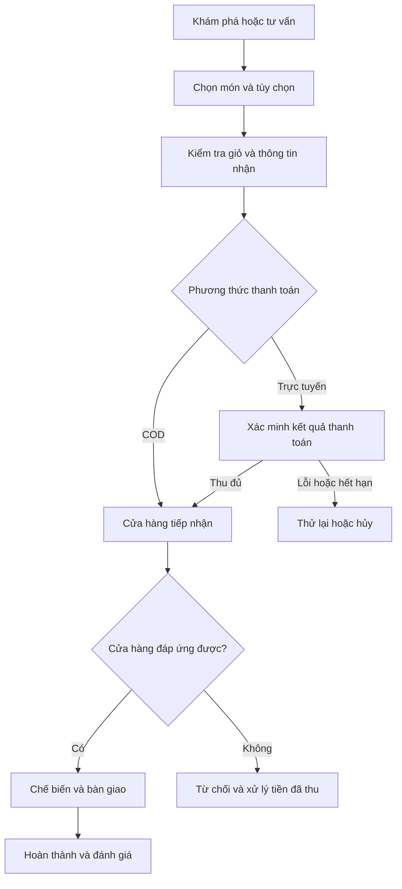

# TÀI LIỆU PHÂN TÍCH NGHIỆP VỤ

## Hệ thống quản lý và kinh doanh đồ ăn trực tuyến tích hợp AI — Vị Việt

| Thuộc tính | Nội dung |
|---|---|
| Tên đề tài | Xây dựng hệ thống quản lý và kinh doanh đồ ăn trực tuyến tích hợp trí tuệ nhân tạo trong tư vấn và cá nhân hóa trải nghiệm người dùng |
| Tên sản phẩm | Vị Việt — tên làm việc của dự án |
| Phiên bản | 1.0 — cơ sở đặc tả và triển khai đồ án |
| Ngày lập | 02/11/2026 |
| Phạm vi | Một cửa hàng; website khách hàng, giao diện nhân viên và trang quản trị |
| Đối tượng đọc | Người thực hiện đồ án, giảng viên hướng dẫn, người thiết kế và phát triển hệ thống |
| Trạng thái | Bản đề xuất nghiệp vụ; chưa phải kết quả khảo sát một cửa hàng thực tế |

## 1. Mục đích và cơ sở phân tích

Tài liệu xác định các chủ thể, quy trình, chức năng, dữ liệu nghiệp vụ, quy tắc và tiêu chí nghiệm thu cho hệ thống Vị Việt. Tài liệu được dùng làm cơ sở xây dựng giao diện, API, cơ sở dữ liệu và kịch bản kiểm thử.

Các yêu cầu được tổng hợp từ phạm vi đã thống nhất: tự phát triển backend, quản lý đặt đồ ăn, hỗ trợ giao hoặc nhận tại cửa hàng, tư vấn AI từ dữ liệu thực đơn, cá nhân hóa theo sở thích và xây dựng trải nghiệm kể chuyện ẩm thực theo nhịp cuộn trang.

Thiết kế nghiệp vụ đối chiếu với bản CSDL Vị Việt đã xây dựng. Tài liệu không thay thế từ điển dữ liệu hoặc tài liệu thiết kế kỹ thuật. Những chính sách chưa có chủ cửa hàng xác nhận được ghi thành giả định hoặc chính sách cơ sở để có thể triển khai nhất quán và điều chỉnh có kiểm soát.

### 1.1. Thuật ngữ

| Thuật ngữ | Ý nghĩa |
|---|---|
| Món ăn | Sản phẩm trong thực đơn, gồm cả đồ uống nếu có |
| Biến thể | Phiên bản của món có giá riêng, ví dụ phần thường/phần lớn |
| Nhóm tùy chọn | Tập lựa chọn cho một món, có giới hạn chọn tối thiểu/tối đa |
| Món thêm/topping | Lựa chọn có thể cộng giá trên mỗi phần |
| Đơn hàng | Yêu cầu mua đã được hệ thống ghi nhận với mã đơn duy nhất |
| Xác nhận đơn | Cửa hàng chấp nhận thực hiện; khác với khách bấm đặt hàng |
| COD | Thu tiền khi giao hoặc bàn giao tại cửa hàng |
| Lần thử thanh toán | Một yêu cầu thu tiền; một đơn có thể có nhiều lần thử |
| Cá nhân hóa | Điều chỉnh danh sách gợi ý theo dữ liệu được phép sử dụng của từng khách |
| Phân cảnh | Một đoạn giới thiệu món bằng hình ảnh, nội dung và chuyển động theo cuộn |
| Chụp dữ liệu | Lưu tên, giá, địa chỉ và lựa chọn tại thời điểm đặt để giữ lịch sử |

## 2. Bối cảnh và vấn đề nghiệp vụ

Khách có thể gặp khó khăn khi chọn món từ một thực đơn nhiều lựa chọn, chưa biết tổ hợp phù hợp ngân sách hoặc phải lặp lại các tùy chọn quen thuộc. Cửa hàng cần thống nhất thông tin món đang bán, tiếp nhận đơn, chuyển việc xuống bếp và đối chiếu tiền thu.

Trong bối cảnh giả định của đề tài, các rủi ro cần xử lý gồm: món hết nhưng vẫn nhận đặt, giá hoặc ghi chú không thống nhất giữa khách và bếp, bỏ sót đơn, thông báo thanh toán đến chậm, hủy đơn chưa xử lý hoàn tiền và gợi ý AI không đúng dữ liệu.

Đây là các vấn đề thiết kế cần giải quyết, chưa phải số liệu hay kết luận từ khảo sát vận hành thực tế.

### 2.1. Mục tiêu

| Mã | Mục tiêu | Kết quả có thể quan sát |
|---|---|---|
| OBJ-01 | Hoàn thiện quy trình bán hàng trực tuyến | Khách đặt được đơn hợp lệ và cửa hàng xử lý đến bàn giao |
| OBJ-02 | Kiểm soát dữ liệu và vận hành | Giá, tùy chọn, trạng thái và lịch sử được ghi nhất quán |
| OBJ-03 | Hỗ trợ ra quyết định bằng AI | Gợi ý liên kết món thật, có giá và lý do phù hợp |
| OBJ-04 | Cá nhân hóa có kiểm soát | Sở thích ảnh hưởng kết quả; khách có thể sửa và tắt sử dụng hành vi |
| OBJ-05 | Tạo trải nghiệm khám phá có bản sắc | Phân cảnh cuộn dẫn đến chọn món, hoạt động trên desktop/mobile |
| OBJ-06 | Hỗ trợ đánh giá kinh doanh | Báo cáo phân biệt giá trị đơn, tiền thu và hoàn tiền |

Không mặc định kết luận hệ thống sẽ tăng doanh thu hay giảm thời gian vận hành. Các tác động này cần được đo sau thử nghiệm.

## 3. Phạm vi và giả định

### 3.1. Trong phạm vi

- Website khách hàng: khám phá, thực đơn, chi tiết món, tư vấn, giỏ, thanh toán, theo dõi đơn và tài khoản.
- Quản lý thực đơn, biến thể, tùy chọn, thành phần, hình ảnh, giá và tình trạng bán.
- Đặt món giao tận nơi hoặc nhận tại cửa hàng, sử dụng một loại tiền là VND.
- COD và một cổng thanh toán trực tuyến; môi trường đồ án sử dụng VNPay Sandbox.
- Nhân viên tiếp nhận, bếp và quản trị viên xử lý theo vai trò.
- Mã giảm giá toàn đơn hoặc phí giao; đánh giá món đã mua.
- Tư vấn AI và bộ gợi ý cá nhân hóa trên dữ liệu hệ thống.
- Quản lý nội dung các chương kể chuyện ẩm thực.
- Báo cáo cơ bản và lịch sử xử lý đơn, thanh toán.

### 3.2. Ngoài phạm vi phiên bản cơ sở

- Sàn nhiều nhà hàng, nhiều chi nhánh, đối soát hoa hồng đối tác.
- Nhập kho, công thức định lượng, tiêu hao và kế toán nguyên liệu.
- Ứng dụng tài xế, GPS trực tiếp và tối ưu tuyến giao.
- Đặt trước theo lịch, đơn định kỳ và đặt bàn.
- Khuyến mãi nhiều tầng, nhiều mã trên một đơn, tích điểm và ví nội bộ.
- Mô hình dinh dưỡng/y khoa, tự huấn luyện LLM, tự khẳng định an toàn dị ứng.
- Mô hình 3D bắt buộc hoặc công cụ cho phép người quản trị tự viết animation.

### 3.3. Giả định và chính sách cơ sở

| Mã | Quyết định dùng để triển khai |
|---|---|
| ASM-01 | Một cửa hàng, một tài khoản có một vai trò chính |
| ASM-02 | Xem món, dùng giỏ tạm và hỏi AI không bắt buộc đăng nhập; tạo đơn yêu cầu đăng nhập |
| ASM-03 | Trạng thái còn/hết do nhân viên cập nhật; chưa quản lý suất bán hoặc tồn nguyên liệu tự động |
| ASM-04 | Giỏ hàng không giữ giá hoặc giữ món |
| ASM-05 | Mỗi đơn tối đa một mã ưu đãi; áp toàn bộ tiền món hoặc phí giao |
| ASM-06 | Một tùy chọn được chọn tối đa một lần trên mỗi phần; số phần tối đa 99 trên một dòng |
| ASM-07 | Hạn thanh toán trực tuyến mặc định đề xuất 15 phút và được cấu hình |
| ASM-08 | Phạm vi giao và biểu phí được cửa hàng khai báo; địa chỉ không xác định được vùng phục vụ phải được làm rõ trước khi đặt |
| ASM-09 | Chưa có tài khoản tài xế; nhân viên tiếp nhận ghi nhận bàn giao và kết quả giao |
| ASM-10 | Khi đồ án chưa tích hợp hoàn tiền tự động, nhân viên được phân quyền ghi nhận quy trình thủ công có căn cứ đối soát |

Các giả định trên là ranh giới của phiên bản 1.0. Thay đổi chúng có thể kéo theo chỉnh sửa CSDL, API, giao diện và kiểm thử.

## 4. Tác nhân và phân quyền

| Tác nhân | Trách nhiệm |
|---|---|
| Khách vãng lai | Khám phá, tìm món, xem chi tiết, chọn món vào giỏ tạm, hỏi AI |
| Khách hàng | Thực hiện quyền của khách vãng lai; quản lý hồ sơ, đặt hàng và theo dõi dữ liệu của mình |
| Nhân viên tiếp nhận | Xử lý đơn, phối hợp bếp, ghi nhận giao nhận và thu COD |
| Nhân viên bếp | Xem món và ghi chú cần chế biến, bắt đầu và hoàn thành chuẩn bị, báo sự cố |
| Quản trị viên | Quản lý thực đơn, nhân viên, chính sách, nội dung, báo cáo và quyết định hoàn tiền |
| Dịch vụ thanh toán | Xử lý giao dịch và cung cấp kết quả xác minh/đối soát |
| Dịch vụ AI | Hỗ trợ hiểu ngôn ngữ và diễn đạt tư vấn; không là chủ thể quyết định giá hoặc quyền thao tác |

### 4.1. Ma trận quyền nghiệp vụ

| Chức năng | Khách hàng | Tiếp nhận | Bếp | Quản trị |
|---|---|---|---|---|
| Xem/sửa hồ sơ và địa chỉ | Của mình | Của mình | Của mình | Của mình |
| Tạo và xem đơn mua | Của mình | Đơn được xử lý theo công việc | Dữ liệu chế biến cần thiết | Tất cả |
| Xác nhận/từ chối đơn | Không | Có | Không | Có |
| Bắt đầu/hoàn thành chế biến | Không | Theo dõi | Có | Có |
| Ghi nhận giao nhận/thu COD | Không | Có | Không | Có |
| Gửi yêu cầu hủy | Của mình | Có | Báo sự cố | Có |
| Phê duyệt hủy/hoàn tiền | Không | Hủy trước chế biến theo chính sách | Không | Có |
| Tạo/sửa món và giá | Không | Không | Không | Có |
| Báo món hết | Không | Có | Có | Có |
| Quản lý khuyến mãi/nội dung | Không | Không | Không | Có |
| Xem báo cáo kinh doanh | Không | Không | Không | Có |
| Quản lý tài khoản nhân viên | Không | Không | Không | Có |

Ẩn nút trên giao diện không thay cho kiểm tra quyền ở backend. Bếp chỉ cần mã đơn, món, tùy chọn, ghi chú chế biến và thời gian; không cần toàn bộ thông tin liên hệ khách.

## 5. Quy trình nghiệp vụ tổng thể

### 5.1. Khám phá và lựa chọn

Khách có thể vào thẳng thực đơn hoặc đi qua hành trình cuộn. Mỗi phân cảnh giới thiệu một món, nối sang phần chọn biến thể và tùy chọn. Giá, tình trạng bán lấy từ món hiện hành; không được lưu độc lập trong nội dung để hiển thị một giá đã lỗi thời.

Khi chọn món, khách thấy lựa chọn bắt buộc, món thêm và thành tiền. Món khác tùy chọn hoặc ghi chú có thể là hai dòng giỏ riêng. Giỏ tạm được kiểm tra lại khi đăng nhập và đồng bộ.

### 5.2. Kiểm tra và tạo đơn

Khách chọn cách nhận, địa chỉ, ưu đãi và phương thức thanh toán. Hệ thống kiểm tra giờ nhận đơn, vùng phục vụ, món/biến thể còn bán, tùy chọn hợp lệ, giá và ưu đãi. Nếu có thay đổi ảnh hưởng đơn, khách phải xem lại trước khi xác nhận.

Sau khi ghi nhận thành công, đơn có mã duy nhất và lưu bản chụp nội dung đã mua. Bấm nhiều lần hoặc gửi lại cùng một yêu cầu không được tạo đơn trùng.

### 5.3. Tiếp nhận và chế biến

Đơn COD vào hàng chờ xác nhận; đơn trực tuyến có tiền phải thu vào hàng chờ sau khi xác minh thanh toán. Nhân viên kiểm tra khả năng đáp ứng, xác nhận hoặc từ chối có lý do. Đơn xác nhận được chuyển bếp; bếp xử lý đúng số lượng, biến thể, topping và ghi chú.

Nếu không thể đáp ứng một phần sau xác nhận, nhân viên liên hệ khách. Phiên bản cơ sở không tự sửa giá hoặc thay món trên đơn đã chốt. Phương án xử lý là tiếp tục đúng đơn hoặc hủy theo quyền và tạo đơn mới nếu khách đồng ý. Mọi quyết định phải có lịch sử.

### 5.4. Bàn giao và kết thúc

Đơn giao tận nơi được ghi nhận bàn giao, đang giao và kết quả. Đơn nhận tại cửa hàng được đối chiếu mã đơn/thông tin người nhận. Với COD, có thao tác xác nhận thu tiền riêng. Đơn hoàn thành khi bàn giao thành công và đáp ứng điều kiện thanh toán.

Không tự chuyển đơn thành hoàn thành chỉ dựa vào thời gian dự kiến. Không liên hệ được, khách từ chối nhận hoặc giao thất bại cần lý do và người chịu trách nhiệm xử lý.

## 6. Danh mục yêu cầu chức năng

P1: bắt buộc trong đồ án. P2: bổ sung sau khi các luồng chính hoạt động. Thứ tự ưu tiên không làm thay đổi yêu cầu phải có của luồng đã chọn triển khai.

| Mã | Nhóm | Yêu cầu | Ưu tiên |
|---|---|---|---|
| FR-01 | Tài khoản | Đăng ký, đăng nhập, đăng xuất và quản lý phiên | P1 |
| FR-02 | Tài khoản | Xác minh email, quên/đổi mật khẩu bằng token có hạn | P1 |
| FR-03 | Khách hàng | Hồ sơ, nhiều địa chỉ và một địa chỉ mặc định | P1 |
| FR-04 | Sở thích | Khai báo khẩu vị, thành phần tránh và tùy chọn cá nhân hóa | P1 |
| FR-05 | Khám phá | Phân cảnh món theo cuộn, CTA liên kết món thật, giao diện mobile | P1 |
| FR-06 | Tìm kiếm | Từ khóa, danh mục, mức giá, đặc điểm và trạng thái bán | P1 |
| FR-07 | Chi tiết món | Ảnh, mô tả, thành phần, biến thể và thông tin có/thiếu dữ liệu | P1 |
| FR-08 | Chọn món | Kiểm tra nhóm tùy chọn, món thêm, số lượng và thành tiền | P1 |
| FR-09 | Giỏ hàng | Thêm, sửa, xóa, đồng bộ giỏ tạm và kiểm tra lại khi checkout | P1 |
| FR-10 | Đặt hàng | Giao/nhận tại quán, kiểm tra điều kiện, tạo đơn chống trùng | P1 |
| FR-11 | Ưu đãi | Áp mã, kiểm tra điều kiện và giới hạn sử dụng | P1 |
| FR-12 | Thanh toán | COD, trực tuyến, xác minh kết quả, thử lại và hết hạn | P1 |
| FR-13 | Xử lý đơn | Hàng chờ, xác nhận, từ chối và lịch sử xử lý | P1 |
| FR-14 | Bếp | Danh sách chế biến, bắt đầu, hoàn thành và báo sự cố | P1 |
| FR-15 | Giao nhận | Ghi nhận bàn giao, thành công/thất bại và thu COD | P1 |
| FR-16 | Sau bán | Hủy, yêu cầu hủy, đối soát và hoàn tiền | P1 |
| FR-17 | Theo dõi | Trạng thái đơn, thanh toán, chi tiết và hỗ trợ | P1 |
| FR-18 | Lịch sử | Xem đơn cũ và đặt lại sau kiểm tra giá/tình trạng mới | P1 |
| FR-19 | Đánh giá | Đánh giá món đã mua và phản hồi từ cửa hàng | P1 |
| FR-20 | AI | Tư vấn theo nhu cầu, hỏi bổ sung, đề xuất món/tổ hợp hợp lệ | P1 |
| FR-21 | Cá nhân hóa | Lọc, xếp hạng và giải thích theo dữ liệu được phép dùng | P1 |
| FR-22 | Thực đơn | CRUD danh mục, món, biến thể, tùy chọn, ảnh và tình trạng bán | P1 |
| FR-23 | Quản trị | Nhân viên, vai trò, khóa tài khoản và kiểm tra quyền | P1 |
| FR-24 | Nội dung | Câu chuyện, asset, thứ tự và preset chuyển động | P1 |
| FR-25 | Cấu hình | Giờ mở cửa, nhận đơn, vùng giao, biểu phí, hạn thanh toán | P1 |
| FR-26 | Báo cáo | Đơn, giá trị hoàn thành, thu/hoàn tiền và món bán chạy | P1 |
| FR-27 | Yêu thích | Lưu và bỏ món yêu thích | P2 |
| FR-28 | Đo gợi ý | Lượt gợi ý, nhấp, thêm giỏ và phản hồi thử nghiệm | P2 |

## 7. Đặc tả các tình huống sử dụng trọng tâm

### UC-01. Chọn món và quản lý giỏ

**Tác nhân:** khách vãng lai hoặc khách hàng. **Liên quan:** FR-06 đến FR-09.

**Tiền điều kiện:** truy cập được thực đơn. **Kích hoạt:** chọn một món từ thực đơn, phân cảnh hoặc gợi ý.

Luồng chính:

1. Hệ thống hiển thị món, biến thể, tùy chọn và giá hiện tại.
2. Khách chọn biến thể, tùy chọn bắt buộc, số lượng và ghi chú.
3. Hệ thống tính thành tiền minh họa và nêu lựa chọn còn thiếu.
4. Khách thêm vào giỏ; hệ thống lưu cấu hình lựa chọn và thông báo thành công.
5. Khách sửa hoặc xóa dòng giỏ; tổng tiền được cập nhật.

Ngoại lệ: món ngừng bán thì chặn thêm; biến thể/tùy chọn hết thì yêu cầu chọn lại; thiếu nhóm bắt buộc thì chỉ rõ nhóm; đồng bộ sau đăng nhập có xung đột thì hiển thị kết quả và thông tin cần xem lại.

**Hậu điều kiện:** giỏ phản ánh đúng lựa chọn, chưa giữ món hoặc cam kết giá cuối cùng.

### UC-02. Đặt hàng

**Tác nhân:** khách hàng. **Liên quan:** FR-03, FR-09 đến FR-12. **Tiền điều kiện:** đăng nhập, giỏ không rỗng, tài khoản có quyền mua.

1. Khách chọn giao tận nơi hoặc nhận tại quán.
2. Cung cấp/chọn thông tin người nhận; hệ thống kiểm tra vùng phục vụ và giờ nhận đơn.
3. Khách áp mã nếu có, chọn phương thức thanh toán.
4. Hệ thống kiểm tra toàn bộ món, lựa chọn, giá, mã và tổng tiền ở phía máy chủ.
5. Khách xem thông tin cuối cùng và xác nhận.
6. Hệ thống tạo đơn cùng dòng món, tùy chọn, lượt ưu đãi và lịch sử trong một giao dịch nhất quán.
7. COD vào chờ xác nhận; trực tuyến chuyển sang thanh toán.
8. Hệ thống hiển thị mã đơn và hướng dẫn tiếp theo.

Ngoại lệ: thay đổi giá/món hết yêu cầu xem lại; mã không hợp lệ không được âm thầm áp mức khác; lỗi ghi dữ liệu không để lại đơn thiếu dòng; gửi lại yêu cầu cũ trả về đúng đơn của khách, không tạo bản sao; hết giờ trong lúc xác nhận phải kiểm tra lại.

**Hậu điều kiện:** đơn hợp lệ được lưu đầy đủ hoặc không có đơn mới được tạo. Giỏ được đối chiếu và chỉ loại các dòng đã mua sau khi chắc chắn tạo đơn thành công.

### UC-03. Thanh toán trực tuyến

**Tác nhân:** khách, hệ thống, dịch vụ thanh toán. **Liên quan:** FR-12. **Tiền điều kiện:** đơn thuộc khách, còn hạn và có tiền cần thu.

1. Hệ thống lưu lần thử thanh toán với mã tham chiếu riêng.
2. Chuyển khách đến giao diện dịch vụ thanh toán.
3. Dịch vụ gửi kết quả; hệ thống xác minh chữ ký, tham chiếu, số tiền và tiền tệ.
4. Trong một giao dịch, hệ thống ghi nhận kết quả đã xử lý và cập nhật khoản thu.
5. Nếu thu đủ và đơn còn hợp lệ, đơn vào chờ xác nhận.
6. Giao diện lấy trạng thái đã xác minh từ backend để hiển thị.

Ngoại lệ: khách đóng trang vẫn có thể nhận kết quả sau; redirect thành công không thay xác minh; lỗi cho phép thử lại nếu đơn còn hợp lệ; thông báo lặp không ghi nhận hai lần; tiền về sau hủy hoặc thu thừa được chuyển đối soát/hoàn, không tự đưa đơn về bếp.

**Hậu điều kiện:** mỗi khoản thực thu có dấu vết; trạng thái đơn và thanh toán không bị suy ra từ riêng thao tác trình duyệt.

### UC-04. Tiếp nhận, chế biến và bàn giao

**Tác nhân:** tiếp nhận, bếp, quản trị. **Liên quan:** FR-13 đến FR-15.

1. Tiếp nhận xem đơn đủ điều kiện vào hàng chờ, kiểm tra khả năng đáp ứng.
2. Xác nhận hoặc từ chối kèm lý do.
3. Bếp xem món đã xác nhận, bắt đầu chuẩn bị.
4. Bếp hoàn thành đầy đủ và đánh dấu sẵn sàng bàn giao.
5. Tiếp nhận ghi bàn giao cho người giao hoặc khách nhận tại quán.
6. Ghi kết quả nhận hàng và khoản thu COD nếu có; hoàn thành khi đủ điều kiện.

Ngoại lệ: bếp phát hiện không thể làm thì báo sự cố; thao tác từ màn hình cũ phải bị từ chối nếu trạng thái đã đổi; lỗi giao không đánh dấu hoàn thành; thiếu xác nhận tiền COD phải được làm rõ trước hoàn thành.

**Hậu điều kiện:** trạng thái hợp lệ, có người và thời điểm thao tác, món và giá không bị sửa ngầm.

### UC-05. Hủy và hoàn tiền

**Tác nhân:** khách, tiếp nhận, quản trị. **Liên quan:** FR-16.

1. Khách gửi hủy hoặc yêu cầu hủy kèm lý do.
2. Hệ thống kiểm tra chủ đơn, trạng thái hiện tại và chính sách.
3. Nếu không được tự hủy, ghi yêu cầu để người có quyền quyết định.
4. Khi được chấp thuận, cập nhật hủy và lịch sử; xác định tiền đã thu và khoản cần hoàn.
5. Tạo yêu cầu hoàn theo giao dịch gốc; người có quyền xử lý qua đối tác hoặc quy trình thủ công có căn cứ.
6. Chỉ ghi đã hoàn khi có kết quả xác minh; thất bại giữ thông tin để xử lý tiếp.

**Hậu điều kiện:** không chế biến/giao tiếp một đơn đã hủy; tiền và lượt ưu đãi được xử lý đúng chính sách. Yêu cầu hủy không đồng nghĩa đơn đã hủy.

### UC-06. Tư vấn chọn món bằng AI

**Tác nhân:** khách vãng lai hoặc khách hàng. **Liên quan:** FR-20.

1. Khách nhập nhu cầu, ví dụ “Hai người, dưới 150 nghìn, không cay”.
2. Hệ thống xác định số người, ngân sách, khẩu vị, điều kiện tránh; hỏi bổ sung nếu thiếu thông tin quyết định.
3. Các chức năng backend truy vấn thực đơn, loại món không phù hợp và tính phương án bằng dữ liệu thực.
4. AI diễn đạt đề xuất gồm tên, giá, số lượng, lý do và phần chi phí đã/chưa tính.
5. Khách yêu cầu đổi hoặc chọn phương án.
6. Trước khi thêm giỏ, hệ thống kiểm tra lại món và yêu cầu chọn tùy chọn còn thiếu.

Ngoại lệ: không có kết quả thì nói rõ điều kiện không đáp ứng; AI lỗi thì giữ đường đặt món thông thường; thiếu dữ liệu thành phần thì không suy đoán; câu hỏi ngoài phạm vi được hướng về nhu cầu ẩm thực/cửa hàng.

**Hậu điều kiện:** đề xuất tham chiếu món thật, có thể kiểm tra và không tự tạo đơn hoặc thanh toán.

### UC-07. Cá nhân hóa

**Tác nhân:** khách hàng. **Liên quan:** FR-04, FR-21, FR-28.

1. Khách khai báo sở thích và lựa chọn việc dùng lịch sử để cá nhân hóa.
2. Hệ thống lấy món đủ điều kiện bán và áp các điều kiện bắt buộc.
3. Nếu được phép, dùng lịch sử mua, đánh giá và hành vi để chấm điểm; nếu chưa đồng ý thì chỉ dùng thông tin chủ động cung cấp cho yêu cầu hiện tại hoặc gợi ý phổ biến.
4. Xếp hạng, hiển thị lý do ngắn và ghi nhận tương tác khi được phép.
5. Khách sửa sở thích hoặc tắt cá nhân hóa; hệ thống dừng khai thác hành vi cho gợi ý theo chính sách.

**Hậu điều kiện:** khách hiểu và kiểm soát cơ sở gợi ý; suy đoán không ghi đè khai báo. Đơn mua vẫn được giữ phục vụ giao dịch nhưng không mặc định tiếp tục dùng để cá nhân hóa sau khi khách tắt.

### UC-08. Quản lý phân cảnh kể chuyện

**Tác nhân:** quản trị. **Liên quan:** FR-05, FR-24.

1. Chọn món, ảnh, tên chương, tiêu đề, nội dung và nhãn nút.
2. Chọn màu, mẫu chuyển động và thứ tự từ danh sách được hỗ trợ.
3. Xem trước desktop/mobile, kiểm tra nội dung và đường dẫn chọn món.
4. Xuất bản hoặc ẩn phân cảnh.
5. Website lấy giá/tình trạng hiện hành của món; khi món hết, hiển thị đúng trạng thái và lối sang thực đơn.

**Hậu điều kiện:** nội dung đồng nhất với món thật, không chứa mã thực thi tùy ý và không làm tắc đường đặt hàng.

## 8. Mô hình trạng thái

### 8.1. Trạng thái đơn

| Mã trạng thái | Ý nghĩa | Chuyển tiếp thông thường |
|---|---|---|
| PENDING_PAYMENT | Chờ thanh toán trực tuyến | PENDING_CONFIRMATION hoặc CANCELLED |
| PENDING_CONFIRMATION | Chờ cửa hàng chấp nhận | CONFIRMED hoặc CANCELLED |
| CONFIRMED | Cửa hàng chấp nhận | PREPARING; hủy có thẩm quyền |
| PREPARING | Đang chế biến | READY; hủy ngoại lệ có phê duyệt |
| READY | Đủ món để bàn giao | DELIVERING với giao tận nơi; COMPLETED với nhận tại quán |
| DELIVERING | Đã bàn giao đi giao | COMPLETED hoặc DELIVERY_FAILED |
| COMPLETED | Bàn giao thành công, điều kiện tiền đã đáp ứng | Kết thúc luồng thường |
| CANCELLED | Đã hủy | Không tự mở lại |
| DELIVERY_FAILED | Giao không thành công | Nhân viên xử lý ngoại lệ; chuyển CANCELLED khi chốt không giao lại |

Phiên bản cơ sở không tự giao lại đơn DELIVERY_FAILED. Sau xử lý, có thể chốt hủy và hoàn tiền nếu đủ điều kiện; nhu cầu đặt lại được tạo thành đơn mới. Một order event ghi đầy đủ lý do. Không sửa trực tiếp trạng thái trong CSDL để bỏ qua quy trình.

### 8.2. Thanh toán và hoàn tiền

| Đối tượng | Các trạng thái |
|---|---|
| Tổng hợp thanh toán của đơn | UNPAID, PROCESSING, PAID, REFUND_PENDING, PARTIALLY_REFUNDED, REFUNDED |
| Một lần thử thanh toán | PENDING, SUCCEEDED, FAILED, EXPIRED |
| Một yêu cầu hoàn tiền | REQUESTED, PROCESSING, SUCCEEDED, FAILED |

Một lần thử FAILED không chứng minh đơn chưa từng thu tiền: phải xem tất cả giao dịch. Trạng thái tổng hợp đơn được tính từ các khoản thực thu và hoàn có liên quan; báo cáo tài chính luôn đối chiếu giao dịch gốc.

### 8.3. Ma trận hủy cơ sở

| Tình huống | Cách xử lý |
|---|---|
| Chờ thanh toán, chưa có khoản thu | Khách tự hủy hoặc hệ thống hủy khi hết hạn |
| Chờ xác nhận, COD chưa thu | Khách tự hủy |
| Chờ xác nhận, đã trả trước | Khách yêu cầu hủy; nhân viên xác nhận, quản trị xử lý hoàn |
| Đã xác nhận, chưa chế biến | Gửi yêu cầu; tiếp nhận/quản trị quyết định theo khả năng dừng |
| Đang chế biến hoặc sẵn sàng | Quản trị xử lý ngoại lệ, không tự hủy |
| Đang giao | Tiếp nhận ghi sự cố; quản trị chốt kết quả và tiền liên quan |
| Cửa hàng không đáp ứng | Cửa hàng hủy có lý do; hoàn khoản phải hoàn nếu đã thu |

Quyền và trạng thái phải được kiểm tra tại thời điểm chấp thuận, không dựa trên trạng thái khi khách mở màn hình.

## 9. Quy tắc nghiệp vụ

| Mã | Quy tắc |
|---|---|
| BR-01 | Chỉ chủ sở hữu hoặc nhân viên đúng quyền được truy cập dữ liệu đơn/hồ sơ |
| BR-02 | Tài khoản khóa không được tạo đơn hoặc thao tác quản trị; xử lý đơn đang có vẫn do cửa hàng thực hiện |
| BR-03 | Món mở bán cần ít nhất một biến thể đang hoạt động |
| BR-04 | Món, biến thể và tùy chọn phải cùng cấu hình hợp lệ; nhóm bắt buộc không được thiếu |
| BR-05 | Cửa hàng ngừng nhận, ngoài giờ hoặc ngoài vùng giao thì không nhận đơn ngay |
| BR-06 | Giá và tình trạng được kiểm tra phía máy chủ khi đặt; giỏ không giữ giá/món |
| BR-07 | Lưu tên, giá, lựa chọn và địa chỉ trên đơn; sửa hồ sơ/thực đơn không đổi lịch sử |
| BR-08 | Tạo đơn và các dòng chi tiết phải nhất quán; retry không tạo bản sao |
| BR-09 | Cùng một món nhưng khác cấu hình/ghi chú được phép thành các dòng riêng |
| BR-10 | Mỗi đơn tối đa một coupon; ngưỡng tối thiểu tính trên tiền món trước giảm |
| BR-11 | Giảm phần trăm làm tròn nửa lên tới đồng; không vượt trần hoặc tiền món; giảm phí không vượt phí giao |
| BR-12 | Coupon giữ lượt khi tạo đơn, dùng lượt khi xác nhận; hủy trước xác nhận trả lượt, sau xác nhận không tự trả |
| BR-13 | Giới hạn coupon kiểm tra trên lượt đang giữ và đã dùng; yêu cầu đồng thời không vượt hạn mức |
| BR-14 | Đơn nhận tại quán có phí giao và giảm phí giao bằng 0 |
| BR-15 | Đơn tổng 0 không tạo giao dịch thu 0; ghi nhận không cần thu và lịch sử giải thích |
| BR-16 | Chỉ kết quả được xác minh từ đối tác mới ghi đã thanh toán trực tuyến |
| BR-17 | Thông báo lặp xử lý an toàn; thông báo từng lỗi có thể được xử lý lại có kiểm soát |
| BR-18 | Không giấu tiền thu thừa; tiền đến sau hủy được đối soát và không khởi động chế biến lại |
| BR-19 | Tổng hoàn đã thành công và đang được giữ để xử lý không vượt khoản thu của giao dịch gốc |
| BR-20 | Hủy đơn không đồng nghĩa đã hoàn tiền; hoàn chỉ thành công khi có căn cứ xác minh |
| BR-21 | COD được ghi nhận bằng thao tác thu có người chịu trách nhiệm; không suy ra tiền thu từ trạng thái giao |
| BR-22 | Mọi chuyển trạng thái có kiểm tra luồng, vai trò, người thao tác, thời điểm và lý do nếu là ngoại lệ |
| BR-23 | Đơn đã xác nhận không tự thay món hoặc đổi giá; thay đổi lớn xử lý bằng hủy/đặt mới có đồng ý |
| BR-24 | Chỉ chủ đơn hoàn thành được đánh giá dòng món đã mua, tối đa một đánh giá trên mỗi dòng |
| BR-25 | Cửa hàng phản hồi/ẩn có lý do; không sửa nội dung đánh giá thay khách |
| BR-26 | AI chỉ gợi ý món hợp lệ; giá, tổng tiền và ưu đãi do chức năng hệ thống xác định |
| BR-27 | Không đủ dữ liệu thành phần thì không khẳng định món không có chất gây dị ứng |
| BR-28 | Điều kiện bắt buộc không bị nới ngầm; yêu cầu hiện tại ưu tiên hơn thói quen cũ |
| BR-29 | Khách xác nhận trước khi thêm cấu hình còn thiếu vào giỏ, tạo đơn và thanh toán |
| BR-30 | Thu thập hành vi cá nhân hóa theo lựa chọn đồng ý; cho phép sửa sở thích và dừng sử dụng |
| BR-31 | Khách chưa có lịch sử nhận gợi ý từ khai báo hoặc mức phổ biến với nhãn đúng bản chất |
| BR-32 | Nội dung phân cảnh lấy giá và trạng thái từ món; preset chuyển động thuộc danh sách an toàn |
| BR-33 | Không xóa cứng món/biến thể đã có giao dịch; sử dụng ngừng bán hoặc ẩn |
| BR-34 | Báo cáo giá trị đơn, tiền thu, tiền hoàn và dòng tiền thuần được định nghĩa riêng |
| BR-35 | Thời gian nghiệp vụ hiển thị theo giờ Việt Nam; lưu và truy vấn thống nhất mốc thời gian |
| BR-36 | Chưa có dữ liệu chi phí thì không báo cáo giá trị thu như lợi nhuận |

## 10. Tính tiền và tình huống minh họa

Tiền một dòng = (giá biến thể + tổng giá tùy chọn trên một phần) × số lượng.

Tổng phải trả = tiền món − giảm tiền món + phí giao − giảm phí giao.

Ví dụ một đơn giao:

| Thành phần | Giá trị |
|---|---:|
| 2 phở thường: mỗi phần 59.000đ, thêm trứng 7.000đ | 132.000đ |
| 1 đồ uống | 20.000đ |
| Tiền món | 152.000đ |
| Mã giảm 10%, trần 20.000đ | −15.200đ |
| Phí giao | 15.000đ |
| Tổng thanh toán | 151.800đ |

Nếu dùng mã miễn phí giao thay thế thì tổng là 152.000đ. Không cộng hai mã trong phiên bản cơ sở. Mã không còn lượt hoặc không đủ điều kiện phải được báo trước khi khách xác nhận lại.

## 11. Nghiệp vụ AI và bộ gợi ý

### 11.1. Phân chia trách nhiệm

| Thành phần | Trách nhiệm |
|---|---|
| AI ngôn ngữ | Hiểu nhu cầu, hỏi bổ sung và diễn đạt dựa trên kết quả được cung cấp |
| Bộ lọc nghiệp vụ | Kiểm tra tình trạng bán, ngân sách và điều kiện khách yêu cầu |
| Bộ gợi ý | Chấm điểm và xếp hạng các món đã qua lọc |
| Bộ tính tiền | Tính giá phương án và phí/ưu đãi đã xác định |
| Khách hàng | Chọn phương án và xác nhận mua |

Không có yêu cầu bắt buộc tự huấn luyện LLM. Phần hệ thống tự xây dựng là truy xuất dữ liệu, luật lọc, chấm điểm, kiểm tra tính hợp lệ và kết nối với luồng mua hàng.

### 11.2. Dữ liệu và giới hạn

Dữ liệu đầu vào gồm nhu cầu hội thoại, thực đơn, biến thể, tùy chọn, thành phần đã khai báo, sở thích và lịch sử được phép dùng. Thành phần có trạng thái chưa rõ/chưa đầy đủ/đã xác minh. Cần lưu ý cả khả năng lẫn chéo được cửa hàng ghi nhận.

Với điều kiện dị ứng, danh sách không có một thành phần không đủ chứng minh an toàn. Khi không xác minh được, kết quả nêu rõ giới hạn và đề nghị khách liên hệ cửa hàng; không gắn nhãn an toàn bằng suy đoán.

### 11.3. Trình tự xếp hạng đề xuất

1. Loại món không bán, danh mục ẩn và biến thể không hợp lệ.
2. Áp điều kiện bắt buộc của lần yêu cầu; xử lý thiếu dữ liệu trước khi kết luận phù hợp.
3. Xét sở thích chủ động; nếu được đồng ý, bổ sung lịch sử mua, đánh giá và tương tác.
4. Chấm điểm theo công thức có thể giải thích; trọng số thuộc cấu hình triển khai và cần thử nghiệm.
5. Bổ sung độ đa dạng để tránh luôn lặp cùng một món.
6. Hiển thị lý do ngắn, không biến suy đoán thành tuyên bố chắc chắn về khách.

Ví dụ: “Phù hợp lựa chọn không cay của bạn” phải có dữ liệu tương ứng. Một lần mua không đủ để gắn sở thích cố định.

## 12. Trải nghiệm giao diện phục vụ nghiệp vụ

### 12.1. Khám phá theo cuộn

Phân cảnh phở có các nhịp: bát xuất hiện từ trái, trượt/xoay vào vị trí chính, nội dung lần lượt hiện, dừng để đọc, sau đó xuất hiện giá và nút chọn món. Món tiếp theo thay nhịp, bố cục hoặc màu nền để nối câu chuyện.

Animation cần liên kết với tiến độ cuộn, có thể đảo khi cuộn ngược. Không buộc khách xem hết để đặt hàng; thực đơn và giỏ luôn có lối tiếp cận. Mobile giảm khoảng di chuyển và thời gian giữ cảnh. Người chọn giảm chuyển động vẫn nhận đầy đủ nội dung và thao tác mua.

### 12.2. Màn hình và hành động chính

| Màn hình | Nội dung và hành động |
|---|---|
| Trang chủ | Hero, chương món, món nổi bật, gợi ý, lối vào thực đơn/AI |
| Thực đơn | Tìm/lọc, giá, trạng thái bán, chọn món |
| Chi tiết/chọn món | Ảnh, câu chuyện, thành phần, biến thể, tùy chọn, số lượng |
| Giỏ | Sửa/xóa, mã ưu đãi, tạm tính, thông báo thay đổi |
| Thanh toán | Cách nhận, địa chỉ, phí, phương thức, tổng cuối và xác nhận |
| Kết quả thanh toán | Đang chờ, thành công hoặc lỗi theo xác minh |
| Theo dõi đơn | Tiến độ, trạng thái tiền, chi tiết, hỗ trợ/hủy theo quyền |
| Tư vấn AI | Hội thoại, phương án món, lý do, giá và chuyển vào giỏ |
| Tài khoản | Hồ sơ, địa chỉ, sở thích, lịch sử, đặt lại, đánh giá |
| Tiếp nhận | Hàng chờ, chi tiết, trạng thái, giao nhận và sự cố |
| Bếp | Mã đơn, món, lựa chọn, ghi chú và thời gian chờ |
| Quản trị | Thực đơn, ưu đãi, nội dung, tài khoản, cài đặt, báo cáo |

Các màn hình có trạng thái tải, trống, lỗi và thử lại. Lỗi không được làm mất giỏ hoặc làm người dùng tưởng đơn đã thành công khi chưa ghi nhận.

## 13. Báo cáo và định nghĩa chỉ tiêu

| Chỉ tiêu | Định nghĩa |
|---|---|
| Số đơn tạo | Đơn có thời điểm tạo trong kỳ; tách theo trạng thái |
| Giá trị đơn hoàn thành | Tổng giá trị đơn COMPLETED có completed_at trong kỳ |
| Tiền thực thu | Tổng giao dịch SUCCEEDED có paid_at trong kỳ |
| Tiền đã hoàn | Tổng refund SUCCEEDED có refunded_at trong kỳ |
| Dòng tiền thuần | Tiền thu trừ tiền hoàn trong cùng kỳ; không phải lợi nhuận |
| Món bán chạy | Số phần từ đơn hoàn thành trong kỳ, không tính đơn hủy |
| Tỷ lệ hủy của nhóm đơn | Số đơn hủy trong tập đơn tạo của kỳ chia số đơn tạo của kỳ, chốt tại thời điểm báo cáo |
| Khách quay lại | Khách có đơn hoàn thành trong kỳ và có đơn hoàn thành trước đó |
| Hiệu quả gợi ý | Lượt gợi ý, nhấp và thêm giỏ gắn nguồn nếu có dữ liệu |

Phải ghi rõ kỳ thời gian, tiêu chí và thời điểm chốt số liệu. Tập đơn chưa kết thúc có thể làm tỷ lệ hủy thay đổi sau này. Không nối trực tiếp nhiều bảng một-nhiều rồi cộng tiền gây nhân bản.

Thiết kế hiện tại đo được tương tác gợi ý; chưa có attribution đầy đủ từ từng gợi ý đến đơn mua. Không công bố tỷ lệ mua theo gợi ý như số liệu chính xác trước khi bổ sung liên kết này.

## 14. Yêu cầu phi chức năng và mục tiêu kiểm chứng

Các con số dưới đây là mục tiêu kiểm thử đề xuất, chưa phải kết quả đã đo hoặc cam kết hạ tầng thực tế.

| Mã | Yêu cầu | Cách kiểm chứng |
|---|---|---|
| NFR-01 | Kiểm soát quyền ở backend trên mọi tài nguyên riêng | Thử truy cập chéo tài khoản/role, kết quả bị từ chối |
| NFR-02 | Mật khẩu được băm, token có hạn/thu hồi, secret không gửi trình duyệt | Kiểm tra luồng đăng nhập, cấu hình và response |
| NFR-03 | Đơn và tiền nhất quán khi retry/đồng thời | Kiểm thử tạo trùng, callback lặp, cạnh tranh mã và hoàn tiền |
| NFR-04 | API thông thường p95 dưới 1 giây với 50 phiên hoạt động trong kịch bản thử nghiệm đã mô tả | Ghi rõ máy, dữ liệu, tải và loại API; loại trừ thời gian dịch vụ ngoài |
| NFR-05 | AI có phản hồi tiến trình ngay; giới hạn chờ đề xuất 20 giây rồi thông báo có thể thử lại | Mô phỏng chậm/lỗi và kiểm tra không mất nội dung |
| NFR-06 | Animation hướng đến 60 fps trên thiết bị desktop kiểm thử, giảm chất lượng hợp lý trên mobile | Đo frame time theo cảnh, ghi thiết bị và kiểm tra thao tác |
| NFR-07 | Các luồng đặt món dùng được ở chiều rộng 390px và 1440px | Kiểm tra không che nút, tràn nội dung hoặc mất thông tin |
| NFR-08 | Hỗ trợ bàn phím, nhãn biểu mẫu, tương phản và giảm chuyển động | Thử thao tác toàn bộ luồng chính bằng bàn phím |
| NFR-09 | AI hoặc cập nhật trực tiếp lỗi không làm tê liệt đặt món | Cho phép xem lại trạng thái và đặt bằng thực đơn |
| NFR-10 | Có sao lưu và quy trình khôi phục dữ liệu | Thử khôi phục bản sao trên môi trường riêng |
| NFR-11 | Nhật ký không chứa mật khẩu, secret, token thô hoặc dữ liệu thanh toán nhạy cảm | Kiểm tra log các ca lỗi và callback |
| NFR-12 | Tối thiểu hóa dữ liệu và cho khách kiểm soát cá nhân hóa | Tắt tùy chọn, kiểm tra dừng ghi hành vi và xử lý dữ liệu theo yêu cầu |

## 15. Đối chiếu với nhóm dữ liệu

| Nghiệp vụ | Nhóm dữ liệu chính |
|---|---|
| Tài khoản và phiên | users, auth_sessions, account_tokens |
| Hồ sơ/địa chỉ/sở thích | addresses, user_preferences, user_tag_preferences, user_ingredient_restrictions |
| Thực đơn | categories, dishes, dish_images, dish_variants, option_groups, option_values |
| Thành phần/đặc điểm | ingredients, dish_ingredients, tags, dish_tags |
| Giỏ | carts, cart_items, cart_item_options |
| Đơn và lịch sử | orders, order_items, order_item_options, order_events |
| Ưu đãi | coupons, coupon_redemptions |
| Thu/hoàn tiền | payments, payment_events, refunds |
| Đánh giá/yêu thích | reviews, favorites |
| AI và gợi ý | ai_conversations, ai_messages, recommendation_items, user_interactions |
| Nội dung/cấu hình | story_sections, store_settings |

Một bảng không đồng nghĩa một màn hình hoặc một API. Điều kiện liên bảng như tổng đơn, quyền đánh giá và giới hạn coupon cần được thực hiện ở service nghiệp vụ và giao dịch dữ liệu.

## 16. Tiêu chí nghiệm thu và truy vết

| Mã | Yêu cầu liên quan | Tình huống | Kết quả mong đợi |
|---|---|---|---|
| AC-01 | FR-01,23 | Khách gọi chức năng quản trị hoặc đọc đơn người khác | Bị từ chối; không lộ nội dung riêng |
| AC-02 | FR-02 | Dùng token reset đã dùng/hết hạn | Bị từ chối; không đổi mật khẩu |
| AC-03 | FR-07,08 | Chọn biến thể/tùy chọn món khác hoặc thiếu nhóm bắt buộc | Không thêm/đặt thành công |
| AC-04 | FR-09,10 | Giá thay đổi hoặc món hết khi checkout | Thông báo và yêu cầu xem lại |
| AC-05 | FR-10 | Đặt ngoài giờ/vùng giao hoặc nhận tại quán | Đúng điều kiện; nhận tại quán không có phí giao |
| AC-06 | FR-10 | Gửi lặp cùng yêu cầu đặt | Chỉ một đơn hợp lệ của đúng chủ |
| AC-07 | FR-11 | Hai khách tranh lượt coupon cuối | Tối đa một đơn giữ được lượt |
| AC-08 | FR-10,11 | Đơn có biến thể, topping, phần trăm và phí giao | Tổng khớp công thức, giới hạn giảm và làm tròn |
| AC-09 | FR-12 | Callback lặp hoặc redirect giả thành công | Không thu trùng; chỉ xác minh hợp lệ mới đổi trạng thái |
| AC-10 | FR-12,16 | Thanh toán thành công sau khi hủy | Ghi thu, chờ xử lý hoàn; không đưa bếp |
| AC-11 | FR-12,16 | Hai lần thử đều thu thành công | Ghi đủ khoản thu, phát hiện thu thừa |
| AC-12 | FR-13,14,15 | Bếp/tiếp nhận cập nhật đúng và sai trình tự | Chỉ bước đúng vai trò/trạng thái được chấp nhận |
| AC-13 | FR-15 | Đơn COD được giao nhưng chưa ghi thu | Không tự xác nhận đã thu; yêu cầu xử lý trước hoàn thành |
| AC-14 | FR-16 | Hai yêu cầu hoàn cùng lúc | Không giữ/xử lý quá khoản đã thu |
| AC-15 | FR-18,22 | Sửa giá món rồi xem đơn cũ/đặt lại | Đơn cũ giữ giá; đặt lại dùng giá mới và yêu cầu xác nhận |
| AC-16 | FR-19 | Đánh giá khi chưa mua hoặc đơn chưa hoàn thành | Bị từ chối; đơn hợp lệ cho đánh giá dòng đã mua |
| AC-17 | FR-20 | “Hai người, dưới 150 nghìn, không cay” | Món thật, giá đúng; điều kiện thiếu được hỏi hoặc nêu rõ |
| AC-18 | FR-20 | Không có món hợp lệ hoặc thiếu dữ liệu dị ứng | Không bịa món, không tự nới yêu cầu hoặc khẳng định an toàn |
| AC-19 | FR-04,21 | Cùng thực đơn nhưng khác sở thích; sau đó tắt hành vi | Gợi ý phản ánh dữ liệu đúng, dừng dùng/ghi hành vi theo lựa chọn |
| AC-20 | FR-05,24 | Cuộn desktop/mobile và chọn giảm chuyển động | Nội dung đọc được, CTA hoạt động, không mắc kẹt trong cảnh |
| AC-21 | FR-24,22 | Món ở phân cảnh đổi giá/hết bán | Giá/trạng thái được cập nhật, không đặt món hết |
| AC-22 | FR-26 | Đơn có nhiều payment/refund | Báo cáo không nhân đôi tổng đơn, phân biệt thu/hoàn |
| AC-23 | FR-17 | Kết nối cập nhật trực tiếp bị ngắt | Có thể tải lại lấy trạng thái chính xác |

### 16.1. Bộ đánh giá AI đề xuất

Chuẩn bị tối thiểu 30 yêu cầu thử nghiệm đã gắn đáp án điều kiện: ngân sách, mức cay, số người, thành phần tránh, không có kết quả và thiếu dữ liệu. Ghi lại món trả về, điều kiện đáp ứng, lỗi, thời gian và nhận xét người thử.

Điều kiện bắt buộc trước nghiệm thu: không có id món không tồn tại được chấp nhận vào giỏ; tổng giá phải khớp bộ tính của hệ thống; các câu dị ứng thiếu dữ liệu phải được xử lý đúng giới hạn. Chất lượng diễn đạt và mức hữu ích được chấm riêng, không thay thế kiểm tra điều kiện.

## 17. Phân kỳ thực hiện

| Giai đoạn | Kết quả nghiệp vụ cần đạt |
|---|---|
| 1 — Nền tảng | Tài khoản, quyền, món/biến thể/tùy chọn, cài đặt quán, giỏ và đặt COD |
| 2 — Vận hành | Tiếp nhận, bếp, giao nhận, trạng thái, lịch sử, hủy và thu COD |
| 3 — Thanh toán | Trực tuyến, chống lặp, coupon, hoàn/đối soát, đánh giá và báo cáo |
| 4 — AI | Thành phần, sở thích, tư vấn, bộ gợi ý và kiểm chứng kết quả |
| 5 — Trải nghiệm | Hoàn thiện phân cảnh cuộn, quản trị nội dung, mobile và đo hiệu năng |

Thiết kế hình ảnh và nguyên mẫu animation có thể thực hiện song song từ đầu. Giai đoạn 5 là mốc hoàn thiện và tích hợp, không phải đến cuối mới bắt đầu thiết kế giao diện.

## 18. Rủi ro và hướng xử lý

| Rủi ro | Ảnh hưởng | Hướng xử lý |
|---|---|---|
| Animation nặng hoặc kéo dài | Khó mua, giật trên mobile | Giới hạn cảnh chủ đạo, tối ưu ảnh, giảm chuyển động và có lối đặt nhanh |
| Ảnh tách nền thiếu nhất quán | Mất chất lượng thị giác | Chốt bộ ảnh/góc nhìn/ánh sáng trước khi hoàn thiện chuyển động |
| Thành phần không đầy đủ | Tư vấn sai mức chắc chắn | Gắn chất lượng dữ liệu, bổ sung thông tin và trả lời đúng giới hạn |
| AI chậm/lỗi hoặc chi phí cao | Gián đoạn tư vấn | Giới hạn lượt, timeout, kết quả có kiểm tra và đường đặt món thường |
| Thanh toán trễ/lặp | Sai trạng thái hoặc thu thừa | Mã tham chiếu, chống lặp, đối soát và luồng hoàn |
| Nhân viên quên cập nhật hết món | Nhận đơn không đáp ứng | Nút báo hết nhanh; xác nhận khả năng trước chế biến |
| Quá nhiều chức năng đồng thời | Chậm hoàn thành đồ án | Hoàn tất từng luồng đầu-cuối theo phân kỳ và tiêu chí nghiệm thu |

## 19. Các chính sách cần xác nhận trước vận hành thực tế

| Chủ đề | Chính sách cơ sở đang dùng | Nội dung cần cửa hàng chốt |
|---|---|---|
| Nhận đơn | Giờ/công tắc nhận đơn và hạn thanh toán | Lịch thật, trường hợp quá tải, đóng đột xuất |
| Giao hàng | Phạm vi và biểu phí cấu hình | Đơn vị giao, vùng cụ thể, xử lý địa chỉ khó xác định |
| Hủy | Theo ma trận mục 8.3 | Phí/chi phí khi đã chế biến và cách trao đổi với khách |
| Hoàn tiền | Quản trị phê duyệt, ghi kết quả thực | Thời hạn, kênh, chứng từ và nhân sự đối soát |
| Đánh giá | Một đánh giá trên mỗi dòng đã hoàn thành | Thời hạn sửa, nguyên tắc ẩn nội dung |
| Dữ liệu | Giảm thiểu và kiểm soát cá nhân hóa | Thời hạn lưu hội thoại/hành vi, quy trình xóa/ẩn danh |
| Dị ứng | Không kết luận khi chưa xác minh | Trách nhiệm cập nhật thành phần và thông tin lẫn chéo |

Những nội dung này không chặn xây dựng nguyên mẫu đồ án theo chính sách cơ sở. Khi triển khai thật, cần xác nhận rồi cập nhật tài liệu, giao diện chính sách và kiểm thử tương ứng.

## 20. Điều kiện hoàn thành phiên bản đồ án

Phiên bản được coi là hoàn thành khi các yêu cầu P1 đã có luồng thực thi đầu-cuối, các tiêu chí nghiệm thu liên quan có bằng chứng kiểm tra, dữ liệu minh họa nhất quán và các giới hạn được công bố đúng.

Ba kết quả trọng tâm phải trình diễn được: khách khám phá rồi đặt món qua một luồng rõ ràng; cửa hàng xử lý đơn và tiền có kiểm soát; AI đưa ra đề xuất có căn cứ, chuyển được sang giỏ và tôn trọng lựa chọn của người dùng.

Tài liệu này là cơ sở nghiệp vụ. Thiết kế CSDL, API, giao diện và kế hoạch kiểm thử phải truy vết được về các mã FR, BR và AC trong tài liệu; thay đổi phạm vi cần cập nhật các phần liên quan cùng nhau.
